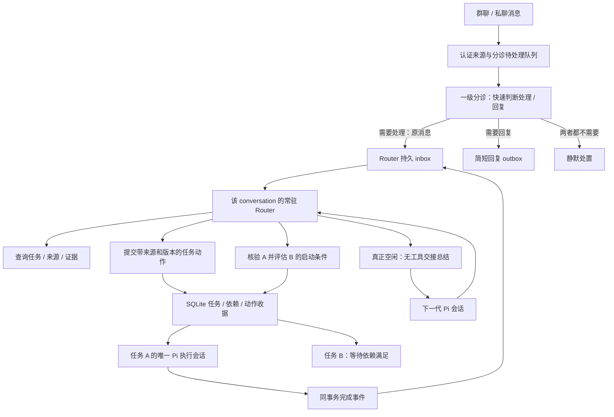

# Router 与事项直连方案

日期：2026-11-06。基线：`refactor/pi-native-retirement@0a03f0bbb3ce6119b488553c4e143110d1e71f78`。

本文件是实施前决策方案。本轮只核对源码、锁定版本的 Pi API 和官方文档，没有修改运行时代码，也没有进行模型、渠道或部署验收。

## 1. 结论与目标

采用“轻量一级分诊 → 每个群聊/私聊一个常驻 Router → 每个事项一个执行会话”。删除 Topic 业务实体以及消息先归 Topic、再由 Topic 判断任务的流程；保留一级分诊，但它不拆分、创建或安排事项。一级分诊只用手头直接/快速可得的信息判断是否需要处理、是否需要回复；需要处理的原消息交给 Router，需要回复则给简短回复，两者都不需要时保持静默。

常驻逻辑会话统一命名为 **Router**。Router 理解转入消息，拆分或关联事项，查询、安排和调整事项，并接收事项执行结果。一级分诊的初判不是 Router 必须遵循的任务规划。

常驻的是会话身份、职责和连续的业务记录；Pi 物理会话可以更换。每次处理完当前队列，执行一次无工具交接总结，再新建下一代 Pi 会话。旧 journal 保留，下一代只携带必要交接与查询入口，不重新装入整个历史。

“先 A 后 B”必须同时具备两种记忆：SQLite 中可校验的任务依赖，以及 Router 对用户意图的理解。A 完成事件唤醒 Router，由模型结合验收条件和实际证据判断是否满足要求；Host 校验版本、权限及依赖后才允许 B 执行。不能只靠自然语言摘要记住顺序，也不能见到 `completed` 就无条件自动启动 B。

本次重构不引入每任务 Owner、独立协调任务或执行团队。Router 负责所在 conversation 的安排；具体事项仍由已有唯一执行会话结合 Skill 和记忆完成。

## 2. 需求的具体解释

| 场景 | 目标行为 |
| --- | --- |
| 无需处理也无需回复 | 一级分诊记录静默处置，不转 Router、不发送确认消息 |
| 只需简单回复 | 一级分诊返回简短回复，不唤醒 Router、不创建任务 |
| 需要处理但不需立即回复 | 一级分诊把原消息转 Router，自身保持静默 |
| 既需处理也需立即回复 | 一级分诊转 Router，同时给一条简短回复；回复送达不作为转交前提 |
| 一条消息提出一个事项 | 一级分诊整条转交；Router 创建或关联 task，记录原消息和版本 |
| 一条消息说“先 A 后 B” | 一级分诊不拆分；Router 创建/关联 A、B，并原子保存依赖；B 暂不可执行 |
| 后续消息补充、调整、取消 | Router 查询关联与当前版本，再调用原任务的补充/修订/控制能力 |
| 一条消息涉及多个事项 | 支持多对多关联，保留各事项对应的来源片段；不强行一消息一任务 |
| 指代不明确且可能需要处理 | 一级分诊转 Router；由 Router 查询或澄清，不在分诊阶段展开事项分析 |
| 问候、闲聊、简单进度查询 | 用快速可得信息足以回复的由一级分诊简短回复；无需回应则静默；需进一步查询或判断的转 Router，不制造空执行任务 |
| A 执行期间群里有新要求 | Router 独立处理；需要时经版本校验 steer 到 A 的原执行会话 |
| A 汇报完成 | Router 读取当前结果与必要证据，决定认可、继续 A、等待补充或释放 B |
| Router 空闲但 A 仍在执行 | 仍可总结和轮换；不等待所有事项结束 |

会话身份沿用现有 `chat` / `chat-room` 隔离：渠道账号的命名空间、类型、conversationId 参与计算；私聊继续保留已认证对端隔离。群内不同发送人共享该群的安排上下文，但权限仍逐条绑定真实发送人。相同任务标题不作为跨群合并依据。

## 3. 当前实现与缺口

以下行号均绑定上述基线，不能用历史验收文档代替当前接线。

| 当前证据 | 结论及改动方向 |
| --- | --- |
| `src/channels/service.js:43–91` | 已有 conversation 身份、create/resume、memory bind 和串行投递；但 `:46` 在 attachIngress 后直接转入业务入口，不能认定当前默认路径已是常驻统筹 |
| `packages/dingtalk-core/task-session-service.js:1705–1723`、`:1030–1088` | 默认 chat/chat-room 仍进入旧 group/Topic 链；复用认证、来源版本、冲突检查和材料读取，替换下游路由 |
| `packages/dingtalk-core/coordination-sessions.js:44–52,108–120` | 当前按 group/request 创建临时会话；一级分诊保留短批次生命周期，事项理解与安排转入按 conversation 持有的 Router generation |
| `src/channels/triage.js:5–30` | 当前反馈按 topicKey 组织，并强制暂定措辞；改为按原消息版本输出是否处理及可选短回复，不产出 task/Topic 拆分；保留来源校验和发送去重 |
| `packages/dingtalk-core/task-session-service.js:705–778` | Topic 还负责抽取授权来源和创建/修改任务；删除 Topic 时必须把来源合同迁到直接任务动作 |
| `packages/dingtalk-core/topic-facts.js:10–26`、`topic-runtime.js:810` | 完成事实回合的 schema 和提示都禁止任务动作；仅延长分诊会话寿命不会获得 A→B 推进能力 |
| `packages/dingtalk-core/dynamic-task-store.js:525–536,770–800` | task.create 立即 active+wake，claim 没有依赖门槛；B 必须在创建事务中就不可执行，claim 处也要检查 |
| 同文件 `:1036–1058,1986–1994` | 已有完成校验及同事务 `dynamic_task_events/task.completed`；复用该事件，不另建完成消息总线 |
| `src/tasks/single-session.js:19`、`task-session-service.js:1131,1172–1192` | 已有单执行会话、Skill/记忆接入、结果和冻结产物；继续保留 |
| `src/runtime/pi-business-admission.js:24–58` | Pi 输入幂等属于单个物理 session，不能单独保障跨 generation 不重放 |
| `src/tasks/ledger-archive.js:5–29` | task archive 当前包含 topic_facts 且有严格白名单；需要同步改来源、依赖、评估及恢复合同 |

## 4. Pi 能提供什么

项目锁定 `@earendil-works/* 1.5.0`。已核对同版本安装源码，以及官方 [SDK](https://github.com/earendil-works/pi/blob/v1.5.0/packages/coding-agent/docs/sdk.md)、[压缩说明](https://github.com/earendil-works/pi/blob/v1.5.0/packages/coding-agent/docs/compaction.md)、[AgentSession 源码](https://github.com/earendil-works/pi/blob/v1.5.0/packages/coding-agent/src/core/agent-session.ts)、[SessionManager 源码](https://github.com/earendil-works/pi/blob/v1.5.0/packages/coding-agent/src/core/session-manager.ts)。

| 官方能力 | 本次用途与限制 |
| --- | --- |
| `AgentSession.waitForIdle()`、`agent_settled` | 判断原生重试、队列与压缩结束；还要叠加 Host 业务提交和工具排空检查 |
| `setActiveToolsByName([])` | 当前会话进入无工具交接轮次；Host 仍须拒绝该阶段的任务动作、发送和其它副作用 |
| `sendCustomMessage(..., {triggerTurn:true})` | 经现有内部 admission 发起交接，不伪造一条新的用户授权 |
| `SessionManager.appendCustomMessageEntry(...)` | 新一代在初始化时接入交接；由官方组件构建上下文，并通过现有 native store 提交 |
| `compact(customInstructions)` / `session_before_compact` | 连续繁忙时继续使用官方压缩；不是本次空闲轮换的主路径 |
| `AgentSessionRuntime.newSession(...)` | 上游有换会话原语，但不能直接替换当前 Night actor/store 的接入方式 |

三个候选方案比较：

| 方案 | 优点 | 取舍 |
| --- | --- | --- |
| 永久使用同一 Pi session，定期 compact | 生命周期改动较小 | 历史树持续增长；默认压缩保留近期原文，小会话可能没有可压缩区间，不能满足空闲即轻量换新的目标 |
| 空闲后交接总结，再创建下一代 Pi session | 逻辑连续，后续推理只带短交接和本代输入 | **采用**；需要把可靠轮换接在现有业务账本与 native store 之间 |
| 每轮只查询 SQLite，完全重新构造会话 | 不付摘要成本 | 容易丢掉未结构化的意图、指代及未决问题；业务查询是必要补充，不能单独替代交接 |

特别注意：`agent_end` 之后仍可能自动重试、压缩或继续队列；`compact()` 会先 abort；默认 `compact().summary` 不包含仍被保留的近期原文。直接把该 summary 复制到新会话会漏掉最新一批内容。

Night 当前采用 `SessionManager.inMemory()` 配合严格 native store，而非 Pi 默认文件存储（`src/pi-session-persistence.js:109–119`）。SDK Runtime 的换会话流程会销毁旧对象、创建另一 manager，不能保持 Night 的 actor、owner、receipt 和 commit 绑定。因此通过现有 `OfficialAgentFactory` 创建下一代，不另写推理循环、历史投影或 Pi 文件编码。

## 5. 目标结构与职责

- **渠道层**：认证、归一化消息/附件/引用、发送与回读；DWS 仍是可选插件。
- **一级分诊**：只判断是否转交及是否简短回复，不拆分事项、不决定匹配哪个任务或认可任务完成。生命周期建议沿用短批次会话、不维护长期事项上下文，这是实现选择。读取本批原消息、已附带的引用/提及、认证信息及有明确新鲜度的本地快速信息（例如已准备好的会话摘要/活动事项索引）；不为初筛拉取长历史、解析大附件或执行多步业务查询，不挂载事项拆分/创建/调整工具。输出逐消息处置和可选简短回复，由 Host 可靠转交/发送。快速信息不足不等于无需处理，需要进一步理解或查询才可判断的业务消息交给 Router。
- **Router**：每个 conversation 一个常驻逻辑会话，负责理解意图、拆分与关联事项，决定新建/补充/修订/取消/等待，解释执行结果并推进已授权安排。只挂载事项查询、受控事项动作、必要 Skill/记忆读取和回复工具；不直接代替执行会话跑业务脚本或访问外部写入工具。
- **事项执行会话**：一个任务一个执行 session；读取限定范围的 Skill、记忆和材料，完成工作并提交证据。补充或返工沿用该任务原会话和已有续办语义。
- **Host/SQLite**：来源、任务状态、依赖、权限、版本、租约、效果收据、事件消费、投递去重和轮换指针。模型负责业务判断，程序负责这些判断何时有权生效。
- **Pi**：模型推理、工具迭代、消息、上下文、原生压缩和会话 journal。
- **学习复盘**：保留独立的 tool-free reflection，负责有来源的记忆/Skill 提炼；它不决定是否启动 B，失败也不撤销交付或已满足的依赖。

## 6. 最小业务数据调整

扩展现有 SQLite store 和来源/事件/收据体系，不另建数据库、消息中间件或通用工作流引擎。具体表名在实现时沿当前 schema 约定确定，必须具备以下字段和约束：

| 记录 | 必需信息 |
| --- | --- |
| 一级分诊处置 | sourceId/messageVersion、是否转 Router、可选简短回复及其 outboundId、处置原因、唯一决定收据；不包含新拆分的事项清单 |
| conversation 状态 | 稳定身份、activeSessionId、generation、phase、输入处理游标、轮换记录引用、持有者版本 |
| Router inbox 事件及处置 | conversation、eventId、类型、顺序、sourceId/messageVersion 或 task event 引用、分诊已回复引用、处理状态、动作决定收据 |
| 消息↔任务关联 | taskId、sourceId/version、准确片段/引用锚点、创建/补充/控制等关系；支持零到多个任务 |
| 任务依赖 | B、前置 A、A 适用 requirementRevision、B 的安排版本、满足条件、原始授权来源、状态、评估收据 |
| 完成评估 | completionEventId、核验的任务版本、条件、证据引用、认可/继续/待补充结论、有效范围 |
| 交接及轮换 | old/new generation、输入截止游标、原 Pi 提交位置、摘要及引用校验结果、下一代提交证明、发布状态 |

任务依赖是“是否已准备好执行”的条件，独立于用户暂停/取消。创建 B 和创建依赖必须同事务；调度筛选及 `task.claim` 都校验依赖，不能仅靠模型不调用执行工具。自依赖和环必须拒绝；不新增复杂条件表达式语言。

任务事件复用 `dynamic_task_events`。完成事件写入原事务时，同时登记所属 conversation 的待消费引用，以 `(conversationId, eventId)` 唯一约束去重，不复制另一份完成 payload。重启从未消费引用恢复。默认只回到任务所属 conversation，跨会话可见性继续受既有授权控制。

摘要不是任务、权限、投递或依赖的权威。SQLite 也不保存第二套模型历史：只存业务事实、交接记录及 Pi journal 引用。

## 7. 一轮消息与动作如何处理

1. 认证渠道消息，记录版本化来源和持久分诊待处理项；重复外部事件返回已有收据。同 ID 内容冲突继续拒绝，合法版本更新保存新版本。
2. 一级分诊每批最多 15 条，溢出排队。对每条消息独立给出 `needsHandling` 和可选 `reply`：`needsHandling=false` 且 `reply` 为空时保持静默；只需回复则短回复；需处理则整条转 Router；两者皆需则同时执行。不输出事项列表、taskId 分配、任务依赖或执行计划。
3. Host 提交前重新校验来源版本，在一个事务中保存分诊决定，并按需登记 Router inbox 引用及回复 outbox。原消息、发送人、版本、引用和附件引用完整保留；初判或短回复不能替代原消息。接纳回执表示可靠接纳，不代表 Router 已处理。分诊失败或结果不完整时保留待处理状态，不能记成静默。
4. 转交和回复独立推进；短回复失败/unknown 不阻止 Router 接纳，同一来源版本也不能重复转交或重发。仅回复/静默消息留在来源记录供必要回查，不进入 Router 活动上下文、不触发其空闲总结。
5. 同一 conversation 的 Router 只有一个活动业务轮次，每批最多 15 条转入用户消息，内部任务事件也有数量/字节预算。Router 收到原消息、短回复的准备/发送状态及引用、必要指代交接和查询入口；详情、日志、旧消息与产物按需查询。任务完成/等待/变化事件直接到 Router，不能再让一级分诊以“无需回复”过滤。
6. Router 调用受控任务动作。Host 重新校验来源作者、版本、任务归属、取消/修订权限、当前任务版本及权限范围，再以稳定业务 operationId 提交。operationId 不依赖本次 Pi sessionId，跨代仍可去重。
7. 分诊处置和 Router 处理各有游标：转交成功只完成分诊阶段；任务动作收据、消息关联及本批处置完成后才推进 Router 业务游标。多步动作恢复按收据继续，不假定整个模型轮次有一个大事务。
8. 一级分诊回复通常为一两句，基于快速可得事实，不承诺尚未执行的结果；初步判断才使用暂定措辞，不强迫问候或收悉回复套用“待核实”前缀。Router 知道分诊已回复什么，避免重复确认；它仍可发送必要澄清、进度或最终结果。来源版本、精确引用、冻结正文和 unknown-send 回读约束继续保留。
9. 新消息先经过一级分诊；需要处理的消息可在 Router 批次 15 条上限内使用现有同会话 steer。已冻结回复与已提交动作不重做。消息更改令旧决定失效，但不自动撤销已发生的外部效果。明确的取消/调整应优先转交 Router 或既有已认证控制入口，保留来源及处置记录，不能被普通分诊批次或 Router 总结长期挡住；一级分诊本身不执行任务控制。

## 8. “先任务 A，再任务 B”的完整闭环

以用户说“先核实数据 A，确认无误后生成报告 B”为例：

1. 一级分诊只判断这条消息需要处理，将整条原话交给 Router，可按需先给简短回复。Router 保存用户原话、拆分 A/B、确定验收及依赖条件；在同一业务动作中创建 A、B，B 为依赖未满足，尚不启动执行会话。A 正常开始。
2. Router 空闲后总结并轮换。下一代保留“当前正在推进的安排及未决语义”的短引用；完整条件和依赖可从任务查询恢复，即使摘要漏写任务名也不能让 B 提前执行。
3. A 的执行会话提交结果；Host 经过当前版本、未决人工输入和效果检查，提交任务结果及 `task.completed` 事件。通知另走 outbox，是否已送达不决定内部事件是否产生。
4. 事件进入同一 conversation 队列。Router 查询 A 当前版本、原验收条件、结果、证据/产物和未验证范围，判断是否真正达到“确认无误”。例如“只完成调查，未核实数据”不能被认可为满足条件。
5. 若证据不足或仍需工作，记录评估并补充/续办 A，或请求必要输入；B 继续等待。重开前先证明 A 原 actor 已排空。当前 `task.reopen` 会推进 requirementRevision：若是原目标和授权范围内返工，在同一业务事务更新 B 所等待的 A 版本并清除旧评估；若目标变化则重新评估安排，依赖不能无条件追随所有新版。不能仅因为 A 自报完成就放行。
6. 若满足条件，Host 在一个事务内校验 A/B 及安排的当前版本、原授权仍有效、没有取消或未决效果阻断，保存评估、消费事件、满足依赖并生成 B 的唯一 wake。B claim 时再次校验，再创建它的唯一执行会话。
7. 重复完成事件返回已有结果。A 的旧版本完成、B 已取消、用户已改成 C、权限已撤回，都不能释放 B。若 A 在 B 启动后被重开，向 Router 发变化事件评估影响；不能静默倒退账本或假定 B 的既有外部效果可回滚。

“业务完成”“符合这条依赖的条件”“通知已送达”分别记录。如果用户明确要求“通知/人工确认后再 B”，才把相应送达/确认条件纳入依赖。任务事件没有新增授权能力：原消息没有授权的 B，应保持提议/待确认，不能由 A 的摘要创造权限。

## 9. 空闲交接与 Pi 会话轮换

### 9.1 保留什么、移出什么

| 内容 | 位置与处理 |
| --- | --- |
| 用户明确要求的先后顺序、条件、暂停和调整 | 先成为任务账本事实；交接仅留必要语义和查询引用 |
| 尚未解决的歧义、指代、承诺、用户当前意图 | 在有来源的交接中保留，不擅自删为“以后可查” |
| 任务状态、版本、验收条件、已完成证据、发送回执 | 通过受控工具查询，交接不重复整段内容 |
| 工具输出、日志、附件正文、代码、旧讨论过程 | 保留在各自原始受控存储，交接只保留确有必要的引用 |
| Skill 全文与长期记忆 | 按当前权限重新发现/检索；不复制整个 scope，也不让摘要复活已遗忘记忆 |

“可通过工具查到”必须是已经成功持久化且新一代有权读取，不能仅因为计划提供查询工具就先删除。摘要中的模型推测要标注为推测，不能提升为用户要求或授权。

交接采用有 schema 的短文：当前意图、未决问题、必要指代、尚未落成事实的假设、证据引用、截止游标。以短交接为目标，输入/输出预算通过验证确定；预算不足或输出截断时拒绝轮换，不静默裁掉关键内容。旧 journal 仍可追溯，但不会自动全量加载。

### 9.2 触发与操作顺序

1. 仅在 Router 业务游标自上次交接推进过，且当前轮次结束时检查：Pi `agent_settled/waitForIdle`、SDK pending 队列、Host 待交付给 Router 的输入、该 Router actor 的工具/进程以及业务提交均已完成，Router inbox 当前为空。一级分诊独立运行；尚在分诊的消息若稍后需要处理，按普通迟到消息耐久转交，不能投向已关闭的 generation。
2. 在 conversation 串行边界内取得交接阶段与 cutoff；冻结向旧 generation 的普通业务投递。新消息继续耐久入队，不丢弃，也不同时 steer 到两代。
3. 设 `phase=handoff`，保存工具集合并 `setActiveToolsByName([])`。经现有 Host 私有内部 producer/admission，发一次原生 custom message 请求交接。模型继续使用现有 Pi 上下文、模型路由和认证；Host 在此阶段禁止业务副作用。
4. 摘要覆盖前一交接与本代全部必要内容，包含最后一批输入；验证 schema、来源范围、必需语义与引用存在性，确认模型正常结束并提交 Pi journal。摘要本身不成为一个新业务事件。
5. 摘要完成后才进入现有维护/排空边界。通过 `OfficialAgentFactory` 创建下一代，先绑定原 conversation 的资源、权限、Skill 和记忆过滤，在官方 SessionManager 初始化阶段加入有来源的 handoff custom entry，然后提交 native store。下一代在正式发布前不可消费业务或产生副作用。
6. 以 old generation、cutoff 和交接记录为条件，CAS 发布新的 active 指针及业务持有权。SQL 与 Pi 文件不是一个事务：下一代有效提交在前、指针发布在后，每一步有可恢复的轮换状态。
7. 旧 actor 保持冻结，关闭并释放资源；下一代接续 inbox。只保留一个有业务执行权的 generation。切换期间到达的消息在新一代处理，不因它们晚于 cutoff 就认定摘要无效或清掉队列。

不能把步骤 3 放在现有 `runMaintenance()` 回调内：该方法先暂停 admission，随后的模型请求会被拒绝（`src/pi-official-agent-factory.js:181–186`）。交接期只冻结 conversation 的普通投递，保留专用内部交接输入；总结完成后再进行 maintenance。直接调用 Pi 的 custom message 绕过应用 admission 也不可取。

新会话初始化与摘要完成不能触发下一次交接：必须同时满足业务游标推进、非 handoff phase 和唯一 handoff ID。不要出现“总结→新建→空闲→再次总结”的空转。

### 9.3 失败与恢复

| 故障位置 | 恢复规则 |
| --- | --- |
| 普通模型摘要失败、截断、缺必需引用 | 不清空原会话；仅在提交、owner 和 drain 可信且实例未被 fence 时恢复工具集合与普通 phase，记录维护故障。已完成业务不回滚；不无间隔循环重试 |
| 摘要阶段收到紧急取消 | 先耐久记录；可中止无副作用的摘要，按既有已认证控制路径处理，不能让维护长期挡住取消 |
| 摘要已提交，下一代创建失败 | active 仍是旧代；保留交接记录。只有旧代仍可合法接纳输入时才恢复；若维护失败已令 admission 暂停或实例被 fence，须保持阻断并按受控证明恢复/重开，不能简单改 phase 或重复业务动作 |
| 下一代已提交，CAS 前崩溃 | 旧指针仍权威；恢复检查候选的身份、journal 提交和cutoff，再完成发布或清理无业务效果的候选 |
| CAS 后、旧代释放前崩溃 | 新指针权威；旧代无权消费输入/执行动作，不重放其历史；恢复仍验证 native owner 和提交证明 |
| SQL/Pi 提交不完整、效果不确定 | 沿现有严格解码、提交栅栏和 unknown-effect 对账；禁止推断成功或自动重放 |

原历史不被清空或覆盖。旧代的保留与清理遵守运行数据/隐私规则，只清理确认无引用且非运行中的临时资源。

连续有消息时不能假装满足“队列为空”。此时继续按批次处理，并保留 Pi 原生阈值压缩及现有输入预算。该设计可限制通常空闲周期之间的上下文增长，但不承诺在无限持续流量、超大单条输入或模型服务变慢时消除所有压缩延迟。

## 10. 删除与保留的代码边界

| 范围 | 实施动作 |
| --- | --- |
| `src/channels/service.js` | 保留身份/渠道能力，接入分诊处置及稳定 Router 身份；直接 taskRefs 由 Router 决策产生 |
| `src/channels/triage.js` | 保留轻量一级分诊，输出按消息版本的处理/短回复决定；去掉 topicKey 和事项拆分，保留来源、覆盖和发送去重约束 |
| `task-topic-coordinator.js`、`topic-runtime.js`、`topic-model.js` | 退休 Topic 路由、decision、revision、merge 和临时会话控制；可复用的来源分页等能力移到当前责任模块 |
| `coordination-sessions.js` | 一级分诊使用短批次会话，Router 使用按 conversation 的长期逻辑身份；不恢复已退休的任务 Owner/协调团队 |
| `task-session-service.js`、`dynamic-task-store.js` | 改为直接来源授权的任务动作；加入最小依赖、事件消费与轮换状态；保留任务版本、效果、调度与通知合同 |
| `topic-facts.js` | 移除 Topic 投影和 actions=[] 限制；复用原完成事件及回执约束接入 conversation，避免保留改名 Topic 实体 |
| `fixed-topics.js` 等特殊入口 | 逐项保留排期、配置、查询等真实能力，改成受控工具/直接动作，不能随 Topic 整包删除 |
| Pi factory/admission/persistence | 增加受控交接与新代种子接入；继续使用官方 Pi、strict journal、native commit、owner/drain |
| `src/tasks/ledger-archive.js` 及归档校验 | 同步任务直接来源、依赖与评估格式；不包含整群常驻 journal 或其它任务全文 |
| HTTP/终端与 prompts/tests | 去掉活动 Topic 入口和字段，直接显示任务、来源、conversation 及状态；同步合同测试 |
| README、运行/迁移/验证/归档文档及 AGENTS | 更新新职责和术语；来源/许可/manifest 对应实际保留和退休代码，不用改 guard 掩盖遗漏 |

必要时在现有 `src/channels/` 增加一个 Router 生命周期模块：这是原 Channels 缺少的持久事件消费及轮换职责，避免继续塞进大型 task-session-service。它调用已有 factory/store，不演变成新的 Agent 框架。

## 11. 现有数据、备份与切换

新安装直接采用目标 schema。对已有 Night Bot 数据，走停机、排空、离线备份和显式升级：先提供 `--check` 零副作用检查，列出活动任务、Topic 来源关联、未决发送/效果与不可转换项；检查通过后才允许升级。这里不引入 DSH 导入、旧插件 ABI 或外部路径转换。

既有 taskId、执行 session、产物、原始来源和效果收据保持身份。已知 Topic→任务关联转换为直接来源关联；不能唯一确定的关联保留待核实，不让模型猜测后直接执行。旧 Topic 的历史记录作为只读审计保留，退出活动路由；没有已持久化依据时，不从旧临时会话摘要虚构依赖。

旧 Topic 内尚未生成任务的消息也须逐条有升级处置：已完整处理的保留结果、不重新入队；有可靠未处理证据的转入该 conversation 的分诊待处理队列；已可靠确定需要处理的可直接登记 Router 待消费引用；待澄清或处置不确定的保存为 held 待核实并提供查询入口。不能因为旧 Topic 退出运行就丢掉这些事项，也不能把所有历史消息当成新命令重放。

当前 Night Bot 的 task archive 需要明确版本升级及已有版本读取策略：保留旧备份可验证性，旧 Topic 字段只作历史证据，不回灌为运行命令；不静默丢字段。单任务归档只携带自己的来源、依赖条件与对其它任务的必要身份/版本/证据引用，不复制整个 A 或整群上下文。恢复仍为 held/paused、操作员复核、禁止自动交付；前置任务不可验证时，B 的依赖保持未满足。

切换默认接线时同时退休旧 Topic 入口，不能让新旧两条链处理同一消息。schema 变更后回退须恢复匹配的代码和离线数据，不允许运行旧代码去猜测新 schema。

## 12. 实施顺序与完成标准

1. **直接任务来源与依赖账本**：先建立消息处置、直接关联、依赖创建/claim 守卫和现有完成事件消费合同，保留原执行与通知能力。
2. **一级分诊与 Router 接入**：真实默认 ingress 先进入轻量分诊；需要处理的原消息交给按 conversation 串行的官方 Pi Router，内部任务事件直接交 Router。分诊只挂快速判断与短回复能力，Router 挂受限任务工具并负责拆分，打通 A→B 评估与一次性释放。先不依赖轮换证明业务正确。
3. **交接与换代**：加入 tool-free handoff、指针发布、失败恢复、迟到消息和跨代去重。先在实际 factory + 本地脚本模型端点上证明，再测长时间多轮行为。
4. **完整去 Topic**：迁移特殊能力、HTTP/终端、来源/归档、恢复、文档与测试；确认默认生产路径不再要求 Topic 实体，来源/导入/许可 guard 仍有效。
5. **集中验收**：按项目规则在 `docs/acceptance/<feature>/` 维护 matrix 和轮次证据。本方案不预先创建空验收文件；实施阶段绑定最终源码及工作树状态记录结果。

关键验收场景：

| 场景 | 必须证明 |
| --- | --- |
| 分诊四种处置：静默、仅回复、仅处理、处理且回复 | 不需要处理时不唤醒 Router；不需要回复时没有确认噪声；转交与短回复独立且各自去重 |
| 复杂多事项消息、快速信息不足、分诊失败 | 一级分诊不拆分任务、不进行深度查询；需处理的原消息完整转交；失败不被伪装为静默 |
| 分诊已回复、Router 后续结果、内部完成事件 | 不重复确认；必要结果正常发送；完成事件不经过初筛而丢失 |
| 私聊/群聊、多发送人、跨渠道同 ID | 会话正确复用与隔离，真实发送人权限不被共享会话身份替代 |
| 单消息多任务、待澄清、无任务消息 | 无 Topic 也能完整记录消息处置；不漏项、不造空任务 |
| 15 条及溢出、处理中补充 | 同代串行/steer 正确，超额留队，来源版本和冻结回复不重复 |
| A→B，A 结果不达标，A 重开，B 取消或改成 C | B 不抢跑；认可后仅启动一次；旧结论不能放行；在途变更有明确处置 |
| 重复完成事件、通知失败/unknown、学习失败 | 事件不漏不重放；依赖、发送与学习互不冒充成功条件 |
| 每轮很短、交接遗漏/截断/失败、摘要自身 settled | 不依赖压缩阈值；不丢上下文；不无限自触发 |
| 总结时来消息/取消，准备/提交/CAS各阶段崩溃 | 输入不丢不双投；可从持久状态恢复唯一活动代；不重放旧效果 |
| Skill 更新、权限撤回、忘记记忆、越权来源 | 新代重新应用当前策略，摘要不扩权、不泄漏、不复活已撤销内容 |
| 原任务归档/恢复、B 脱离 A 恢复 | 仅任务范围材料，依赖待核实，恢复不自动执行/通知 |
| 多轮与持续繁忙 | 空闲周期后上下文不随全部历史线性增长；记录交接成本及新消息等待时间，持续有队列时原生压缩仍可工作 |

实施后按影响运行 `pnpm test`、`pnpm test:runtime`、`pnpm test:routing`，并覆盖本次受影响的 domain/containment、严格 journal/归档以及 native source/hash/import guard。使用隔离目录、本地脚本模型和假渠道验证默认接线；真实模型效果、Windows/Linux 平台限制、真实 DWS 发送单独报告。本文的源码/API核验不算这些测试通过。

最终完成的判据：默认消息路径不再创建或依赖 Topic；一级分诊只快速判断处理/回复且不拆事项；每个 conversation 的 Router 职责可跨重启和换代延续；事项拆分与安排由 Router 负责，任务保持唯一执行会话；A→B 在当前授权和证据条件下可靠推进；无丢消息、重复执行、越权或归档扩散；Router 空闲交接失败不损坏已完成业务。

## 13. 2026-11-07 钉钉产品闭环追加快照

追加基线：原PR #2仍OPEN，head `d27350972df888bf864186eabe64513c12460382`。原重构交付及轮次保留；当前目标从代码接线验收推进为指定测试群的完整产品闭环，不以全量回归作为新门槛。唯一进度仍在原goal，本文只保存本次实施前取舍，不复制后续流水。

### 已核缺口与最小方案

- DWS保持可选渠道插件，配置groups驱动真实订阅；当前统一入站首次订阅使用硬编码通用responsibility，triage未接配置职责，Router/task已有责任字段，reflection只有无工具复盘规则。需要把可信渠道配置接入这条真实链，不能只在示例中增加字段。
- 采用一条可信prompt/责任配置，沿现有responsibility使用：按认证channel与conversation精确解析，会话配置优先于渠道默认；未配置保留既有职责/通用默认。配置入口使用参数，不从消息正文/envelope或环境变量推断角色职责，不引入角色prompt矩阵或第二套权限权威。
- 已定接口为`channels.responsibility(sessionId)`；`undefined`保留既有resident职责/首次通用默认，空字符串明确清空；启动快照，配置修改重启生效。Core对四角色共用resolver，并仅对已明确配置的既有群同步，不以真值判断吞掉空字符串。
- 分诊、Router、单任务执行和无工具复盘各保留原角色限制；prompt承载职责、设定和行为规范，不能生成发送许可、放宽任务/记忆scope或绕过来源/版本/收据守卫。配置更新/已有会话生效规则由实现明确，文档按实际行为说明，不虚称热更新。
- Windows沿现有system账号策略和显式profile，不复制凭据或改变CLI全局选择；使用独立本机运行数据与空闲loopback端口，不替换其它安装。真实目标标识/账号只在私有配置，源码和文档均为占位符。

### 验证与实际接入边界

- 先用现有Host/脚本模型/假渠道能力做最短定向证明：prompt按群隔离、四角色实际输入、配置入站身份不可伪造；相关旧case依据当前合同调整，不逐个修整批历史测试，不跑全量。
- 指定群的最终验证必须来自真实DWS订阅/回填路径，保留可关联的来源、Router事项、执行session、群内消息/附件readback与持久review；注入不算监听，健康或队列idle不算产品完成。
- 单成员同账号：现有bridge在task-session模式先交Host入站，旧按显示名匹配outbox的分支不参与；是否保留人工消息并拒绝自动回声必须按实际监听事实核，不通过放宽automated/own-notification检查凑通过。
- 当前会话仍受原真实外发禁令约束，主控转达尚未由本会话真人解除；只准备隔离实例，不连接或发送，也不让别的执行者绕过。没有新CI、合并或生产部署授权。

实施分工以goal的本次单写增量为准；Core/Platform直接对齐可信resolver，原Tests唯一运行，Docs补操作说明，Review核实际diff，Lead回收证据并更新原PR。不新建团队/会话/定时器。

## 14. 通用替代能力与可选渠道边界（SG10开工快照）

起点：2026-11-07，Night HEAD `2e6cf2e`/clean；旧仓仅只读当前checkout `c6722651ccb58063a92faca163f107e9641031e0`，本地main落后其origin/main 496且已有无关改动，不能代表远端最新/实际生产。原SG1–9保持历史证据，本节记录实施前取舍，持续进度只更新原goal。

### 当前证据与替代差距

| 范围 | 当前可核证据 | 必要动作/不声称范围 |
| --- | --- | --- |
| 群聊真实收发、附件、恢复、复盘 | 旧README:19–43要求通知/业务分账和严格回读；Night SG9已有指定群真实独立事项、文件重下载、同event复盘及冷恢复证据 | 复用已有证据，仅重验本轮确受影响路径；不等于所有平台/所有任务可替代 |
| 通用主体/会话/收件人 | Night resident-router-business:104/114公开atOpenDingTalkIds；service:45–49把中性读回投影为历史senderOpenDingTalkId；single-session:2/116挂载group-message指令 | 核心工具/prompt使用通用actor/conversation/recipient，vendor映射留插件；保留旧来源路径/审计可追溯，不全库替换 |
| 无插件默认路径 | loader:6/11内置dingtalk-dws URL/type，:28–35只加载显式enabled项 | 默认产品实际执行证明不加载/探测DWS；决定是否将内置注册移到可选插件元数据，不能把一个URL声明等同真实probe |
| 持续任务/技能/命令与后台job | 旧README:11–17/41–45说明旧Owner/多执行和原生工具/job合同 | 对照Night当前默认调用链与可复用实测，不恢复Owner/Topic/多执行；不以来源文件存在或48B demo证明通用执行全覆盖 |
| 人工请求/身份配置 | 旧README:37明确operator技术问题与requester业务问题分流；身份别名/署名仍需核当前源码 | 核Night实际默认行为与可选渠道权限；个人身份/账号/业务规范只在私有部署/渠道配置，不写仓库模板 |
| 运行环境/数据 | Night VALIDATION:3明确Windows非Linux进程privacy失败关闭；旧README:5说明自身清洁启动，不代表Night数据迁移 | 不关闭sandbox；给明确支持环境/部署前置与可执行准备，保留Night数据，必要离线变化有--check；绝不改/导入旧DSH数据 |

### 最小方案与取舍

1. 仅给vendor字段换显示名、保留核心schema/prompt：不能满足通用合同，排除。
2. 全库vendor词替换/包名重写/重造编排：会改历史审计、来源与既有数据，超出目标并放大回归，排除。
3. 采用现有通用channel identity/transport边界，公开工具与当前核心通知合同改为中性字段；必要历史账投影留在明确内部边界，钉钉认证/原生收件人、quote/mention/resource/send/readback只在可选插件映射。Core与Platform先对齐当前调用链后实施，确需Night离线数据变化才另给显式--check，不默认添加兼容层或静默迁移。

验收最短路径：实际无插件默认产品＋受影响通用chat/chat-room/收件人/source版本/跨群拒绝/unknown不重放，真实vendor仅由原Tests按现有Night Bot Test授权做必要最小动作。Windows/Linux结果分报，保留失败与未验，不扩大为新全量。Docs只据已核合同更新AGENTS及必要接入/部署前置。原PR push前核state/目标线/CI入口，已合或会触发CI则保留本地成果并报告，不擅自另开分支/PR。

### 技能私有复用追加决策

2026-11-07追加范围沿用SG10。最新明确要求覆盖任何仓库技能模板解释：复用Skill的正文、脚本、references和assets仅进入原安装已忽略的私有`data/config/skills`或适当插件私有技能目录，禁止提交；代码只允许必要通用加载/隔离机制及无正文配置说明。原Core唯一写技能，Platform/Tests/Docs现有职责不变，源仓只读，不复制身份、私有业务数据或凭据。

现状已读：`src/native-skill-filesystem.js`已有custom根、原生frontmatter、provider及`bundledSkillDir`机制；`src/host.js`的portable组合使用`data/config/skills`等受控配置根，`skillDirs`必须留在安装根。存在加载能力不证明目标Skill可发现、可读取或工具可执行。关于独立个人技能包的消息目前只是转述，实际安装指针、来源、许可证和兼容性仍须核证，不从node_modules陈旧worktree推断。

1. 把旧技能全部拷成仓库模板：违反最新不入库要求，也可能带入个人配置/不兼容工具，排除。
2. 为执行旧技能恢复DSH底座、旧Owner/Topic或旧工具ABI：扩大产品边界并冲突当前单执行合同，排除。
3. 优先现有Native技能机制，先核来源/许可/依赖，选择兼容通用能力私有复用；DingTalk/DWS专属技能只随显式启用的可选渠道能力加载。仅在实际证明现机制有缺口后补最小加载/隔离代码，先交接具体文件，不复制业务Skill正文到源码或测试fixture。

复制前读现有目标并执行`git check-ignore`，复制后复核忽略状态，提交前独立核staged/tracked无复用材料。验收必须经过真实任务执行session发现和读取所复用Skill，以及无插件默认路径不加载钉钉专属能力；只保留必要来源/版本/hash及行为摘要，不公开技能正文、账号、私有路径或凭据。准确来源缺失或许可/工具不兼容时保留具体阻断，不伪造已安装，不暂停其它SG10必要实现。

### 已接纳未结批次的显式受控续办

2026-11-07，SG10原安装技能任务已在唯一执行session完成读取并达到completed/drained/run1；随后Router的脚本模型因漏角色返回400，原business packet已admitted而task.completed未settled。实际调用链证明这是恢复能力缺口：deliver对admitted ID保持duplicate/no-replay；普通recover/retry只重新schedule；cursor0且有pending禁止generation handoff。不能用换task/session、重写日志或直接consume事件补验收。

比较后排除：①重启或把deliver改为自动重发，会无效或破坏原admission去重；②绕过pending/游标guard换generation，会丢失业务所有权证明；③直调SDK agent.continue/普通NativeSessionController，缺应用授权、AgentSession生命周期和持久化边界。选择在现有Router lifecycle与official factory间补Host-only显式续办，不开放模型工具，不新增HTTP API、schema、通用重试平台或DSH兼容层。

最小合同：

- Host显式指定原conversation/generation/activeSession、原packet及确定失败的模型轮/原生entry证明；核当前active phase、官方live actor、idle、无并发/较新待输入、原packet及对应未结event身份。过期、外来、取消、已处理、篡改或并发请求在模型请求前拒绝。
- 沿当前Pi 1.5.0公开AgentSession接口和原SessionManager历史继续。必要的Host控制custom message必须明确是非业务控制，不充当用户来源/授权，不创建新business packet，不重跑enqueue/deliver，不改原admission及已提交entry。不能调用SDK私有_startRun、改SDK状态/消息数组或自行实现推理循环；原工具/权限/资源/图像预算/持久化/排空钩子全部保留。
- 受控请求需绑定原失败checkpoint，使重复或过期调用不能再启动模型；继续发生新的失败时保留其原生历史及未结事件，不自动循环。完成后重查本批全部event已settled，再走现有正常handoff流程；不将admitted等同业务消费完成。未知副作用和owner/store失败仍失败关闭，不能通过续办清账或重新发送。
- 默认application在tasks.recover拒绝时会被Cordis卸载，不能捕获启动失败后取失效服务续办。排除新增application维护模式及继续从失败实例操作，选择在现有Router lifecycle/task service仅将确定ROUTER_BATCH_UNSETTLED保留为可观测degraded/恢复失败，使Host显式续办可达；逐conversation保留错误，不能遮蔽其它scope的journal、owner或store异常，这些异常继续失败关闭。定时recover不启动新推理，原pending不消费；仅本批真正settled后清对应错误，不伪报恢复完成。
- Platform唯一写Router lifecycle、official factory、official session wrapper，以及task-session-service中必要Host方法委托和上述精确恢复告警；Core显式交出该最后文件本次写权，其余冻结源码不动。若这四文件不能承载，先说明已证缺口及准确新增文件范围再协调，不先扩平台。Lead独占方案/goal/来源manifest及最终guard，Tests独占测试和原安装，Review只读核边界。

验证仅覆盖新影响：真实默认Host本地SSE模型失败后严格冷开原journal，以同packet/原admission续同一批并完成；拒绝过期/跨conversation、重复/并发续办且不新增模型请求，保留原journal前缀、业务输入唯一性与后续冷启不重放。再由唯一Tests在原安装续现有task.completed，任务/session/run1和原15journal/config/私有技能边界保持；不得新建替代任务或重跑已完成技能执行。最终来源/import/native guard扩充绑定新触及factory/session文件；旧725版通过证据不冒充新代码通过。原正常CLI/neutral/cold结果按实际源码影响复用，不重复全量。

同日写后反证追加：`router.inbox`最多投影30条，生产内部事件没有pending总数上限，30条原批次之后的新第31条会被截断，原相等比较与native pending均看不到它。为兑现无较新待输入合同，精确增加第五文件`src/channels/router-ledger.js`的只读pending总量投影，并在原lifecycle续办校验中要求总量与原eventIds长度相等；不提高每批30/用户15上限、不增加schema或通用分页机制。Platform仍唯一写，等Tests当前在途终态后交接冻结，补满批溢出的模型前拒绝反证。

动态验证后的必要决策：首组真正续轮在`memory.beforeRun`以`MEMORY_ADMISSION_REQUIRED`拒绝，证实冷开raw admission.current为空，而正常deliver才设置current。排除放宽记忆准入/控制文本冒充来源，也排除冷启全局猜最后packet或再deliver；只在既有factory/session wrapper增加每actor、单控制轮寿命的原packet视图。factory仍先核原lookup/native checkpoint/SQL/count/authorize，wrapper在claim持久化且afterClaim成功后绑定，构造时稳定且冻结的current函数按次返回原{id,messages:[packet]}副本，完整公开SDK续轮及原失败检查以finally撤销；正常路径委托原current。raw admission、memory、去重及历史不改，不增加第六文件。

原安装续办后的并发恢复决策：原批次已真实settled/consumed、cursor1且原proof已消费，后续却出现NOT_LIVE，账本记录handoff aborted/interrupted-handoff、未发布candidate。源码确认普通recover在conversation tails之外处理phase和释放旧owner，可能把活交接误作冷中断；堆栈只指预创建Error，不据此独断现场唯一交错。排除放宽factory live、停5秒恢复timer或ifbusy静默跳过；仅在现有lifecycle把phase恢复、published旧owner清理与正常drain/rotate纳入同conversation队列，并在队列内读当前row。保持确定unsettled告警与其它scope错误传播、资源join。以live handoff与普通recover确定交错验证，再在原安装经正式普通recover完成同Router交接；原已settled批次不再resume、不新任务/业务packet、不手工改账。

### DWS现场同次父说明的显式引用增量

2026-11-07，真人明确目标“完成 DWS 现场验收”。在`67d2d50`核当前公开Router schema及Host冻结链：普通无显式受众的reply默认引用并提及原作者；显式`recipientActorIds`或`taskDelivery`进入最终通知分支，不从原来源默认补quote。公开工具没有引用参数，因此无法选择“同次文件交付父说明原生引用当前消息且显式@请求人”，虽然可选DWS底层已有这两个协议参数。引用溯源`sourceRef`不等于发送quote。此缺口与R9现场新增工具的来源定性独立，不据此解释现场事件。

三方案：恢复最终通知自动quote/从sourceRef反推会破坏已验默认受众合同，排除；开放任意replyTo消息/作者或另加通用quote对象需要新的目标与版本授权，超出“回复当前消息”，暂不采用；选择中性、仅true的可选`replyToSource`，明确引用本次`sourceId/messageVersion`已验证的原消息。未选择时全部保持现有默认，不引入vendor字段、数据库schema、HTTP入口或新的推理路径。

- 原同conversation、Router代际、当前source版本检查先执行；Host仅在显式opt-in时从该受信source绑定`replyToMessageId=source.messageId`与`replyToActorId=source.actorId`。模型不能另选消息或冒充作者。
- 引用作者可能收到平台原生通知；显式受众须包含该作者，空数组或只选他人时在冻结/发送前拒绝，不自动扩大受众。`taskDelivery`仍核原任务来源、当前完成版本及冻结artifact manifest。
- 解析后的引用、受众沿原replyRequest/payloadDigest冻结；同operationId改变语义仍冲突，不改写旧收据/历史/unknown，不自动补发。只给父说明原生quote/@；文件child保持现有顺序与受众账，不声称DWS文件协议支持独立quote/@。
- 最小实现仅Router公开schema/描述/prompt及task-session-service的Host opt-in解析，Core单写；Tests补原工具到冻结父说明的有效引用、默认不引用、缺引用作者拒绝、同操作语义冲突最短验证，再按当前指纹做真实现场。Lead同步来源hash/guard，Docs维护实际合同；真实平台字段缺失保留未验证，不用SUCCESS冒充原生引用或@已验。
- R9当前实例已正式IPC自然退出、43项源码不变，原任务/通知与18原journal前缀受保护；新来源及排期的定性仍由Tests离线取证。本增量未借重启重放旧事项，不改DB/日志或私有配置；待具体写入交接后实施。

### DWS发送确认后的自身回声与持久暂缓

R9运行版`67d2d50`的真实ACK仅带openTaskId，不带消息或会话ID。原Tests证实新通知在ack后、正式回读落receipt前的SDK回声进入source/triage，后receipt精确消息ID及经context映射后的会话均与之相同；原源码/配置和旧业务保持，现场已自然关闭。不能将此归因于ACK解析漏字段，也不能把另一条此前未入账真人消息的首次承接称为重放；其排期结果expired，没有未来排期。

已核责任链：默认application只注入operator通知服务，operator未开时现有native observer拿不到querySendStatus；可选DWS plugin未注入自身adapter。即使有query，探针把内部conversation scope与厂商会话直接比较，无法获得精确proof。unifiedIngress又在探针前登记channel fact。修复应保持核心中性身份，在可选插件边界完成已绑定channel/context的厂商映射。

三方案：扩大ACK字段解析没有真实mid可用，排除；等待整条通知内容/文件readback会将同scope入口与资源下载耦合且不能解决unknown身份，排除；采用既有有界精确状态探针，在fact/source登记前核身份。沿原openTaskId、SUCCESS、厂商conversation/message逐项验证，才投影到原内部scope的outbox身份，不改通知终态、不替代内容/文件回读、不重发。

- 仅同channel/scope存在可能已发送而身份未决的starting/unknown通知时触发该边界；prepared未发、按原规则已证未发或无待核通知不阻塞。先查已知精确自身消息，再探针，随后fresh核cache/outbox；得到精确身份才判own或排除此发送。其它scope、同账号/正文/泛DWS标记不能作为丢弃理由。
- 1500ms探针超时、查询错或非SUCCESS不等于真人：仍有未决发送则显式抛`CHANNEL_NOTIFICATION_IDENTITY_PENDING`，不登记fact/source或作已消费/ignored回执。保持现有有界等待和unknown语义，错误保留cause，不增加循环重试或无限挂住单请求。
- 仅抛错不能保晚到真人：原bridge listener/backfill异常只记错误，后续默认起点为最新消息减30秒，失败的更早消息可能永久越过。故精确增加bridge文件，在此typed暂缓结束前借现有controlTail/saveIngressState/recoveryFromAt及entry epoch持久钉住原消息/本轮起点的更早边界；原补读timer及重启继续覆盖，完整成功后才清水位。保存失败显式可观察，不宣称恢复保证或静默按真人通过；不新加state字段/队列/调度器。
- pause原在controlTail内等待inflightMessages；若message pin也等该tail会自等待。仅将pause的资源drain等待放到状态串行队列外，返回仍等待drain，pin/pause/resume/finish共享原状态队列，不增加锁。
- 产品最小范围：可选plugin、native-dws-send、task-session-service、dws-bridge四文件。Platform可先单写三个无交叉文件；service须待Core交回quote增量后再串行移交Platform叠加登记前guard，不能覆盖已确认增量。Lead维护本快照/来源hash，Tests写必要确定性交错与实际同安装验收，Review独立核；实例与旧账均不手改。
- 最短验证以默认application+真实optional plugin注册（operator关闭、internal!=native、仅openTaskId ACK、mget挂起）证echo在登记前过滤且send仍1/未伪造delivered；同账号/正文的新真人及异scope不误滤，探针失败后的晚到真人经持久水位冷恢复正式接纳一次，pause无自等待。该恢复保证只验获准群chat-room，不外推未启用directChats；真实平台仍由唯一Tests执行。

本增量仅修Router/任务队列notification的自身回声；原native operation的send/status支路未在本轮统一typed scope及query接线，不承诺shell原生发送的通用回声修复，也不为此扩大本轮实现或现场范围。
