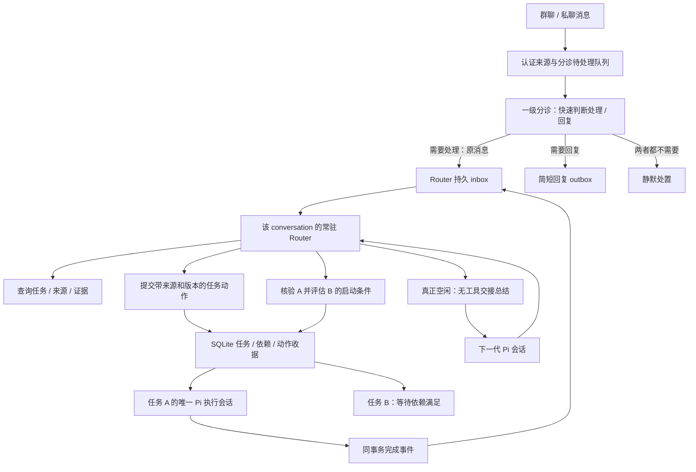

# Router 与事项直连方案

日期：2026-11-06。基线：`refactor/pi-native-retirement@0a03f0bbb3ce6119b488553c4e143110d1e71f78`。

本文件是实施前决策方案。本轮只核对源码、锁定版本的 Pi API 和官方文档，没有修改运行时代码，也没有进行模型、渠道或部署验收。

## 1. 结论与目标

采用“轻量一级分诊 → 每个群聊/私聊一个常驻 Router → 每个事项一个执行会话”。删除 Topic 业务实体以及消息先归 Topic、再由 Topic 判断任务的流程；保留一级分诊，但它不拆分、创建或安排事项。一级分诊只用手头直接/快速可得的信息判断是否需要处理、是否需要回复；需要处理的原消息交给 Router，需要回复则给简短回复，两者都不需要时保持静默。

常驻逻辑会话统一命名为 **Router**。Router 理解转入消息，拆分或关联事项，查询、安排和调整事项，并接收事项执行结果。一级分诊的初判不是 Router 必须遵循的任务规划。

常驻的是会话身份、职责和连续的业务记录；Pi 物理会话可以更换。每次处理完当前队列，执行一次无工具交接总结，再新建下一代 Pi 会话。旧 journal 保留，下一代只携带必要交接与查询入口，不重新装入整个历史。

“先 A 后 B”必须同时具备两种记忆：SQLite 中可校验的任务依赖，以及 Router 对用户意图的理解。A 完成事件唤醒 Router，由模型结合验收条件和实际证据判断是否满足要求；Host 校验版本、权限及依赖后才允许 B 执行。不能只靠自然语言摘要记住顺序，也不能见到 `completed` 就无条件自动启动 B。

本次重构不引入每任务 Owner、独立协调任务或执行团队。Router 负责所在 conversation 的安排；具体事项仍由已有唯一执行会话结合 Skill 和记忆完成。

## 2. 需求的具体解释

| 场景 | 目标行为 |
| --- | --- |
| 无需处理也无需回复 | 一级分诊记录静默处置，不转 Router、不发送确认消息 |
| 只需简单回复 | 一级分诊返回简短回复，不唤醒 Router、不创建任务 |
| 需要处理但不需立即回复 | 一级分诊把原消息转 Router，自身保持静默 |
| 既需处理也需立即回复 | 一级分诊转 Router，同时给一条简短回复；回复送达不作为转交前提 |
| 一条消息提出一个事项 | 一级分诊整条转交；Router 创建或关联 task，记录原消息和版本 |
| 一条消息说“先 A 后 B” | 一级分诊不拆分；Router 创建/关联 A、B，并原子保存依赖；B 暂不可执行 |
| 后续消息补充、调整、取消 | Router 查询关联与当前版本，再调用原任务的补充/修订/控制能力 |
| 一条消息涉及多个事项 | 支持多对多关联，保留各事项对应的来源片段；不强行一消息一任务 |
| 指代不明确且可能需要处理 | 一级分诊转 Router；由 Router 查询或澄清，不在分诊阶段展开事项分析 |
| 问候、闲聊、简单进度查询 | 用快速可得信息足以回复的由一级分诊简短回复；无需回应则静默；需进一步查询或判断的转 Router，不制造空执行任务 |
| A 执行期间群里有新要求 | Router 独立处理；需要时经版本校验 steer 到 A 的原执行会话 |
| A 汇报完成 | Router 读取当前结果与必要证据，决定认可、继续 A、等待补充或释放 B |
| Router 空闲但 A 仍在执行 | 仍可总结和轮换；不等待所有事项结束 |

会话身份沿用现有 `chat` / `chat-room` 隔离：渠道账号的命名空间、类型、conversationId 参与计算；私聊继续保留已认证对端隔离。群内不同发送人共享该群的安排上下文，但权限仍逐条绑定真实发送人。相同任务标题不作为跨群合并依据。

## 3. 当前实现与缺口

以下行号均绑定上述基线，不能用历史验收文档代替当前接线。

| 当前证据 | 结论及改动方向 |
| --- | --- |
| `src/channels/service.js:43–91` | 已有 conversation 身份、create/resume、memory bind 和串行投递；但 `:46` 在 attachIngress 后直接转入业务入口，不能认定当前默认路径已是常驻统筹 |
| `packages/dingtalk-core/task-session-service.js:1705–1723`、`:1030–1088` | 默认 chat/chat-room 仍进入旧 group/Topic 链；复用认证、来源版本、冲突检查和材料读取，替换下游路由 |
| `packages/dingtalk-core/coordination-sessions.js:44–52,108–120` | 当前按 group/request 创建临时会话；一级分诊保留短批次生命周期，事项理解与安排转入按 conversation 持有的 Router generation |
| `src/channels/triage.js:5–30` | 当前反馈按 topicKey 组织，并强制暂定措辞；改为按原消息版本输出是否处理及可选短回复，不产出 task/Topic 拆分；保留来源校验和发送去重 |
| `packages/dingtalk-core/task-session-service.js:705–778` | Topic 还负责抽取授权来源和创建/修改任务；删除 Topic 时必须把来源合同迁到直接任务动作 |
| `packages/dingtalk-core/topic-facts.js:10–26`、`topic-runtime.js:810` | 完成事实回合的 schema 和提示都禁止任务动作；仅延长分诊会话寿命不会获得 A→B 推进能力 |
| `packages/dingtalk-core/dynamic-task-store.js:525–536,770–800` | task.create 立即 active+wake，claim 没有依赖门槛；B 必须在创建事务中就不可执行，claim 处也要检查 |
| 同文件 `:1036–1058,1986–1994` | 已有完成校验及同事务 `dynamic_task_events/task.completed`；复用该事件，不另建完成消息总线 |
| `src/tasks/single-session.js:19`、`task-session-service.js:1131,1172–1192` | 已有单执行会话、Skill/记忆接入、结果和冻结产物；继续保留 |
| `src/runtime/pi-business-admission.js:24–58` | Pi 输入幂等属于单个物理 session，不能单独保障跨 generation 不重放 |
| `src/tasks/ledger-archive.js:5–29` | task archive 当前包含 topic_facts 且有严格白名单；需要同步改来源、依赖、评估及恢复合同 |

## 4. Pi 能提供什么

项目锁定 `@earendil-works/* 1.5.0`。已核对同版本安装源码，以及官方 [SDK](https://github.com/earendil-works/pi/blob/v1.5.0/packages/coding-agent/docs/sdk.md)、[压缩说明](https://github.com/earendil-works/pi/blob/v1.5.0/packages/coding-agent/docs/compaction.md)、[AgentSession 源码](https://github.com/earendil-works/pi/blob/v1.5.0/packages/coding-agent/src/core/agent-session.ts)、[SessionManager 源码](https://github.com/earendil-works/pi/blob/v1.5.0/packages/coding-agent/src/core/session-manager.ts)。

| 官方能力 | 本次用途与限制 |
| --- | --- |
| `AgentSession.waitForIdle()`、`agent_settled` | 判断原生重试、队列与压缩结束；还要叠加 Host 业务提交和工具排空检查 |
| `setActiveToolsByName([])` | 当前会话进入无工具交接轮次；Host 仍须拒绝该阶段的任务动作、发送和其它副作用 |
| `sendCustomMessage(..., {triggerTurn:true})` | 经现有内部 admission 发起交接，不伪造一条新的用户授权 |
| `SessionManager.appendCustomMessageEntry(...)` | 新一代在初始化时接入交接；由官方组件构建上下文，并通过现有 native store 提交 |
| `compact(customInstructions)` / `session_before_compact` | 连续繁忙时继续使用官方压缩；不是本次空闲轮换的主路径 |
| `AgentSessionRuntime.newSession(...)` | 上游有换会话原语，但不能直接替换当前 Night actor/store 的接入方式 |

三个候选方案比较：

| 方案 | 优点 | 取舍 |
| --- | --- | --- |
| 永久使用同一 Pi session，定期 compact | 生命周期改动较小 | 历史树持续增长；默认压缩保留近期原文，小会话可能没有可压缩区间，不能满足空闲即轻量换新的目标 |
| 空闲后交接总结，再创建下一代 Pi session | 逻辑连续，后续推理只带短交接和本代输入 | **采用**；需要把可靠轮换接在现有业务账本与 native store 之间 |
| 每轮只查询 SQLite，完全重新构造会话 | 不付摘要成本 | 容易丢掉未结构化的意图、指代及未决问题；业务查询是必要补充，不能单独替代交接 |

特别注意：`agent_end` 之后仍可能自动重试、压缩或继续队列；`compact()` 会先 abort；默认 `compact().summary` 不包含仍被保留的近期原文。直接把该 summary 复制到新会话会漏掉最新一批内容。

Night 当前采用 `SessionManager.inMemory()` 配合严格 native store，而非 Pi 默认文件存储（`src/pi-session-persistence.js:109–119`）。SDK Runtime 的换会话流程会销毁旧对象、创建另一 manager，不能保持 Night 的 actor、owner、receipt 和 commit 绑定。因此通过现有 `OfficialAgentFactory` 创建下一代，不另写推理循环、历史投影或 Pi 文件编码。

## 5. 目标结构与职责

- **渠道层**：认证、归一化消息/附件/引用、发送与回读；DWS 仍是可选插件。
- **一级分诊**：只判断是否转交及是否简短回复，不拆分事项、不决定匹配哪个任务或认可任务完成。生命周期建议沿用短批次会话、不维护长期事项上下文，这是实现选择。读取本批原消息、已附带的引用/提及、认证信息及有明确新鲜度的本地快速信息（例如已准备好的会话摘要/活动事项索引）；不为初筛拉取长历史、解析大附件或执行多步业务查询，不挂载事项拆分/创建/调整工具。输出逐消息处置和可选简短回复，由 Host 可靠转交/发送。快速信息不足不等于无需处理，需要进一步理解或查询才可判断的业务消息交给 Router。
- **Router**：每个 conversation 一个常驻逻辑会话，负责理解意图、拆分与关联事项，决定新建/补充/修订/取消/等待，解释执行结果并推进已授权安排。只挂载事项查询、受控事项动作、必要 Skill/记忆读取和回复工具；不直接代替执行会话跑业务脚本或访问外部写入工具。
- **事项执行会话**：一个任务一个执行 session；读取限定范围的 Skill、记忆和材料，完成工作并提交证据。补充或返工沿用该任务原会话和已有续办语义。
- **Host/SQLite**：来源、任务状态、依赖、权限、版本、租约、效果收据、事件消费、投递去重和轮换指针。模型负责业务判断，程序负责这些判断何时有权生效。
- **Pi**：模型推理、工具迭代、消息、上下文、原生压缩和会话 journal。
- **学习复盘**：保留独立的 tool-free reflection，负责有来源的记忆/Skill 提炼；它不决定是否启动 B，失败也不撤销交付或已满足的依赖。

## 6. 最小业务数据调整

扩展现有 SQLite store 和来源/事件/收据体系，不另建数据库、消息中间件或通用工作流引擎。具体表名在实现时沿当前 schema 约定确定，必须具备以下字段和约束：

| 记录 | 必需信息 |
| --- | --- |
| 一级分诊处置 | sourceId/messageVersion、是否转 Router、可选简短回复及其 outboundId、处置原因、唯一决定收据；不包含新拆分的事项清单 |
| conversation 状态 | 稳定身份、activeSessionId、generation、phase、输入处理游标、轮换记录引用、持有者版本 |
| Router inbox 事件及处置 | conversation、eventId、类型、顺序、sourceId/messageVersion 或 task event 引用、分诊已回复引用、处理状态、动作决定收据 |
| 消息↔任务关联 | taskId、sourceId/version、准确片段/引用锚点、创建/补充/控制等关系；支持零到多个任务 |
| 任务依赖 | B、前置 A、A 适用 requirementRevision、B 的安排版本、满足条件、原始授权来源、状态、评估收据 |
| 完成评估 | completionEventId、核验的任务版本、条件、证据引用、认可/继续/待补充结论、有效范围 |
| 交接及轮换 | old/new generation、输入截止游标、原 Pi 提交位置、摘要及引用校验结果、下一代提交证明、发布状态 |

任务依赖是“是否已准备好执行”的条件，独立于用户暂停/取消。创建 B 和创建依赖必须同事务；调度筛选及 `task.claim` 都校验依赖，不能仅靠模型不调用执行工具。自依赖和环必须拒绝；不新增复杂条件表达式语言。

任务事件复用 `dynamic_task_events`。完成事件写入原事务时，同时登记所属 conversation 的待消费引用，以 `(conversationId, eventId)` 唯一约束去重，不复制另一份完成 payload。重启从未消费引用恢复。默认只回到任务所属 conversation，跨会话可见性继续受既有授权控制。

摘要不是任务、权限、投递或依赖的权威。SQLite 也不保存第二套模型历史：只存业务事实、交接记录及 Pi journal 引用。

## 7. 一轮消息与动作如何处理

1. 认证渠道消息，记录版本化来源和持久分诊待处理项；重复外部事件返回已有收据。同 ID 内容冲突继续拒绝，合法版本更新保存新版本。
2. 一级分诊每批最多 15 条，溢出排队。对每条消息独立给出 `needsHandling` 和可选 `reply`：`needsHandling=false` 且 `reply` 为空时保持静默；只需回复则短回复；需处理则整条转 Router；两者皆需则同时执行。不输出事项列表、taskId 分配、任务依赖或执行计划。
3. Host 提交前重新校验来源版本，在一个事务中保存分诊决定，并按需登记 Router inbox 引用及回复 outbox。原消息、发送人、版本、引用和附件引用完整保留；初判或短回复不能替代原消息。接纳回执表示可靠接纳，不代表 Router 已处理。分诊失败或结果不完整时保留待处理状态，不能记成静默。
4. 转交和回复独立推进；短回复失败/unknown 不阻止 Router 接纳，同一来源版本也不能重复转交或重发。仅回复/静默消息留在来源记录供必要回查，不进入 Router 活动上下文、不触发其空闲总结。
5. 同一 conversation 的 Router 只有一个活动业务轮次，每批最多 15 条转入用户消息，内部任务事件也有数量/字节预算。Router 收到原消息、短回复的准备/发送状态及引用、必要指代交接和查询入口；详情、日志、旧消息与产物按需查询。任务完成/等待/变化事件直接到 Router，不能再让一级分诊以“无需回复”过滤。
6. Router 调用受控任务动作。Host 重新校验来源作者、版本、任务归属、取消/修订权限、当前任务版本及权限范围，再以稳定业务 operationId 提交。operationId 不依赖本次 Pi sessionId，跨代仍可去重。
7. 分诊处置和 Router 处理各有游标：转交成功只完成分诊阶段；任务动作收据、消息关联及本批处置完成后才推进 Router 业务游标。多步动作恢复按收据继续，不假定整个模型轮次有一个大事务。
8. 一级分诊回复通常为一两句，基于快速可得事实，不承诺尚未执行的结果；初步判断才使用暂定措辞，不强迫问候或收悉回复套用“待核实”前缀。Router 知道分诊已回复什么，避免重复确认；它仍可发送必要澄清、进度或最终结果。来源版本、精确引用、冻结正文和 unknown-send 回读约束继续保留。
9. 新消息先经过一级分诊；需要处理的消息可在 Router 批次 15 条上限内使用现有同会话 steer。已冻结回复与已提交动作不重做。消息更改令旧决定失效，但不自动撤销已发生的外部效果。明确的取消/调整应优先转交 Router 或既有已认证控制入口，保留来源及处置记录，不能被普通分诊批次或 Router 总结长期挡住；一级分诊本身不执行任务控制。

## 8. “先任务 A，再任务 B”的完整闭环

以用户说“先核实数据 A，确认无误后生成报告 B”为例：

1. 一级分诊只判断这条消息需要处理，将整条原话交给 Router，可按需先给简短回复。Router 保存用户原话、拆分 A/B、确定验收及依赖条件；在同一业务动作中创建 A、B，B 为依赖未满足，尚不启动执行会话。A 正常开始。
2. Router 空闲后总结并轮换。下一代保留“当前正在推进的安排及未决语义”的短引用；完整条件和依赖可从任务查询恢复，即使摘要漏写任务名也不能让 B 提前执行。
3. A 的执行会话提交结果；Host 经过当前版本、未决人工输入和效果检查，提交任务结果及 `task.completed` 事件。通知另走 outbox，是否已送达不决定内部事件是否产生。
4. 事件进入同一 conversation 队列。Router 查询 A 当前版本、原验收条件、结果、证据/产物和未验证范围，判断是否真正达到“确认无误”。例如“只完成调查，未核实数据”不能被认可为满足条件。
5. 若证据不足或仍需工作，记录评估并补充/续办 A，或请求必要输入；B 继续等待。重开前先证明 A 原 actor 已排空。当前 `task.reopen` 会推进 requirementRevision：若是原目标和授权范围内返工，在同一业务事务更新 B 所等待的 A 版本并清除旧评估；若目标变化则重新评估安排，依赖不能无条件追随所有新版。不能仅因为 A 自报完成就放行。
6. 若满足条件，Host 在一个事务内校验 A/B 及安排的当前版本、原授权仍有效、没有取消或未决效果阻断，保存评估、消费事件、满足依赖并生成 B 的唯一 wake。B claim 时再次校验，再创建它的唯一执行会话。
7. 重复完成事件返回已有结果。A 的旧版本完成、B 已取消、用户已改成 C、权限已撤回，都不能释放 B。若 A 在 B 启动后被重开，向 Router 发变化事件评估影响；不能静默倒退账本或假定 B 的既有外部效果可回滚。

“业务完成”“符合这条依赖的条件”“通知已送达”分别记录。如果用户明确要求“通知/人工确认后再 B”，才把相应送达/确认条件纳入依赖。任务事件没有新增授权能力：原消息没有授权的 B，应保持提议/待确认，不能由 A 的摘要创造权限。

## 9. 空闲交接与 Pi 会话轮换

### 9.1 保留什么、移出什么

| 内容 | 位置与处理 |
| --- | --- |
| 用户明确要求的先后顺序、条件、暂停和调整 | 先成为任务账本事实；交接仅留必要语义和查询引用 |
| 尚未解决的歧义、指代、承诺、用户当前意图 | 在有来源的交接中保留，不擅自删为“以后可查” |
| 任务状态、版本、验收条件、已完成证据、发送回执 | 通过受控工具查询，交接不重复整段内容 |
| 工具输出、日志、附件正文、代码、旧讨论过程 | 保留在各自原始受控存储，交接只保留确有必要的引用 |
| Skill 全文与长期记忆 | 按当前权限重新发现/检索；不复制整个 scope，也不让摘要复活已遗忘记忆 |

“可通过工具查到”必须是已经成功持久化且新一代有权读取，不能仅因为计划提供查询工具就先删除。摘要中的模型推测要标注为推测，不能提升为用户要求或授权。

交接采用有 schema 的短文：当前意图、未决问题、必要指代、尚未落成事实的假设、证据引用、截止游标。以短交接为目标，输入/输出预算通过验证确定；预算不足或输出截断时拒绝轮换，不静默裁掉关键内容。旧 journal 仍可追溯，但不会自动全量加载。

### 9.2 触发与操作顺序

1. 仅在 Router 业务游标自上次交接推进过，且当前轮次结束时检查：Pi `agent_settled/waitForIdle`、SDK pending 队列、Host 待交付给 Router 的输入、该 Router actor 的工具/进程以及业务提交均已完成，Router inbox 当前为空。一级分诊独立运行；尚在分诊的消息若稍后需要处理，按普通迟到消息耐久转交，不能投向已关闭的 generation。
2. 在 conversation 串行边界内取得交接阶段与 cutoff；冻结向旧 generation 的普通业务投递。新消息继续耐久入队，不丢弃，也不同时 steer 到两代。
3. 设 `phase=handoff`，保存工具集合并 `setActiveToolsByName([])`。经现有 Host 私有内部 producer/admission，发一次原生 custom message 请求交接。模型继续使用现有 Pi 上下文、模型路由和认证；Host 在此阶段禁止业务副作用。
4. 摘要覆盖前一交接与本代全部必要内容，包含最后一批输入；验证 schema、来源范围、必需语义与引用存在性，确认模型正常结束并提交 Pi journal。摘要本身不成为一个新业务事件。
5. 摘要完成后才进入现有维护/排空边界。通过 `OfficialAgentFactory` 创建下一代，先绑定原 conversation 的资源、权限、Skill 和记忆过滤，在官方 SessionManager 初始化阶段加入有来源的 handoff custom entry，然后提交 native store。下一代在正式发布前不可消费业务或产生副作用。
6. 以 old generation、cutoff 和交接记录为条件，CAS 发布新的 active 指针及业务持有权。SQL 与 Pi 文件不是一个事务：下一代有效提交在前、指针发布在后，每一步有可恢复的轮换状态。
7. 旧 actor 保持冻结，关闭并释放资源；下一代接续 inbox。只保留一个有业务执行权的 generation。切换期间到达的消息在新一代处理，不因它们晚于 cutoff 就认定摘要无效或清掉队列。

不能把步骤 3 放在现有 `runMaintenance()` 回调内：该方法先暂停 admission，随后的模型请求会被拒绝（`src/pi-official-agent-factory.js:181–186`）。交接期只冻结 conversation 的普通投递，保留专用内部交接输入；总结完成后再进行 maintenance。直接调用 Pi 的 custom message 绕过应用 admission 也不可取。

新会话初始化与摘要完成不能触发下一次交接：必须同时满足业务游标推进、非 handoff phase 和唯一 handoff ID。不要出现“总结→新建→空闲→再次总结”的空转。

### 9.3 失败与恢复

| 故障位置 | 恢复规则 |
| --- | --- |
| 普通模型摘要失败、截断、缺必需引用 | 不清空原会话；仅在提交、owner 和 drain 可信且实例未被 fence 时恢复工具集合与普通 phase，记录维护故障。已完成业务不回滚；不无间隔循环重试 |
| 摘要阶段收到紧急取消 | 先耐久记录；可中止无副作用的摘要，按既有已认证控制路径处理，不能让维护长期挡住取消 |
| 摘要已提交，下一代创建失败 | active 仍是旧代；保留交接记录。只有旧代仍可合法接纳输入时才恢复；若维护失败已令 admission 暂停或实例被 fence，须保持阻断并按受控证明恢复/重开，不能简单改 phase 或重复业务动作 |
| 下一代已提交，CAS 前崩溃 | 旧指针仍权威；恢复检查候选的身份、journal 提交和cutoff，再完成发布或清理无业务效果的候选 |
| CAS 后、旧代释放前崩溃 | 新指针权威；旧代无权消费输入/执行动作，不重放其历史；恢复仍验证 native owner 和提交证明 |
| SQL/Pi 提交不完整、效果不确定 | 沿现有严格解码、提交栅栏和 unknown-effect 对账；禁止推断成功或自动重放 |

原历史不被清空或覆盖。旧代的保留与清理遵守运行数据/隐私规则，只清理确认无引用且非运行中的临时资源。

连续有消息时不能假装满足“队列为空”。此时继续按批次处理，并保留 Pi 原生阈值压缩及现有输入预算。该设计可限制通常空闲周期之间的上下文增长，但不承诺在无限持续流量、超大单条输入或模型服务变慢时消除所有压缩延迟。

## 10. 删除与保留的代码边界

| 范围 | 实施动作 |
| --- | --- |
| `src/channels/service.js` | 保留身份/渠道能力，接入分诊处置及稳定 Router 身份；直接 taskRefs 由 Router 决策产生 |
| `src/channels/triage.js` | 保留轻量一级分诊，输出按消息版本的处理/短回复决定；去掉 topicKey 和事项拆分，保留来源、覆盖和发送去重约束 |
| `task-topic-coordinator.js`、`topic-runtime.js`、`topic-model.js` | 退休 Topic 路由、decision、revision、merge 和临时会话控制；可复用的来源分页等能力移到当前责任模块 |
| `coordination-sessions.js` | 一级分诊使用短批次会话，Router 使用按 conversation 的长期逻辑身份；不恢复已退休的任务 Owner/协调团队 |
| `task-session-service.js`、`dynamic-task-store.js` | 改为直接来源授权的任务动作；加入最小依赖、事件消费与轮换状态；保留任务版本、效果、调度与通知合同 |
| `topic-facts.js` | 移除 Topic 投影和 actions=[] 限制；复用原完成事件及回执约束接入 conversation，避免保留改名 Topic 实体 |
| `fixed-topics.js` 等特殊入口 | 逐项保留排期、配置、查询等真实能力，改成受控工具/直接动作，不能随 Topic 整包删除 |
| Pi factory/admission/persistence | 增加受控交接与新代种子接入；继续使用官方 Pi、strict journal、native commit、owner/drain |
| `src/tasks/ledger-archive.js` 及归档校验 | 同步任务直接来源、依赖与评估格式；不包含整群常驻 journal 或其它任务全文 |
| HTTP/终端与 prompts/tests | 去掉活动 Topic 入口和字段，直接显示任务、来源、conversation 及状态；同步合同测试 |
| README、运行/迁移/验证/归档文档及 AGENTS | 更新新职责和术语；来源/许可/manifest 对应实际保留和退休代码，不用改 guard 掩盖遗漏 |

必要时在现有 `src/channels/` 增加一个 Router 生命周期模块：这是原 Channels 缺少的持久事件消费及轮换职责，避免继续塞进大型 task-session-service。它调用已有 factory/store，不演变成新的 Agent 框架。

## 11. 现有数据、备份与切换

新安装直接采用目标 schema。对已有 Night Bot 数据，走停机、排空、离线备份和显式升级：先提供 `--check` 零副作用检查，列出活动任务、Topic 来源关联、未决发送/效果与不可转换项；检查通过后才允许升级。这里不引入 DSH 导入、旧插件 ABI 或外部路径转换。

既有 taskId、执行 session、产物、原始来源和效果收据保持身份。已知 Topic→任务关联转换为直接来源关联；不能唯一确定的关联保留待核实，不让模型猜测后直接执行。旧 Topic 的历史记录作为只读审计保留，退出活动路由；没有已持久化依据时，不从旧临时会话摘要虚构依赖。

旧 Topic 内尚未生成任务的消息也须逐条有升级处置：已完整处理的保留结果、不重新入队；有可靠未处理证据的转入该 conversation 的分诊待处理队列；已可靠确定需要处理的可直接登记 Router 待消费引用；待澄清或处置不确定的保存为 held 待核实并提供查询入口。不能因为旧 Topic 退出运行就丢掉这些事项，也不能把所有历史消息当成新命令重放。

当前 Night Bot 的 task archive 需要明确版本升级及已有版本读取策略：保留旧备份可验证性，旧 Topic 字段只作历史证据，不回灌为运行命令；不静默丢字段。单任务归档只携带自己的来源、依赖条件与对其它任务的必要身份/版本/证据引用，不复制整个 A 或整群上下文。恢复仍为 held/paused、操作员复核、禁止自动交付；前置任务不可验证时，B 的依赖保持未满足。

切换默认接线时同时退休旧 Topic 入口，不能让新旧两条链处理同一消息。schema 变更后回退须恢复匹配的代码和离线数据，不允许运行旧代码去猜测新 schema。

## 12. 实施顺序与完成标准

1. **直接任务来源与依赖账本**：先建立消息处置、直接关联、依赖创建/claim 守卫和现有完成事件消费合同，保留原执行与通知能力。
2. **一级分诊与 Router 接入**：真实默认 ingress 先进入轻量分诊；需要处理的原消息交给按 conversation 串行的官方 Pi Router，内部任务事件直接交 Router。分诊只挂快速判断与短回复能力，Router 挂受限任务工具并负责拆分，打通 A→B 评估与一次性释放。先不依赖轮换证明业务正确。
3. **交接与换代**：加入 tool-free handoff、指针发布、失败恢复、迟到消息和跨代去重。先在实际 factory + 本地脚本模型端点上证明，再测长时间多轮行为。
4. **完整去 Topic**：迁移特殊能力、HTTP/终端、来源/归档、恢复、文档与测试；确认默认生产路径不再要求 Topic 实体，来源/导入/许可 guard 仍有效。
5. **集中验收**：按项目规则在 `docs/acceptance/<feature>/` 维护 matrix 和轮次证据。本方案不预先创建空验收文件；实施阶段绑定最终源码及工作树状态记录结果。

关键验收场景：

| 场景 | 必须证明 |
| --- | --- |
| 分诊四种处置：静默、仅回复、仅处理、处理且回复 | 不需要处理时不唤醒 Router；不需要回复时没有确认噪声；转交与短回复独立且各自去重 |
| 复杂多事项消息、快速信息不足、分诊失败 | 一级分诊不拆分任务、不进行深度查询；需处理的原消息完整转交；失败不被伪装为静默 |
| 分诊已回复、Router 后续结果、内部完成事件 | 不重复确认；必要结果正常发送；完成事件不经过初筛而丢失 |
| 私聊/群聊、多发送人、跨渠道同 ID | 会话正确复用与隔离，真实发送人权限不被共享会话身份替代 |
| 单消息多任务、待澄清、无任务消息 | 无 Topic 也能完整记录消息处置；不漏项、不造空任务 |
| 15 条及溢出、处理中补充 | 同代串行/steer 正确，超额留队，来源版本和冻结回复不重复 |
| A→B，A 结果不达标，A 重开，B 取消或改成 C | B 不抢跑；认可后仅启动一次；旧结论不能放行；在途变更有明确处置 |
| 重复完成事件、通知失败/unknown、学习失败 | 事件不漏不重放；依赖、发送与学习互不冒充成功条件 |
| 每轮很短、交接遗漏/截断/失败、摘要自身 settled | 不依赖压缩阈值；不丢上下文；不无限自触发 |
| 总结时来消息/取消，准备/提交/CAS各阶段崩溃 | 输入不丢不双投；可从持久状态恢复唯一活动代；不重放旧效果 |
| Skill 更新、权限撤回、忘记记忆、越权来源 | 新代重新应用当前策略，摘要不扩权、不泄漏、不复活已撤销内容 |
| 原任务归档/恢复、B 脱离 A 恢复 | 仅任务范围材料，依赖待核实，恢复不自动执行/通知 |
| 多轮与持续繁忙 | 空闲周期后上下文不随全部历史线性增长；记录交接成本及新消息等待时间，持续有队列时原生压缩仍可工作 |

实施后按影响运行 `pnpm test`、`pnpm test:runtime`、`pnpm test:routing`，并覆盖本次受影响的 domain/containment、严格 journal/归档以及 native source/hash/import guard。使用隔离目录、本地脚本模型和假渠道验证默认接线；真实模型效果、Windows/Linux 平台限制、真实 DWS 发送单独报告。本文的源码/API核验不算这些测试通过。

最终完成的判据：默认消息路径不再创建或依赖 Topic；一级分诊只快速判断处理/回复且不拆事项；每个 conversation 的 Router 职责可跨重启和换代延续；事项拆分与安排由 Router 负责，任务保持唯一执行会话；A→B 在当前授权和证据条件下可靠推进；无丢消息、重复执行、越权或归档扩散；Router 空闲交接失败不损坏已完成业务。

## 13. 2026-11-07 钉钉产品闭环追加快照

追加基线：原PR #2仍OPEN，head `d27350972df888bf864186eabe64513c12460382`。原重构交付及轮次保留；当前目标从代码接线验收推进为指定测试群的完整产品闭环，不以全量回归作为新门槛。唯一进度仍在原goal，本文只保存本次实施前取舍，不复制后续流水。

### 已核缺口与最小方案

- DWS保持可选渠道插件，配置groups驱动真实订阅；当前统一入站首次订阅使用硬编码通用responsibility，triage未接配置职责，Router/task已有责任字段，reflection只有无工具复盘规则。需要把可信渠道配置接入这条真实链，不能只在示例中增加字段。
- 采用一条可信prompt/责任配置，沿现有responsibility使用：按认证channel与conversation精确解析，会话配置优先于渠道默认；未配置保留既有职责/通用默认。配置入口使用参数，不从消息正文/envelope或环境变量推断角色职责，不引入角色prompt矩阵或第二套权限权威。
- 已定接口为`channels.responsibility(sessionId)`；`undefined`保留既有resident职责/首次通用默认，空字符串明确清空；启动快照，配置修改重启生效。Core对四角色共用resolver，并仅对已明确配置的既有群同步，不以真值判断吞掉空字符串。
- 分诊、Router、单任务执行和无工具复盘各保留原角色限制；prompt承载职责、设定和行为规范，不能生成发送许可、放宽任务/记忆scope或绕过来源/版本/收据守卫。配置更新/已有会话生效规则由实现明确，文档按实际行为说明，不虚称热更新。
- Windows沿现有system账号策略和显式profile，不复制凭据或改变CLI全局选择；使用独立本机运行数据与空闲loopback端口，不替换其它安装。真实目标标识/账号只在私有配置，源码和文档均为占位符。

### 验证与实际接入边界

- 先用现有Host/脚本模型/假渠道能力做最短定向证明：prompt按群隔离、四角色实际输入、配置入站身份不可伪造；相关旧case依据当前合同调整，不逐个修整批历史测试，不跑全量。
- 指定群的最终验证必须来自真实DWS订阅/回填路径，保留可关联的来源、Router事项、执行session、群内消息/附件readback与持久review；注入不算监听，健康或队列idle不算产品完成。
- 单成员同账号：现有bridge在task-session模式先交Host入站，旧按显示名匹配outbox的分支不参与；是否保留人工消息并拒绝自动回声必须按实际监听事实核，不通过放宽automated/own-notification检查凑通过。
- 当前会话仍受原真实外发禁令约束，主控转达尚未由本会话真人解除；只准备隔离实例，不连接或发送，也不让别的执行者绕过。没有新CI、合并或生产部署授权。

实施分工以goal的本次单写增量为准；Core/Platform直接对齐可信resolver，原Tests唯一运行，Docs补操作说明，Review核实际diff，Lead回收证据并更新原PR。不新建团队/会话/定时器。

## 14. 通用替代能力与可选渠道边界（SG10开工快照）

起点：2026-11-07，Night HEAD `2e6cf2e`/clean；旧仓仅只读当前checkout `c6722651ccb58063a92faca163f107e9641031e0`，本地main落后其origin/main 496且已有无关改动，不能代表远端最新/实际生产。原SG1–9保持历史证据，本节记录实施前取舍，持续进度只更新原goal。

### 当前证据与替代差距

| 范围 | 当前可核证据 | 必要动作/不声称范围 |
| --- | --- | --- |
| 群聊真实收发、附件、恢复、复盘 | 旧README:19–43要求通知/业务分账和严格回读；Night SG9已有指定群真实独立事项、文件重下载、同event复盘及冷恢复证据 | 复用已有证据，仅重验本轮确受影响路径；不等于所有平台/所有任务可替代 |
| 通用主体/会话/收件人 | Night resident-router-business:104/114公开atOpenDingTalkIds；service:45–49把中性读回投影为历史senderOpenDingTalkId；single-session:2/116挂载group-message指令 | 核心工具/prompt使用通用actor/conversation/recipient，vendor映射留插件；保留旧来源路径/审计可追溯，不全库替换 |
| 无插件默认路径 | loader:6/11内置dingtalk-dws URL/type，:28–35只加载显式enabled项 | 默认产品实际执行证明不加载/探测DWS；决定是否将内置注册移到可选插件元数据，不能把一个URL声明等同真实probe |
| 持续任务/技能/命令与后台job | 旧README:11–17/41–45说明旧Owner/多执行和原生工具/job合同 | 对照Night当前默认调用链与可复用实测，不恢复Owner/Topic/多执行；不以来源文件存在或48B demo证明通用执行全覆盖 |
| 人工请求/身份配置 | 旧README:37明确operator技术问题与requester业务问题分流；身份别名/署名仍需核当前源码 | 核Night实际默认行为与可选渠道权限；个人身份/账号/业务规范只在私有部署/渠道配置，不写仓库模板 |
| 运行环境/数据 | Night VALIDATION:3明确Windows非Linux进程privacy失败关闭；旧README:5说明自身清洁启动，不代表Night数据迁移 | 不关闭sandbox；给明确支持环境/部署前置与可执行准备，保留Night数据，必要离线变化有--check；绝不改/导入旧DSH数据 |

### 最小方案与取舍

1. 仅给vendor字段换显示名、保留核心schema/prompt：不能满足通用合同，排除。
2. 全库vendor词替换/包名重写/重造编排：会改历史审计、来源与既有数据，超出目标并放大回归，排除。
3. 采用现有通用channel identity/transport边界，公开工具与当前核心通知合同改为中性字段；必要历史账投影留在明确内部边界，钉钉认证/原生收件人、quote/mention/resource/send/readback只在可选插件映射。Core与Platform先对齐当前调用链后实施，确需Night离线数据变化才另给显式--check，不默认添加兼容层或静默迁移。

验收最短路径：实际无插件默认产品＋受影响通用chat/chat-room/收件人/source版本/跨群拒绝/unknown不重放，真实vendor仅由原Tests按现有Night Bot Test授权做必要最小动作。Windows/Linux结果分报，保留失败与未验，不扩大为新全量。Docs只据已核合同更新AGENTS及必要接入/部署前置。原PR push前核state/目标线/CI入口，已合或会触发CI则保留本地成果并报告，不擅自另开分支/PR。

### 技能私有复用追加决策

2026-11-07追加范围沿用SG10。最新明确要求覆盖任何仓库技能模板解释：复用Skill的正文、脚本、references和assets仅进入原安装已忽略的私有`data/config/skills`或适当插件私有技能目录，禁止提交；代码只允许必要通用加载/隔离机制及无正文配置说明。原Core唯一写技能，Platform/Tests/Docs现有职责不变，源仓只读，不复制身份、私有业务数据或凭据。

现状已读：`src/native-skill-filesystem.js`已有custom根、原生frontmatter、provider及`bundledSkillDir`机制；`src/host.js`的portable组合使用`data/config/skills`等受控配置根，`skillDirs`必须留在安装根。存在加载能力不证明目标Skill可发现、可读取或工具可执行。关于独立个人技能包的消息目前只是转述，实际安装指针、来源、许可证和兼容性仍须核证，不从node_modules陈旧worktree推断。

1. 把旧技能全部拷成仓库模板：违反最新不入库要求，也可能带入个人配置/不兼容工具，排除。
2. 为执行旧技能恢复DSH底座、旧Owner/Topic或旧工具ABI：扩大产品边界并冲突当前单执行合同，排除。
3. 优先现有Native技能机制，先核来源/许可/依赖，选择兼容通用能力私有复用；DingTalk/DWS专属技能只随显式启用的可选渠道能力加载。仅在实际证明现机制有缺口后补最小加载/隔离代码，先交接具体文件，不复制业务Skill正文到源码或测试fixture。

复制前读现有目标并执行`git check-ignore`，复制后复核忽略状态，提交前独立核staged/tracked无复用材料。验收必须经过真实任务执行session发现和读取所复用Skill，以及无插件默认路径不加载钉钉专属能力；只保留必要来源/版本/hash及行为摘要，不公开技能正文、账号、私有路径或凭据。准确来源缺失或许可/工具不兼容时保留具体阻断，不伪造已安装，不暂停其它SG10必要实现。

### 已接纳未结批次的显式受控续办

2026-11-07，SG10原安装技能任务已在唯一执行session完成读取并达到completed/drained/run1；随后Router的脚本模型因漏角色返回400，原business packet已admitted而task.completed未settled。实际调用链证明这是恢复能力缺口：deliver对admitted ID保持duplicate/no-replay；普通recover/retry只重新schedule；cursor0且有pending禁止generation handoff。不能用换task/session、重写日志或直接consume事件补验收。

比较后排除：①重启或把deliver改为自动重发，会无效或破坏原admission去重；②绕过pending/游标guard换generation，会丢失业务所有权证明；③直调SDK agent.continue/普通NativeSessionController，缺应用授权、AgentSession生命周期和持久化边界。选择在现有Router lifecycle与official factory间补Host-only显式续办，不开放模型工具，不新增HTTP API、schema、通用重试平台或DSH兼容层。

最小合同：

- Host显式指定原conversation/generation/activeSession、原packet及确定失败的模型轮/原生entry证明；核当前active phase、官方live actor、idle、无并发/较新待输入、原packet及对应未结event身份。过期、外来、取消、已处理、篡改或并发请求在模型请求前拒绝。
- 沿当前Pi 1.5.0公开AgentSession接口和原SessionManager历史继续。必要的Host控制custom message必须明确是非业务控制，不充当用户来源/授权，不创建新business packet，不重跑enqueue/deliver，不改原admission及已提交entry。不能调用SDK私有_startRun、改SDK状态/消息数组或自行实现推理循环；原工具/权限/资源/图像预算/持久化/排空钩子全部保留。
- 受控请求需绑定原失败checkpoint，使重复或过期调用不能再启动模型；继续发生新的失败时保留其原生历史及未结事件，不自动循环。完成后重查本批全部event已settled，再走现有正常handoff流程；不将admitted等同业务消费完成。未知副作用和owner/store失败仍失败关闭，不能通过续办清账或重新发送。
- 默认application在tasks.recover拒绝时会被Cordis卸载，不能捕获启动失败后取失效服务续办。排除新增application维护模式及继续从失败实例操作，选择在现有Router lifecycle/task service仅将确定ROUTER_BATCH_UNSETTLED保留为可观测degraded/恢复失败，使Host显式续办可达；逐conversation保留错误，不能遮蔽其它scope的journal、owner或store异常，这些异常继续失败关闭。定时recover不启动新推理，原pending不消费；仅本批真正settled后清对应错误，不伪报恢复完成。
- Platform唯一写Router lifecycle、official factory、official session wrapper，以及task-session-service中必要Host方法委托和上述精确恢复告警；Core显式交出该最后文件本次写权，其余冻结源码不动。若这四文件不能承载，先说明已证缺口及准确新增文件范围再协调，不先扩平台。Lead独占方案/goal/来源manifest及最终guard，Tests独占测试和原安装，Review只读核边界。

验证仅覆盖新影响：真实默认Host本地SSE模型失败后严格冷开原journal，以同packet/原admission续同一批并完成；拒绝过期/跨conversation、重复/并发续办且不新增模型请求，保留原journal前缀、业务输入唯一性与后续冷启不重放。再由唯一Tests在原安装续现有task.completed，任务/session/run1和原15journal/config/私有技能边界保持；不得新建替代任务或重跑已完成技能执行。最终来源/import/native guard扩充绑定新触及factory/session文件；旧725版通过证据不冒充新代码通过。原正常CLI/neutral/cold结果按实际源码影响复用，不重复全量。

同日写后反证追加：`router.inbox`最多投影30条，生产内部事件没有pending总数上限，30条原批次之后的新第31条会被截断，原相等比较与native pending均看不到它。为兑现无较新待输入合同，精确增加第五文件`src/channels/router-ledger.js`的只读pending总量投影，并在原lifecycle续办校验中要求总量与原eventIds长度相等；不提高每批30/用户15上限、不增加schema或通用分页机制。Platform仍唯一写，等Tests当前在途终态后交接冻结，补满批溢出的模型前拒绝反证。

动态验证后的必要决策：首组真正续轮在`memory.beforeRun`以`MEMORY_ADMISSION_REQUIRED`拒绝，证实冷开raw admission.current为空，而正常deliver才设置current。排除放宽记忆准入/控制文本冒充来源，也排除冷启全局猜最后packet或再deliver；只在既有factory/session wrapper增加每actor、单控制轮寿命的原packet视图。factory仍先核原lookup/native checkpoint/SQL/count/authorize，wrapper在claim持久化且afterClaim成功后绑定，构造时稳定且冻结的current函数按次返回原{id,messages:[packet]}副本，完整公开SDK续轮及原失败检查以finally撤销；正常路径委托原current。raw admission、memory、去重及历史不改，不增加第六文件。

原安装续办后的并发恢复决策：原批次已真实settled/consumed、cursor1且原proof已消费，后续却出现NOT_LIVE，账本记录handoff aborted/interrupted-handoff、未发布candidate。源码确认普通recover在conversation tails之外处理phase和释放旧owner，可能把活交接误作冷中断；堆栈只指预创建Error，不据此独断现场唯一交错。排除放宽factory live、停5秒恢复timer或ifbusy静默跳过；仅在现有lifecycle把phase恢复、published旧owner清理与正常drain/rotate纳入同conversation队列，并在队列内读当前row。保持确定unsettled告警与其它scope错误传播、资源join。以live handoff与普通recover确定交错验证，再在原安装经正式普通recover完成同Router交接；原已settled批次不再resume、不新任务/业务packet、不手工改账。

### DWS现场同次父说明的显式引用增量

2026-11-07，真人明确目标“完成 DWS 现场验收”。在`67d2d50`核当前公开Router schema及Host冻结链：普通无显式受众的reply默认引用并提及原作者；显式`recipientActorIds`或`taskDelivery`进入最终通知分支，不从原来源默认补quote。公开工具没有引用参数，因此无法选择“同次文件交付父说明原生引用当前消息且显式@请求人”，虽然可选DWS底层已有这两个协议参数。引用溯源`sourceRef`不等于发送quote。此缺口与R9现场新增工具的来源定性独立，不据此解释现场事件。

三方案：恢复最终通知自动quote/从sourceRef反推会破坏已验默认受众合同，排除；开放任意replyTo消息/作者或另加通用quote对象需要新的目标与版本授权，超出“回复当前消息”，暂不采用；选择中性、仅true的可选`replyToSource`，明确引用本次`sourceId/messageVersion`已验证的原消息。未选择时全部保持现有默认，不引入vendor字段、数据库schema、HTTP入口或新的推理路径。

- 原同conversation、Router代际、当前source版本检查先执行；Host仅在显式opt-in时从该受信source绑定`replyToMessageId=source.messageId`与`replyToActorId=source.actorId`。模型不能另选消息或冒充作者。
- 引用作者可能收到平台原生通知；显式受众须包含该作者，空数组或只选他人时在冻结/发送前拒绝，不自动扩大受众。`taskDelivery`仍核原任务来源、当前完成版本及冻结artifact manifest。
- 解析后的引用、受众沿原replyRequest/payloadDigest冻结；同operationId改变语义仍冲突，不改写旧收据/历史/unknown，不自动补发。只给父说明原生quote/@；文件child保持现有顺序与受众账，不声称DWS文件协议支持独立quote/@。
- 最小实现仅Router公开schema/描述/prompt及task-session-service的Host opt-in解析，Core单写；Tests补原工具到冻结父说明的有效引用、默认不引用、缺引用作者拒绝、同操作语义冲突最短验证，再按当前指纹做真实现场。Lead同步来源hash/guard，Docs维护实际合同；真实平台字段缺失保留未验证，不用SUCCESS冒充原生引用或@已验。
- R9当前实例已正式IPC自然退出、43项源码不变，原任务/通知与18原journal前缀受保护；新来源及排期的定性仍由Tests离线取证。本增量未借重启重放旧事项，不改DB/日志或私有配置；待具体写入交接后实施。

### DWS发送确认后的自身回声与持久暂缓

R9运行版`67d2d50`的真实ACK仅带openTaskId，不带消息或会话ID。原Tests证实新通知在ack后、正式回读落receipt前的SDK回声进入source/triage，后receipt精确消息ID及经context映射后的会话均与之相同；原源码/配置和旧业务保持，现场已自然关闭。不能将此归因于ACK解析漏字段，也不能把另一条此前未入账真人消息的首次承接称为重放；其排期结果expired，没有未来排期。

已核责任链：默认application只注入operator通知服务，operator未开时现有native observer拿不到querySendStatus；可选DWS plugin未注入自身adapter。即使有query，探针把内部conversation scope与厂商会话直接比较，无法获得精确proof。unifiedIngress又在探针前登记channel fact。修复应保持核心中性身份，在可选插件边界完成已绑定channel/context的厂商映射。

三方案：扩大ACK字段解析没有真实mid可用，排除；等待整条通知内容/文件readback会将同scope入口与资源下载耦合且不能解决unknown身份，排除；采用既有有界精确状态探针，在fact/source登记前核身份。沿原openTaskId、SUCCESS、厂商conversation/message逐项验证，才投影到原内部scope的outbox身份，不改通知终态、不替代内容/文件回读、不重发。

- 仅同channel/scope存在可能已发送而身份未决的starting/unknown通知时触发该边界；prepared未发、按原规则已证未发或无待核通知不阻塞。先查已知精确自身消息，再探针，随后fresh核cache/outbox；得到精确身份才判own或排除此发送。其它scope、同账号/正文/泛DWS标记不能作为丢弃理由。
- 1500ms探针超时、查询错或非SUCCESS不等于真人：仍有未决发送则显式抛`CHANNEL_NOTIFICATION_IDENTITY_PENDING`，不登记fact/source或作已消费/ignored回执。保持现有有界等待和unknown语义，错误保留cause，不增加循环重试或无限挂住单请求。
- 仅抛错不能保晚到真人：原bridge listener/backfill异常只记错误，后续默认起点为最新消息减30秒，失败的更早消息可能永久越过。故精确增加bridge文件，在此typed暂缓结束前借现有controlTail/saveIngressState/recoveryFromAt及entry epoch持久钉住原消息/本轮起点的更早边界；原补读timer及重启继续覆盖，完整成功后才清水位。保存失败显式可观察，不宣称恢复保证或静默按真人通过；不新加state字段/队列/调度器。
- pause原在controlTail内等待inflightMessages；若message pin也等该tail会自等待。仅将pause的资源drain等待放到状态串行队列外，返回仍等待drain，pin/pause/resume/finish共享原状态队列，不增加锁。
- 产品最小范围：可选plugin、native-dws-send、task-session-service、dws-bridge四文件。Platform可先单写三个无交叉文件；service须待Core交回quote增量后再串行移交Platform叠加登记前guard，不能覆盖已确认增量。Lead维护本快照/来源hash，Tests写必要确定性交错与实际同安装验收，Review独立核；实例与旧账均不手改。
- 最短验证以默认application+真实optional plugin注册（operator关闭、internal!=native、仅openTaskId ACK、mget挂起）证echo在登记前过滤且send仍1/未伪造delivered；同账号/正文的新真人及异scope不误滤，探针失败后的晚到真人经持久水位冷恢复正式接纳一次，pause无自等待。该恢复保证只验获准群chat-room，不外推未启用directChats；真实平台仍由唯一Tests执行。

本增量仅修Router/任务队列notification的自身回声；原native operation的send/status支路未在本轮统一typed scope及query接线，不承诺shell原生发送的通用回声修复，也不为此扩大本轮实现或现场范围。

## 15. Windows安全执行与进程隔离（SG11开工快照）

2026-11-07，沿原goal/六成员/分支/PR追加Windows安全执行；原case梳理纳入当前基线、影响验证和最终冻结同版全量，旧“不跑全量”由主控补齐的真人原文覆盖。现状：`src/memory/privacy.js`仅在Linux解析bwrap并对其它平台失败关闭，且portable环境固定POSIX临时路径；`src/native-sandbox.js`已有Windows ACL provider但声明partial，既有runner采用WRITE_RESTRICTED，只限制写不能证明秘密读取隔离。现有official actor/managed range/job intent与no-replay、取消/排空proof继续复用。

三条候选路线的静态比较（尚未定案，不宣称三者当前均满足前置）：

1. 复用现有Koffi/Windows runner及Job能力，使用真正约束读写的受限token和明确SID/ACL授权。核双重访问检查、默认DACL、继承句柄、链接/重解析、创建时Job归属及孙进程排空；只对本任务自有目录授必要权，不扩写全系统ACL。
2. Windows AppContainer/lowbox受限安全主体及文件/网络能力。核所需API/权限/系统版本、程序和依赖只读可达、task work/tmp写、秘密/跨任务不可读及授权网络；不以API名称、token标签或ACL partial代替OS探针。
3. 现有成熟Windows native provider，或独立低权主体/独立宿主。须核实际可用入口、权限/安装需求和原命令/后台job合同；若需创建账号、改系统策略或安装，超出当前授权先报具体前置。Linux/WSL只能作为有明确隔离边界的备选，不能静默取代原生Windows目标。

仅cwd/环境过滤/命令白名单不构成OS权限隔离，直接去win32拒绝或绕bwrap守卫亦排除。路线1的WRITE_RESTRICTED只检查write，现有partial不能重新贴full标签；改成双重检查仍需证明依赖、owner/DACL和IPC授权。路线2允许先做无profile的最小LPAC证伪，不等于已经选型；路线3的Windows Sandbox不支持本机Home版，新账号/安装/系统功能不在本轮授权，WSL/docker目前仅确认CLI存在、未启动。

已核参考：[Microsoft TOKEN_INFORMATION_CLASS](https://learn.microsoft.com/en-us/windows/win32/api/winnt/ne-winnt-token_information_class)明确LPAC不享有ALL_APPLICATION_PACKAGES的广泛授权，枚举顺序为IsAppContainer=29、Capabilities=30、AppContainerSid=31、IsLessPrivilegedAppContainer=46；[DeriveAppContainerSidFromAppContainerName](https://learn.microsoft.com/en-us/windows/win32/api/userenv/nf-userenv-deriveappcontainersidfromappcontainername)用于derive SID，不能推导profile注册或成功launch。[Chromium锁定commit 3cc7d6aa1b352511cb9595bfe36ecc023ae100f5](https://raw.githubusercontent.com/chromium/chromium/3cc7d6aa1b352511cb9595bfe36ecc023ae100f5/sandbox/win/src/app_container_base.cc)的Open/kDerived路径不注册profile，仅为候选前置证据。Tests先--check零副作用、再无caps/无profile的最小launch，区分Win32与HRESULT；必须在不可信target前完成Job归属，并核token与真实访问。旧profileless失败不自动扩大capabilities或修改系统/外部Node依赖ACL；新专属Profile诊断依下段36明确授权。

上游反证同样保留：固定commit的[sandbox_policy_base.cc](https://raw.githubusercontent.com/chromium/chromium/3cc7d6aa1b352511cb9595bfe36ecc023ae100f5/sandbox/win/src/sandbox_policy_base.cc)真实调用CreateProfile，[app_container_test.cc](https://raw.githubusercontent.com/chromium/chromium/3cc7d6aa1b352511cb9595bfe36ecc023ae100f5/sandbox/win/src/app_container_test.cc)的NoCapabilitiesLPAC在已注册profile的setup后运行；当前不能把Open/kDerived说成成熟profileless launch。也没有据此证明profileless永远不可能。[CreateAppContainerProfile](https://learn.microsoft.com/en-us/windows/win32/api/userenv/nf-userenv-createappcontainerprofile)创建当前用户per-app目录/registry、无自定义根参数，不等于新账号/全局策略。主控36现已转交明确授权：可准备并运行任务唯一随机moniker、零network capabilities、仅本任务fixture精确ACL的最小Profile诊断，先--check，记录创建身份/路径。Platform精确规格、Tests单写原ignored修订、Review先核同版源码/SHA与默认可写面、Tests唯一执行；当前未check/run/创建。必要可逆自有Profile资源无需再笼统按每个OS API请示；不接管已有Profile、外部系统/Node ACL、账户/WSL/宿主目录放宽或外发。

默认Profile目录/registry可create/read/write，零caps或HOME/TEMP重定向不撤原生权限。只读核新Profile目录/owner/DACL/IL，固定cmd与Job0后用唯一synthetic marker反证work/tmp外写；可写或不可约束不得投产，不据此宣称永久不可约束。registry不能精确绑定新Profile token则audit/残留UNVERIFIED，不猜路径/加权限。未知排空或handle未关时fixture与Profile都禁删；[DeleteAppContainerProfile](https://learn.microsoft.com/en-us/windows/win32/api/userenv/nf-userenv-deleteappcontainerprofile)仅回收本次Create S_OK身份，Job0及全部句柄关闭后执行，API返回与独立目录/registration核分列，不扫描删除用户Packages或接管ALREADY_EXISTS。

本轮局部证伪现已结束并保失败：四次profileless LPAC均在CreateProcessW返回Win32=2、无child；不是成功隔离或永久不可行证明。严格token最终有flags1/唯一task SID/Low4096、无继承handle的真实child，CREATE_SUSPENDED→Job→核child token→resume后固定cmd退出0xc0000022，activeProcesses0。Get-Acl缺mandatory-label的观测缺陷已改为GetNamedSecurityInfoW OWNER|GROUP|DACL|LABEL=0x17；work必要读写谓词通过、secret/taskB拒读，仍不能替代child实际文件访问。后续只读诊断对cmd.exe、ntdll.dll、kernel32.dll、KernelBase.dll四个固定系统对象的READ/EXEC谓词均拒，当前依赖前置不足；不由此断定此前首个故障对象，不扩系统ACL或ambient SID。A尚无可用shell；B已获36有界专属Profile诊断授权但额外可写面待解决；C仍缺获准系统前置，当前无可验收生产路线。集中证据为round-11/windows-probe-results.json；首两次没有执行时sourceBindings，不补当前hash；check/run抽取错误已修且8个原outputSHA保留，没有为修归档重跑OS。

授权粒度不可机械照搬Linux ro-bind后mask：含data的install/package/task根不能整棵递归RX，否则读穿secrets/state/其它task。只授Host核定代码/库依赖和本任务明确可读材料/产物子树，work/tmp可写，sessions/reviews及Host元数据保持隐私。父目录遍历不等于递归读；布局不能局部区分时先报具体前置，不整树grant+deny、不搬现有数据。

默认终端是独立缺口：`src/process/index.js:1391`只在ordinary选择windows-job，`:1459`直接node-pty启动，Windows ConPTY现无OS Job owner；`src/runtime/pi-process-ownership.js:42`只信任terminal terminate承诺。Platform核锁定node-pty 1.2.0-beta.15仅装PSEUDOCONSOLE、没有挂起/LPAC/Job接口；后续须采用受信helper先纳管握手再放payload，或原生ConPTY+LPAC+Job薄绑定，不能改node_modules或把Core argv包装当成修复。ordinary已有挂起→Job→resume路径应复用；terminal terminate同样须可观察Job active=0。

关联Host IO反例尚未确认：`src/native-fs-local.js:149`起使用Host权限的path-based mkdir/staging/open/link/rename，最终canonical检查后可能存在可写physical parent被junction置换的窗口。静态canonical前已存在链接会被拒，随机独占stage/CAS不能直接证明ancestor稳定；后台job与下一次官方write可并发，唯一session不排除该场景。Tests只在隔离synthetic诱饵上验证真正LPAC是否能合法置换，再走原Host写链；不用Host替受限进程造链接。若成立再交接必要Host文件工具文件，不能只加一次canonical检查或扩大drain proof。

验收硬线：默认实际接线；任务仅work/tmp可写，秘密/跨任务读被拒，符号/硬链接与继承句柄反例；真实子孙/后台job取消及range排空，冷恢复未知效果不重放；必要经授权网络。Tests独占OS探针/实际shell、grep、git或构建/job业务，以及基线/最终全量，严格绑定源码与工作树。改动前b0o72thqz七组不再作为实施前置：9a取消整基线等待，98进一步转交真人授权按准确归属诊断后受控停止挂起测试，保CANCEL/TIMEOUT与源码版本。Tests核本轮停止、owned资源/所有在途源码消费者排空及实际源摘要后才解冻，当前尚无此回执；原候选Web源变更触发break未授权/未执行且取消，不热改在途源。剩余改动前组可NOT_RUN，最终修改后同一冻结源码版本必要全量仍完整兑现。没有OS能力/权限时先具体诊断并给可审阅方案，不关闭sandbox或提前宣布永久不支持。

所有副作用仅本任务隔离workspace/原Night Bot Test既有授权，不动旧生产、其它项目或全局安全策略，不新增团队/定时器、不CI/合并/生产部署。私有身份、账号及Skill材料不入库；阶段状态唯一存原goal，轮末必要证据留round-11，不另建总状态。

## 16. DSH实质审计与清理边界（SG11追加快照）

2026-11-07主控night-bot-64及night-bot-0e补齐真人逐字原文【让团队看看dsh相关内容是否都已经清理，没有的话都清理掉】，Lead已实际消费；此前2f转述的原文待核条件解除，不要求真人进入本会话再次确认。范围为Night Bot内DSH残留：必要能力真实替换/迁接后移除旧namespace、compat及运行残留，不能仅改名；必要许可来源保留，不触碰旧DSH安装、源仓或业务数据。此前永久保留namespace合同依新授权调整，现有产品仍在基线冻结，须Tests依98授权安全收口本任务基线并核owned资源/源码消费者排空、依赖替换后按实际文件单写实施。Windows安全执行、全量case和最终同版全量目标不被替换；DSH清理本身不扩大OS副作用；专属Profile另依36明确授权，系统/外部ACL等禁区不变。状态唯一回原goal；此处仍为实施前决策快照，不宣称已清理或已有运行无DSH证据。

候选处置比较：

1. 全库DSH字符串/包名替换：排除。它不移除实际import、facade、私有协议或发布依赖，也可能改坏审计历史和防注入过滤；改名不证明替换或原创。
2. 整目录删除legacy/alias/旧测试：排除。当前仍有Windows ACL/process及Host scope-compat真实边，移除会丢安全能力；缺module或静态不可达也不等于整文件退役。
3. 按真实调用边与现行职责迁接必要本地能力、移除已确认退役能力，再维护原生来源/import/产物guard及完整行为证据：作为后续审计与方案目标。删除授权已核，基线解冻及实际接口未齐前不实施；保许可并消除旧ABI责任，而非仅换路径名。

已核现状与盲点：

- Lead独立回读Host实际调用native-scope-guard，后者加载scope-compat并与native-scope作六项引用等值检查；不是无入口兼容文件。Host插件声明native-sandbox，sandbox实际import legacy Windows ACL、默认注册诊断skill并动态解析runner。Review的236节点静态潜在图含5个legacy JS节点；Host computed URL/插件、ACL assets等动态边未被完整证明，不能把此图当全量live加载图或把未入图Owner/Topic文件判死。
- native-web仍消费DSH_WEB_SEARCH_PROVIDER/FETCH_PROVIDER，process/control仍用DSH_SUBPROCESS_CONTROL，runner-launch有DSH_SUBPROCESS_RUNNER私有协议。它们是活行为；若授权后替换须两端、消费/清除、防注入、负例与文档同步，不删除NODE_/TSX_/DSH_秘密与marker过滤来制造无字符串。
- Lead核check-native-runtime/audit-runtime中DSH识别仍仅startsWith('@deepseek-ai/dsh-')；Review指出精确根包@deepseek-ai/dsh的漏拒，尚未构造实跑。后续原生guard须核根包与子包、namespace/relative legacy实际边和发布内容，不以externalSDK=0或直接删验证脚本冒充完整性；来源/hash/import守卫保持有效，合法署源与历史映射据事实维护。
- Platform只读核ACL诊断代码期待固定bundled assets并复制到系统tmp，但git ls-files及当前路径没有这些assets/SKILL.md/脚本；package files声明不证明资源存在。只可先标活动注册支路/资源缺失/必要性待判，未实跑不得说当前启动已失败，也不得从旧安装补私有skill。资产归属、工具授权与task work/tmp边界要分别核，不能借迁接抹掉写边界问题。
- 旧release-artifacts有两种责任：三旧包publisher依赖已不存在的manifest/旧发行合同；collectSourceEvidence却由当前default的pi-native-profile-verifier真实调用，绑定lock、纯官方Pi profile与verifyOfficialPi。先将有用证据helper归既有native verifier并迁消费者，再退旧publisher，不能整脚本盲删。native-profile仅三个官方Pi依赖应保留；EXTERNAL旧DSH bundle/verifyNativeProfile文案已过期，不据此恢复旧函数或删Pi资产。MIGRATION/THIRD_PARTY旧facade口径按真实替换更新，Cordis/schemastery按实际用途判断。

唯一台账为docs/acceptance/resident-conversation-routing/dsh-cleanup-inventory.csv，Review单写；测试注册/历史PASS/执行处置仍在原test-case-inventory.csv，不建第二case库。Core给实际应用/兼容和退役注册证据，Platform给Windows本地安全能力/动态资源/协议证据，Docs给活文档与历史分层，Tests关联实际执行与case。现仅新增审计CSV可写，baseline的tracked产品、测试、脚本、配置、lock及docs执行fixture冻结；Core原service授权回验条件写权保持，不因DSH清理丢失既定修复。Tests安全收口/排空并核真实源摘要后，原goal的首批精确条件写权生效：本地安全迁接由Platform收敛，应用/授权职责由Core收敛，Tests/Docs各守原边界，manifest/guard与Git由Lead整合；当前不得热改。首批Core负责service同投影回验、029两个pure reader归既有maintenance/artifact owner及真实contracts调用方，Tests同批迁fixture；Platform按六模块本地ACL/独立CLI与两端marker迁接，退缺assets自动诊断Skill支路而保Win32原码/错误分类、partial/fail-closed、fd7/Job0。新文件理由、精确删除范围、许可/互斥边界仅在原goal维护；helper迁接不称Owner/Topic全部退役，不等57项或293测试穷尽才实施。

完成证据必须涵盖生产声明与实际静态/动态加载、发布物自包含、默认与受支持可选渠道的实际接线，以及unknown、官方Pi/SessionManager历史、严格portable解码、取消全range排空与冷恢复no-replay不退化。保现存Night数据，不删除旧DSH安装/源仓，不迁移/重写历史审计以消字符串；合法许可/归属准确保留、私有Skill不上Git、历史轮次不逐词清洗。最终冻结同版必要全量与实际业务仍是SG11要求，审计表不代替实质处置和运行证据。

### 16.1 孤立Owner执行模块退役决策

SG11首批pure reader归属拆开后，当前应用链为application→openTaskSessionService→createSingleTaskSessions；task-owner-controller与task-owner-session仅彼此组成已取消的多执行Owner机制，仓内未找到两文件外产品调用。三个候选中：删除两孤立执行模块并逐注册迁接/退役测试，可移除死机制；只删factory留无生产读者的V4/schema helper仍保留无需求死API；改名或转发Single则恢复旧Owner ABI。采用第一项，仅在Tests确认12个测试/fixture消费者中的现用合同已迁接或旧执行形状按注册有明确退役依据后，由Core先--check再删除这两文件。Lead保持来源原sourceSha256、最后保留hash及显式退休理由，并同步原source/coverage guard；不新建兼容facade。

task-owner-store、task-owner-context、message-ledger、maintenance约束分页及trusted-platforms的历史task.owner.events/receipt/source证据仍有真实域消费者，均保留，不迁SQL或机械去词。测试中的纯projector、工作流/需求、取消和历史证据合同不随旧执行factory整文件删除；仓内静态无调用也不代表任意外部动态插件不可导入。Topic另按实际消费者处理，非本次两文件删除授权范围。

### 16.2 已删除runtime测试容器的元数据处置

77b1817d591d3454d35e0d05e5a3d39561ff84ad已删除runtime、runtime-history和runtime-mixed三个测试文件，但mixed-test-contracts仍有149注册，且原退休说明明确其中现用合同未逐项迁完。恢复旧driver会违背当前执行架构；直接删元数据或遇ENOENT跳过会掩盖合同缺口。采用仅对白名单该容器显式removed-unmigrated：固定完整原记录指纹和sourceCommit，保原149注册/分类/来源sha/review，验证删除提交、证据路径及三个精确旧路径均不存在，再从当前destinations集合排除。其它活组仍严格校验fixture、注册、分类和当前字节；未授权归档、基线篡改、旧容器复活均失败。该状态不代表149用例通过或全部合同退休，24兼容+10现用合同保留未迁缺口，不恢复旧执行层，也不为旧发行lane新造分组机制。

### 16.3 默认Profile反例后的受控约束候选

5d1c探针的固定cmd已实际exit0，第二child在API Profile/AC外于work/tmp写marker并精确读回；默认Profile方案据此排除，不能把目录改称OS临时豁免。仅重定向TEMP/HOME不撤权；同条件profileless此前创建API失败，不原样重复，也不宣称永久不可行；本机Home无Windows Sandbox前置，账户/WSL/系统组件不在授权范围。下一候选仅为本次新建、注册前不存在且经真实API句柄/最终路径绑定的唯一ProfileRoot整树保护DACL；不是生产方案已定案。36原最小探针仅准fixture精确ACL；当时Lead将其外推为整树一概未授权，属于历史调度判断，不是Windows隔离总目标取消。2026-11-07由night-bot-81转达本轮真人原文“准确专属资源的必要只收紧ACL可实施，Review核清单，Tests执行，外部共享目录/系统ACL禁止。”本节后续仅按这项准确自有资源边界准备，尚无整树ACL实跑；具体清单、归属和回收先审，未知或共享资源不写。

静态候选保持owner/group/SACL/Low，逐既有节点替换并保护DACL，不靠Root继承清除后代显式FA；本包SID先DENY写位0xD0156、ALLOW RX0x1200A9，Host及SYSTEM仅保原有有效维护权，不对原未获FA对象新增FA，OWNER_RIGHTS仅READ_CONTROL以取消owner隐含WRITE_DAC。只允许本次真实身份绑定自有树，reparse/多硬链接/布局不符即拒；共享Packages及所有祖先只读逐层核DELETE、父DELETE_CHILD、DAC/OWNER，未知或可写则BLOCKED，绝不修共享ACL。保留首cmd0与work/tmp实际允许写；既有正常属性synthetic文件/目录的覆盖、创建、rename/delete必须真实拒绝并独立核身份/内容未变，不能以不存在目标、readonly属性或Host未share-delete句柄制造假拒绝；AccessCheck逐位区分API成功与权限拒绝，组合mask一次拒绝不代表全位拒绝。改DACL/owner缺真实操作则UNVERIFIED。身份/硬链接/句柄未知不能因children=[]或finally而删除；AC、整Root、registry、registration清理分别给证。

GetAppContainerRegistryLocation仅取当前Profile，无任意SID参数；现Identification copy只授权内存AccessCheck，不能转作线程impersonation/registry，也不能猜HKCU路径或启privilege。registry精确根名及同HKEY SD绑定已由B实证，exclusive/link及注册残留仍缺证，即使文件树实验全部通过也不得生产准入；默认接线、ConPTY、Host IO、秘密/跨task、取消全range、no-replay及授权网络合同仍需履约。官方依据为CreateAppContainerProfile/SetNamedSecurityInfoW及Microsoft SID文档的OW规则，平台固定源码为Chromium 3cc7d6aa1b352511cb9595bfe36ecc023ae100f5的sandbox/win/src/app_container_base.cc。

### 16.4 旧个人DSH运维入口的条件退役

现package start指向bin/night-bot-run.js；scripts/start-web.ps1仍解析DSH_HOME/profile/DSH CLI，restart-web.ps1硬编码旧安装、工作区及计划任务且依赖缺失旧ledger脚本，recover-data-change-approval.ps1指向旧生产及退役包/部署链，web-module-loader.cjs只透传nextLoad。保留这些活入口会继续提供旧安装副作用；泛改路径或造新部署兼容器会把本次清理扩成旧生产迁移；采用四文件精确条件退役。Tests先逐注册保留restart-web混合容器内分页、不可变输入、原生模块/worker及冷恢复等仍有效合同，明确旧安装专属注册退休；消费者排空后Lead核四文件无他人改动、先--check再删并独立核缺席。不得执行旧安装、移动旧数据或删除整个混合测试文件。

### 16.5 registry根绑定诊断与生产责任分层

生产链为host安装installProcessPrivacy→subprocess spawn/spawnTerminal；当前privacy仅Linux bwrap，Windows在MEMORY_PROCESS_PRIVACY_UNAVAILABLE失败关闭。另native-sandbox的Windows本地ACL runner仍partial，windows-acl仍CreateRestrictedToken/WRITE_RESTRICTED，没有生产AppContainer Profile/registry绑定。因此本批缺少的是可用Windows full隐私provider；未加载docs/tmp探针本身不是生产缺陷，也不为了接线而加载诊断脚本。

三条registry观测路线已静态比较：可信child直接调用API不改变Host身份，但当前固定cmd child不具API回证，需另建受信child程序；任意SID→storage HKEY未核到公开API，不猜HKCU；采用原同步C#探针另建SecurityImpersonation=2副本的有界B候选，原Identification=1副本仍只做AccessCheck，不偷改用途。此前“不设Host线程token”是旧probe实现/调度边界；现有原spec并无独立真人禁止所有后续临时线程身份实验的原文。本次由Lead按既有Windows隔离与可逆自有资源诊断目标明确提出机制差量，不记作新增真人授权。若实际工具拒绝或出现准确真人禁令，停止该动作，不由成员代跑。

B不Resume业务child，仅只读根观测；只对本次Create S_OK的新专属Profile：同一已鉴别身份、零network caps、原child QUERY|DUPLICATE不增；另level2副本QUERY|IMPERSONATE。原线程已有token则拒，必须在一个同步OS线程、无await/其它业务IO的窗内ImpersonateLoggedOnUser→核实际线程TokenUser/AppContainerSid/level2→GetAppContainerRegistryLocation(KEY_READ)→NtQueryKey(KeyNameInformation)真实原生名→GetSecurityInfo(0x17，owner/group/DACL/LABEL，不称全SACL)。Impersonate失败不得继续API；RevertToSelf失败native fail-stop一次性probe host，不走普通finally删除。恢复后同线程OpenThreadToken须精确ERROR_NO_TOKEN，RegCloseKey/LocalFree/CloseHandle及真实inFlight必须进入全children Job0和删除gate，不能沿用硬false日志。

Platform给精确资源/ABI/回收规格，Review先核同版源码SHA与差量，Tests唯一先零副作用--check再run；不为普通消费者迁接添加此门。只读绑定阶段不写ACL/value、不启privilege、不猜路径、不触共享父/系统/Node/别的账号或Profile。API返回普通hive、SID/归属或链接不明即BLOCKED保资源。KEY_READ API可能初始化自有storage，不能宣称完全无OS副作用；仅--check必须零副作用。根绑定不等子树/link/秘密读隔离、registration或full cleanup完成；5d1c默认Profile已真实外写，productionAdmissible=false保持。

### 16.6 四个缺历史helper注册的现行处置

缺docs/acceptance/task-session-runtime-repair/scripts只是失败症状，不是退休依据；恢复旧DSH部署helper、造通用兼容平台或按当前真实owner迁接三个方案中，采用最后一项，并逐注册区分取消的部署策略。原restart-consumer-domain.log的1PASS/4FAIL保留。

- 分页注册迁当前http.js的/state/tasks与/state/authorizations真实路由，保health正常不能掩盖分页503、精确offset/limit及pending过滤、分页DTO。旧PowerShell部署准入器的非分页拒绝子断言无当前调用者，单独退休，不谎称当前HTTP兼容非分页接口具有该拒绝guard，不塞自证式checker。
- 十分钟双端口新PID注册属取消的DSH双包部署策略，明确退休而非PASS。当前bin/night-bot-run.js为单Node源码ESM入口和IPC关闭，现runbook无双包、3080双端口或固定600秒启动合同；不为旧策略造平台。
- SHA包缓存注册中旧双TGZ部署缓存、installationPolicy apply/verify协议随该部署机制退休；当前Night没有此安装缓存。不可变文件/摘要和reparse一般安全合同仍归当前task archive/backup/runtime data实现及测试，本批不据其存在声称旧缓存等价覆盖或已实跑。
- 冷启动注册迁真实openDynamicTaskStore初始化/owner/marker与Host恢复。活owner、initToken/instance错配拒绝且业务行不变；成功打开由Host持有writer并将starting留unknown，不要求成功open完全只读，不恢复inspectStartup facade。保原任务/效果身份和no-replay；旧只读部署preflight包装单独退休。

保留原注册身份、FAIL历史和迁退原因；测试及库存由Tests单写。四旧ops脚本的消费者已排空，精确--check/delete不因这些域合同仍在迁接而重新恢复旧安装入口。

### 16.7 旧DSH部署包装器的下一批处置快照

scripts/deploy-local.ps1不是Night Bot安装器：它固定旧个人DSH profile/Node/端口，调用旧topic-context部署与事故排空桥，默认按双包安装→readback→resume控制旧实例。现行Windows runbook明确它不适用于Night Bot，现Night按源码ESM和portable data独立运行；生产没有该包装器的调用方，test/deploy-local.test.js是直接消费者。

三个候选为保留旧包装器、将其参数泛化成新Night部署平台、逐注册退休取消协议并删除旧入口。第一种保留了本次应去的旧安装副作用；第二种需要新增当前产品没有的包安装/服务管理/恢复平台且不属于清理；采用第三种。必须等当前Tests主组自然终态、消费者逐注册归档后再实施，不能热改受验版本。不得执行旧脚本或触碰旧profile。

注册范围按现有测试原身份记录，不因helper缺失删掉安全语义：

| 原注册/展开组 | 处置与准确边界 |
|---|---|
| 统一入口Check实际核SHA且目录零写 | 退旧包/profile摘要部署preflight；当前所有真实维护命令的--check零副作用仍为硬合同，不称已由此得到验证 |
| 显式保留维护/只有Resume派发 | 退旧安装维护序列；当前Host权限、任务依赖与unknown效果门不退、不从安装成功推导业务授权 |
| 旧检查排空预览零写/先受管排空再部署/不能占用已有维护 | 退固定旧事故桥接及其包装协议；不删当前正式ledger owner、维护CAS、drain、来源及版本约束 |
| 单调用顺序与重复Readback/Resume不安装 | 退旧三阶段包安装wrapper；当前恢复no-replay及原效果收据不修改 |
| check-wrote、fail-check、fail-deploy、fail-readback、pending、not-resumed、resume-not-ready七失败展开 | 逐原注册退旧wrapper故障传播，不把它们标PASS，不改变当前Host/工具真实失败停止与保留unknown要求 |
| 已安装失败只转发受控恢复原收据 | 退该旧部署恢复参数/launch格式；不引入历史DSH数据导入或伪造Night恢复收据 |
| 独立Readback/Resume未就绪不能成功两展开 | 逐注册退该旧安装状态机；当前业务可观察终态仍须独立验收 |
| 最小Package JSON生成证据目录且Check保profile | 退旧Package/profile配置接口；不重命名为Night配置或混入环境变量 |
| 普通活跃节点不进入旧事故桥 | 退该固定DSH事故桥路由；当前活任务资源不可删除和停止权限规则保留 |

以上均是旧包装器具体合同，不代表概括性的安全原则被退休，也不声称当前archive/backup/maintenance测试等价覆盖或本批已实跑。Tests核精确展开数量、原registration SHA与退休依据；如发现真实当前消费者，先迁当前owner再删，不以本表跳过。消费者排空后Lead先--check核本checkout目标原字节及regular/reparse，精确删除包装器并补缺席guard；Docs仅更新现行入口，不洗历史验收或许可证。

### 16.8 Topic历史pure合同先归真实数据owner

Core已定位两旧模块共9个导出、9份直接测试消费者；当前应用静态只见task-topic-coordinator→topic-runtime单向依赖，不据此外推任意动态插件不可导入。三个方案中，整删会丢历史pure/分页/只读隔离合同；把旧factory/group工具搬入Router会恢复取消的路由实体；采用先归已有历史数据owner，再逐注册迁退执行包装。

第一独立小批仅Core修改topic-model.js和topic-runtime.js，Tests修改topic-runtime.test.js的pure导入。将严格JSON列表预算helper、TOPIC_CONTEXT_MAX_CHARS/boundedTopicContext、projectTopicContext逐体归topic-model（已有topicMessages、固定版本/来源解码，且由store/topic-facts/service真实消费），runtime改真实import、不留旧helper re-export。预算helper还被runtime内部另一实际路径消费，须迁唯一实现并显式import，不复制或反向依赖runtime。保40k字符、8k taskRefs、50条、UTF-16 textOffset续读、source/unit身份、完成项标记、剔除_sourceMessageText、pending决策有界投影及原错误码；无摘要无损JSON和预算连一字符也装不下的原注册保持。TASK_REVIEW_MAX_CHARS、factory及group_*工具本批不动，不改SQL/schema，不新增模块或中间facade，原93e431a来源/UNLICENSED私有归属不改授MIT。

写入条件为当前11根集成自然终态、Tests确认该源/消费者无在途；Core与Tests直接衔接原单写范围，不等Lead逐项重复批准。Lead按实际新hash同步来源manifest，再由Tests实跑受影响合同；阶段独立Review不成为每个简单迁接的前置。本批已实现：model4259f3d8/runtime5dc431af、test074eec32只改pure导入。Review已核原体及真实消费者，Lead同步来源；新源运行待Tests，迁前364PASS不追认新源。

最终必要迁接把原routeRecallQueries逐体归topicHistoryQueries（4000字符输入、最多5词、每词2..32字符），把原消息/引用、最新有效entry及已送回复的精确历史关联逐体归topicHistoryReferences（replyTopicId优先、topicRefs仅fallback）。两者仍在现有topic-model，runtime真import/真调用，无兼容re-export，不让测试复制逻辑。Tests迁四个topic-recall-search注册及九根混合消费者后即固定同版全量；不等待DSH整表、Windows或Docker队列清空。旧执行源只能在对应消费者排空后单独--check精退，RETIRED不作PASS。

后续仍保decision-payload等群隔离/归档只读cap/异步assert/来源及版本/requestId水位、历史分页与固定版本、topic-facts通知/重启/归档合同；不能为去factory整退。旧route/decision角色菜单、VM截取旧Proxy列表等仅是精确退休候选，不在本批冒报已退；当前resident_task_query允许archived:'all'，不得搬旧列表过滤改变现合同。Owner12/12证据不外推这些消费者，旧Topic字段只作历史审计保持。

### 16.9 Windows生产最小差量与下一OS规格

Platform本轮只读收敛：WRITE_RESTRICTED(flags13)不能保证秘密/跨任务读隔离；默认Profile已由5d1c外写反例排除。当前候选LPAC加准确自有Profile文件/registry树只收紧、明确依赖读和work/tmp写；B仅证明有效线程身份/API/HKEY根，不证明exclusive/link/子树写拒、秘密读或完整回收。

生产采用一次Host可信准备、一个原生launch边界：native-sandbox文件策略与memory/privacy安装/任务隐私取交集，private typed policy贯穿process/index发送、runner-launch严格parser、runner消费和bash/pwsh准备，不扩公开工具schema，不靠env/argv当权限。仅provider真实保证后报full；旧partial无fallback业务路径。Platform统一负责privacy及上述必要调用点，Core交出privacy写权。

复用win32挂起→AssignJob→核实际token/package/caps/Low/LPAC→首次Resume；新增STARTUPINFOEX/SECURITY_CAPABILITIES及明确handle allowlist，stdio/fd7只准指定端点，秘密/token/HKEY/Job句柄不继承。真实settled/Job0/所有close后才撤grant或删Profile，unknown保资源，接原runner range与Host drain不重造owner。node-pty现ConPTY直接非挂起CreateProcess、无LPAC/Job参数，不能事后assign称隔离；候选为win32薄扩ConPTY创建/resize/close/pipe并共用同一launch和managedOwner排空，POSIX不动；未证明可用时失败关闭，不保不安全fallback。

下一OS动作先准确自有文件/registry根/后代及link/祖先只读资格核验，给Review逐对象原SD→只收紧清单；Tests同版probe先check再run。不能递归给install/package/task整根RX，依赖只读核真实身份/来源；不改Node/System32/共享父ACL。owner隐含DAC、父DELETE_CHILD、显式ACE和Host持句柄造成假拒绝须分别反证。网络默认零caps，必要连接来自正式已批准task/effect策略；代理env/API_KEY或单internetClient不等目的地授权。最终仍验work/tmp允许、Profile/registry外写拒、秘密/跨任务拒、ordinary/PTY子孙及后台Job0、冷恢复no-replay与真实shell/grep/git或构建。该段为未实施差量，不宣称生产full。

生产必要调用点由Platform同批负责：仅return prepared.argv会丢私有typed策略，必须接通Host准备消费点、process/index发送、实际runner-launch严格parser及runner消费，不走env/argv权限标记。保direct target-exit语义，但range finish0必须晚于Job active0、全部child/token/HKEY/ConPTY句柄关闭及本次准确Profile/ACL回读回收，复用WindowsJobOwner.waitForExit，不新增owner/终态。不能放在managed-process.done.finally后被catch的cleanup或native-sandbox.warn后清map的close；异常closeJob只遏制，不授权Delete。

apply前重开准确ID/名并核当前原SD/成员快照，漂移就停；apply后从同实际对象回读SD、用真实Host/LPAC身份逐位AccessCheck，另验正负IO。只撤本实例SID/ACE，禁止整份回灌旧SD覆盖他人变化。回收顺序为child settled→Job0→身份恢复→全部句柄close→本次新moniker官方Delete→绑定文件/key/注册状态独立回查→回查句柄close→撤本实例授权/元数据→finish0；失败/未知保准确资源。官方Delete对不存在Profile也可S_OK，开storage句柄会不完全删除，故S_OK/DeriveSID/目录空不能证明fullcleanup；注册存在/缺席的独立谓词仍待实际验证。上述均为未实施差量。

### 16.10 C资格探针与实际拒绝反例

C同版PS c85832e6/MJS f8e8afff/参数7e7eacf6已前审并实际check0、唯一bt21wpzia run2，日志57729d60。readonlyQualificationSatisfied=false：6文件/2key双快照、API128ID/HKEY名SD及Host维护/原SD保留成立，nativeRecoveryGateSatisfied=true；包根8位原拟均拒绝，AC及4后代8写位、2key6写位原拟均API成功且allowed，不能证明新增deny产生任何收紧，两侧allObjectProposalsSatisfied=false。不是异常导致的伪false，不能外推根拒绝为后代隔离。下一步沿实际token/拟ACE/访问位定位最小机制，失败前不apply/Resume/Delete、不重跑同参数；新378c与旧B6269保留。资格/内存提案不能抵未来继承、registration/fullcleanup或生产full。

沿B根绑定所得事实，C用新随机name/root，不复用B6269或替其清理。仅检查创建前缺席、Create S_OK后的本次身份、API根和自有树，输出原SD及内存拟DACL；不Resume、不设置ACL/Low/value、不Delete，deletionGate=false、production=false。Tests同版源码/参数交Review前审，再唯一先--check后run，不另加Lead重复门。

- 文件根与API AC目录须同volume且完整128-bit FileID绑定；祖先及自有整树no-follow，双次成员/身份快照一致。共享父只读资格、不枚举兄弟或改其ACL；reparse、多硬链、未知身份与失败分别保留，不以扫描全机替代归属。
- Registry只从本次有效AppContainer线程的实际HKEY获取Nt名与SD，再核Host USER_Classes分支/本leaf、祖先逐级相对OPEN_LINK及SymbolicLinkValue元数据；不枚举兄弟，不用候选字符串路径代替同句柄身份。
- 原SD/control/hash、Host和LPAC原/拟逐位AccessCheck须分别记录API success/allowed/granted及实际generic mapping。Host token QUERY8增至QUERY|DUP0xA是明确新增查询权限；另建Identification1仅AccessCheck，child level1/2用途区分，恢复/close/Job0不省略。
- 文件写deny掩码0xD0156、registry key写deny0xD0026；保原ACE顺序/语义/owner/group/label和既有OW。无OW时拟补OW RC是新增allow ACE，只为替代owner隐含RC/WD，不能笼统写成无新增allow。不给原无维护权的Host/SYSTEM新增FA/RX。unsupported ACE、异常DACL或维护权不足BLOCKED。
- PROTECTED+继承显式化仅能证明当前快照不扩权，不证明未来父策略传播；未来apply仍需重核身份/SD。私人SID/path/SD仅进ignored raw，Git只保相对名/谓词/hash。资格/内存提案不能代替真实只收紧、完整回收或生产provider验收。

C反例后的有限下一探针：Platform已核7个允许对象存在精确本包ALLOW（文件0x1f01ff/key0xf003f），flags含CRITICAL_ACE_FLAG0x20；新deny本身SID/mask/位置及API成功已核，owner/privilege不能仅凭现证据整类排除，critical路径仅候选，不报kernel定因。复用原两probe、全新随机name/root，实际Identification1 copy只读核AppSID/type/level/User/Auth/Groups/RestrictedSids/Privileges，按真实returnedLength及指针布局解码，不启privilege。

同身份逐对象7列纯内存对照：原SD、OW-only、C deny+OW、clear0x20+OW无deny、clear0x20+deny+OW、保flags仅从全部精确本包ALLOW mapped mask减既定写位+OW、TokenUser deny+OW正控。真实critical flag禁止清除或删ACE；grant减位候选仅记录目标mask delta，保非目标ACE/flags/owner/group/SACL/control，不再声称目标ACE字节未变。正控须确能拒绝，clear有/无deny须能区分路径，只有保flags的减grant候选对全部owned对象写位全拒且Host原拟RC/WD/DELETE保留、delta仅去目标写位，才可讨论下一真实apply。任一主体/查询未知，或仅清flag/正控成功，均不准apply。Tests已明确将原两ignored probe及新参数准备写权交Platform；Platform先保原C源/参数/结果，再直接落同版新版→Review前审→交回Tests唯一--check/run，Tests不并写或并行native，无Lead重复门；保持不Resume/ACL/Low/value/Delete、BLOCKED2/production=false，不动C378c/B6269。实际critical mask能否经OS修改/保回读、正负IO及注册/fullcleanup仍须后续独立实跑，本次内存矩阵不能抵扣。

七列新版PS7742a795/MJSb12c2c20/参数a3263e9c已窄审，实际check0/effects0→唯一bp594xbym run2，日志7b53a6b6。仅保flags的精确包ALLOW减写候选8对象内存资格true且Host维护保留；其他包deny/清flag对照不拒，TokenUser正控损Host。实际copy完整无UNKNOWN、双快照及恢复/全close/Job0 true；真实ACL/IO/Resume/Low/value/Delete仍未执行，production=false/registrationCleanup=false/cleanup UNVERIFIED。下一步仅准确自有新资源的实际mask减位→同对象回读→真实身份/最短正负IO，由Platform落具体探针、Review前审、Tests唯一check/run，不触旧6e00/378c/B，不改外部共享ACL，不用内存true抵生产full。

### 16.11 既有注册资源的身份绑定与显式回收边界

当前准确新owner的只读观测已证明Moniker两次原生读取均成功、类型和长度一致、严格UTF-16且仅末尾NUL；Ordinal不等而IgnoreCase相等，原Profile仍为unknown。该观测只描述当前值，不补造旧联合守卫失败时未记录的字段。后续比较三案：重复Create会遗留或覆盖未知资源，排除；仅放宽大小写再Delete不足以证明注册归属，排除；采用同准确owner的独立官方SID同一性、目录/API路径与完整FileID绑定，再以已捕获原bytes精确回查的候选。具体调用和逐对象谓词须由原Platform给出、原Review核对后，交原Tests唯一先check再run；任一身份或回收门失败均保留原owner，不自动Delete、不新建替代Profile。真实注册回收未闭合前，生产默认LPAC继续失败关闭，不能只移除throw或以普通Job/ConPTY原语通过抵扣full。

### 16.12 Windows只读进程的内部临时能力与环境

现状：privacy 的 portable 环境仍先写 POSIX HOME/TEMP，Windows 私有策略生成后还会被缺 bwrap 拒绝；现有 read-only business policy 明确 writeRoots=[]。本节仅适用于 ask/auto 的 LPAC 受限执行；显式 full 保持既定 OS 账号访问，不承诺临时根跨 Job 或普通文件工具的 OS 隔离，不改变三档语义。TASK-ARCHIVE 与 §17.6 允许隔离 OS 临时机制，不允许把任务 work/tmp、材料、输出或 Host 私有目录改成可写。该段先定实施边界，未证明 Windows 生产接线或准入。

比较三案：①复用 SDK Profile/AC 默认可写目录，已被原 work/tmp 外写实证排除；②read-only 放开 task.tmp，违反既有业务只读合同；③由原 OwnedProfile/Job 管理安装 data/temp 下唯一随机内部临时根，采用第三案。不新增 owner、账本、权限模式或模型参数，不复制 Linux bwrap，也不把环境变量当授权。

- 只读调用的内部根由可信执行层从 portable 安装的 runtimePaths.temp 与本次唯一 Profile 身份导出，位于规范 data/temp 下；需要该能力但没有此可信字段时失败关闭，不为 legacy 推导替代根或回退宿主 temp；仅创建本次原先不存在、无 reparse/链接歧义的根，不采用模型给出的 TEMP/argv 路径，不接管已有目录。原 planned 收据 ACK 在目录创建及后续副作用之前，scopeCount/完整 roots 从最初就计入本次内部依赖；创建后捕获原 FileID/SD，经原私有 proof、reader/ACK、scope forest 与精确 SID 差量处理。不能以该例外把只读业务 writeRoots 改成非空，也不能把安装 data/temp 或其它 Job 临时根作为外部业务授权目标。
- 临时根是准许该受限进程写入的 OS 依赖范围，OS 不能按内容区分“临时数据”和“业务数据”；模型进程可在那里产生临时字节，因此不能声称 read-only 进程绝无文件写入。保证是业务目录仍不可写、只多一个精确隔离且不持久交付的根。其内容不进入任务归档/outputs、记忆、备份或自动交付，其他模型调用/Job 不获得读取或复用权限。Windows Host 可观察自有根，不能套用 §17.6 Linux 私有 mount 对 Host 不可见的结论。
- 可写任务继续把 TEMP/TMP/TMPDIR 绑定准确 task.tmp，不改既有归档合同。Windows HOME/USERPROFILE 只指已批准可读工作目录，不隐式开放含 sessions/reviews 的整个任务根；只读 TEMP/TMP 仅指上述内部根。SystemRoot/WINDIR/ComSpec/PATHEXT 从可信实际 Windows 环境保留，模型不能覆盖为新的可信依赖；保留环境值不产生路径、网络或执行授权。POSIX 环境分支不动，不回退宿主 TEMP、个人 profile 或未限定共享目录，缺少必要前件继续失败关闭。
- 内部根复用原 Profile/Job 的 mandatory scope/ACL/句柄回收链，真实 child settled、Job0、创建/准备 join、身份恢复及精确撤权/回读满足后才可删除；文件/目录身份漂移、seal/scope unknown、ACK/close/release 失败保准确资源与阻断。不得因未创建 scopePlan 就把未知准备标成 released，不重用已尝试关闭的旧句柄，不在 done.finally 吞错清理，也不另设自动恢复/重试路径。
- Platform 沿既有 privacy/contracts/runner/Profile 单写范围实现；涉及通用文件工具的私有路径拒绝与 Core 直接对齐，不越权并行改同文件。代码可先落并接受阶段 Review，三处生产门在有效权限/生命周期实证前保持；准确新 fixture、临时根、Native 调用与清理清单仍先由原 Review 核、仅 Tests 同版 --check/run。必要验收证明实际命令可用、只读业务 work/tmp 写拒、临时根可用/跨 Job 拒绝、取消与未知回收不放锁；语法、env DTO 或自有目录存在不能代替实际接线和隔离。

### 16.13 Windows、Linux、macOS的支持范围与接线缺口

2026-11-08真人明确三平台均需支持。本节是原SG11/SG12的实施前边界补充，复用本方案和唯一goal，不新增跨平台总框架；完成标准按各平台本机Host/CLI/Pi、文件/进程权限、Job/PTY取消排空及恢复逐项核对，机制不同不等于允许静默降低安全合同。

现有证据：Linux保留bwrap/landlock与linux scope，Windows LPAC/Job/ConPTY仍按本方案的准确源与门禁推进；native-sandbox虽有darwin Seatbelt入口，默认memory/privacy当前仍只为Linux解析bwrap，darwin进程选择亦明确弱树fallback/无persistent range owner。不能把Seatbelt profile构造、跨平台Node启动、full模式或Docker运行当作macOS默认受限业务链已完成。

三种交付解释中：仅Windows实现加平台名声明缺少Linux/macOS行为；把macOS限定为Linux容器客户端会改变本机支持语义且没有用户依据；采用现有逐平台provider、原Host/权限/receipt/lifecycle公共链并补准确缺口，保相同业务合同和明确OS差异。选第三项，优先复用Seatbelt/POSIX和现有成熟运行机制；具体macOS范围owner方案由Core按官方契约比较至少三种可实施路线，不能把弱fallback改个名字记为可靠排空，不为支持声明恢复DSH或增加第二owner/恢复账本。

Core只读比较三条路线后的阶段结论：A，Seatbelt加PGID/launchd能补文件权限，但不能由同进程组清理保证脱组后代终止/排空；B，引入独立成熟sandbox runtime可复用规则，仍不能据此证明全部后代terminate/join，当前不新增依赖；C，在原ProcessRuntime范围资格与Seatbelt联合profile内补齐，仅是未证方向，不能写成已选且可交付的强owner方案。强范围资格未收敛与缺macOS执行端是两个独立缺口，不进入私有内核/受限entitlement研发，不提前拆darwin门。以上Core分析已接原Review独立反证（review.md:1583）：XNU固定源码的coalition成员关系确实跨fork/exec/posix_spawn继承且不可变，但普通Host未取得其受限管理能力，terminate也不是kill-all；NOTE_TRACK实际不支持、generic syscall hook存在但spawn attr脱组入口未被完整封闭。不能断言macOS内核没有范围归属或绝不可能隔离，当前仍是强owner未收敛，另无Mac执行端，不扩私有/特权研发。

权限接口限定在现有bindProcessFileRequest的argv/mode/workspaceRoot、privacy actor/task/原grant及retainProcessPolicy recorder，一次生成联合profile；不嵌套sandbox-exec、不丢内层限制、不新增公开DTO/adapter。probeRunner只证明backend可用，不证明强进程范围资格。共享privacy/native-sandbox/process仍由Platform单写，Core不写、不拆门，Windows不等macOS。

Pi复用咨询已核当前1.5.0的官方read/write/edit、Bash/PowerShell及operations接口，可作为收窄重复工具实现的依据；Pi默认按启动账号权限执行，工具取消/进程树清理不等同于应用ask/auto/full审批、耐久Job或强OS隔离。随后真人明确“Pi能复用的就复用”，按§16.14实施可替代部分的收敛；原ask/auto/full、业务收据、隔离与no-replay合同不变。

原Core先只读收敛macOS方案及现有代码最小改动位置；Platform维持五源Windows消费窗并协调必要共享接口，未交接前Core不写privacy/native-sandbox/process。Tests仍唯一实跑与matrix/round写者，Review核三平台保护和失败关闭；原Windows授权不外推为任意macOS系统策略/账户改动。本会话无已确认macOS执行端，真实macOS内核/默认业务未验单列，代码/静态或注入平台测试不代替实机；Linux容器与Windows真实结果保各自源码边界。源码稳定后统一原相关回归/guards/文档/PR，不触CI、合并、部署或真实外发。

### 16.14 优先复用Pi官方工具（2026-11-08实施前增量）

真人已明确“Pi能复用的就复用”。比较三案：直接启用默认本地工具会绕过现有应用授权/私有数据与耐久效果边界，排除；继续保留与官方工具重复的完整自建算法不满足本次要求，排除；采用Pi官方工具与公开operations接口承载已有通用行为，Night只保授权/收据/耐久Job及确有缺口的执行后端。选择第三案，不新增依赖、第二owner/账本或通用适配框架。

现状先核清：src/pi-file-tools.js已经真实调用官方createReadTool/createWriteTool/createEditTool，src/native-tool-fs-search.js的find已经调用createFindToolDefinition。noTools:builtin只是关闭默认自动注册，不能据此称全部工具自建；已有复用保留，应用read_window、图像/请求预算、先读后写/版本绑定是否仍需保留按具体官方缺口判断，不重复迁移。命令Bash/PowerShell和其余搜索按当前1.5.0公开接口收敛；避免仅导入或改工具名称而底层仍跑同一重复算法。

Core负责既有Pi文件/文件授权及剩余搜索消费者，Platform负责native-tool-bash/pwsh与process/privacy/sandbox，互不跨写。官方工具参数、输出与流式/截断行为优先复用；既有超时单位、前台转后台、明确后台、取消/Job范围join及错误语义须准确映射，不能以Pi原生timeout杀进程替代现有转后台语义。operations只能接当前精确授权的文件/进程能力，不调用默认OS后端绕过ask/auto审批、私有目录限制或受限执行；full仍是真实OS账号语义。Pi上游没有相应业务持久能力的部分保最小现有实现并注明证据，不自造“Pi已提供”的声明。

本批文件/search核回后无最终产品增量：现有read/write/edit/find保真复用，grep缺执行port，read_window/图像/CAS具实际应用缺口；不新增本来没有的ls或虚报退休量。命令采用真实官方tool.execute/operations/truncateTail及原受控执行：先给Pi有界显示尾窗、原stdout/stderr/pull/spill完整保留，额外截断准确标明，不能把SDK短窗完整标记或后台占位exit_code/wall_time当真实结果外传；此设计及稳定两源仍须实际默认链验证，不是行为PASS。

按真人快速并行要求，本批setter根因/最小修复仅src/process/windows-acl.js窄写窗交Core；Platform保其余process/privacy/sandbox与命令/ConPTY单写。Tests保raw差异与唯一OS执行，Review分批审，Docs只接受影响Web/手册，cleanup只读来源/notice，Lead最终整合；只冻结真实在途依赖，不冻结无关整树、不重复验证或为利用率新增能力。

Tests唯一实跑，先验证默认Host调用确实经过官方实现，再验证实际正向、未批准零效果、拒绝/取消、参数/actor绑定、后台Job及真实drain/no-replay和必要平台差异；已有有效文件工具证据按版本/影响复用，不把所有测试重跑作为开始改动的前提。变更源码稳定后运行相关主组和native source/hash/import guard，Lead整合来源许可/manifest与README/部署说明；只有已无消费者的真实重复实现才退休，历史审计和原许可不机械删除。原精确OS清单/--check/Review门禁及禁CI/合并/部署/真实外发保持。

### 16.15 新建私有根的创建期资格与条件初始化（2026-11-08）

第28轮真实反例：PAI请求control9404、DACL mask150c为1404，创建根并创建两后代后的首次实际读回为9804/1004；owner/group/DACL逐字相同，Node1、baseline/阶段/Set均0。请求漏400已排除，但根创建后没有立即读回，不能唯一归因CreateDirectoryW瞬间剥位，也不能据此断言Profile416的立即创建门已被生产反例证伪。保该轮FAIL和三个失败根，不原样重跑、改Buffer或比较器。

比较三个候选：①继续PAI请求并紧邻创建读回，保留为下一探针的首个观测分支；只有真实AI/无REQ与精确mask相符才成立，不能靠SDDL输入宣布完成。②盲换PAR/PARAI，CreateDirectoryW没有已核到的AR转AI/清REQ原子保证，排除仅凭名称换参数求绿。③仅在Host本次成功创建、根句柄同FileID绑定、未发布且尚无子对象的私有根上，必要时用原SetSecurityInfo对同一完整非null DACL作一次真实初始化。复用已有API、无新主体或FFI；Set成功也不保证新增400，仍须读回证明，因此先做条件式Native组件探针，不先改Profile。

探针顺序固定：根Create返回后立即读取实际SD；若已经AI且无REQ，不强做初始化。只有唯一缺DACL400且其它创建谓词成立时才允许一次DACL4 Set，owner/group/SACL参数均NULL；不加权限或ACE，不重试。Set后实际SD只允许control新增400且无REQ，其余字节/组件必须严格不变。再创建子对象，并额外硬比根SD未因该步骤变化；继承/四业务setter仍走原严格冻结器。创建期原SD、初始化结果、随后业务baseline分别留证，最终三对象只按明确业务baseline逐字恢复；不得将初始化后baseline冒称创建期原SD已恢复，或据账面terminal宣称OS排空。

此路线不适用于既有业务树、三个旧失败根、已发布目录，或仅因API创建Profile就假定整树为空/独占。排他性来自Host创建流程、私有DACL和未授权任务token；组件只做repo/base realpath与逐祖先lstat复核，未持每层Native父句柄；这不称Native祖先锚。初始化只对已持同FileID根句柄设DACL；Create到首次open及路径式创建后代的命名空间原子性未证。不共享DELETE不能阻止同账号full/可信插件建子对象或换链，不声称cwd或此句柄隔离它们。生产Profile已有temporary.parents逐层Native链必须保留，组件证据不准用于退化该链；任何漂移即FAIL留现场，不reopen补绿。未来若接Profile，仅在实际证据成立后沿既有#file(path,true)取得精确WRITE_DAC访问并复核同FileID，不用MAXIMUM_ALLOWED、共享父ACL、系统策略或新owner。初始化未知保新根与原错误，不自动回滚/重放/删除。

沿原单写执行：Platform规格与后续Profile实现，Tests准备准确新根/脚本/资源清单，Review核同版后Tests先同参零副作用--check再唯一run；此阶段只证明创建/初始化/四setter组件，不伪造Job史去冒充完整release/Profile或ConPTY消费者。三生产门及scopeReady=false不因本快照变化。

### 16.16 LABEL-only setter 的可逆资格（2026-11-08）

第29轮的新空根初始化已成立，最终NULL label-release仍真实失败：三个SACL内容均NULL，但原LABEL16+pSacl接口没有完整SD control输入，实际残留PRESENT10，根另增PROTECTED2000。完整比较/原业务baseline不变，Set返回0不能作为精确恢复。责任落在首次可能改变label前的可逆资格与实际setter，不把此反例归为初始化失败或Low ACE残留。

比较路线：①改内存expected或掩10/2000，会把未恢复改称已恢复，排除。②直接换UNPROTECTED_SACL/全SACL或旧路径式SetFileSecurity，涉及当前未授予的ACCESS_SYSTEM_SECURITY/特权及未证的PRESENT清除，不作为当前合法的小修；不提权、改共享ACL或盲换flags试绿。③先在原冻结器对确实受本次label变化/继承影响、需要恢复absence的对象于首个业务label副作用前拒绝，同时保留已有合法显式label路径；这是防止不可逆修改的必要安全修复，不等于旧业务树已支持或Windows准入完成。④SetKernelObjectSecurity的完整SD+LABEL是否能在同一文件handle/当前权限下表达absence，仍作官方文档/已知实现的只读反证核；在权限和可表达性收敛前不加FFI或OS实验，也不宣称绝对不可能。

沿原Core单写ACL、Platform单写Profile、Tests唯一执行。资格门只约束实际受影响对象，不因无关对象SACL为NULL泛拒。任何合法恢复路径仍须真实Native正向与最终完整SD证据；新Host-owned空根可以另评估在业务baseline前建立明确label，但不能自动为已存在业务树补标签、移动baseline或放宽比较。Profile的新22513f6e只接已证的条件同DACL初始化，未解决本节LABEL缺口；scopeReady=false与完整生产/mandatory/ConPTY门保留。准确新根/清单须原Review前审、Tests同参fresh --check再唯一run，旧四失败根不复用或自动恢复/删除。

### 16.17 完整SD Native setter的隔离表达能力探针（2026-11-08）

承接§16.16的只读反证核：SetKernelObjectSecurity官方明确不应设置文件系统对象的安全描述符，排除此文件恢复路线。NtSetSecurityObject接受handle、SECURITY_INFORMATION和完整absolute/self-relative SD，用户态使用Nt而非Zw；通用LABEL权限为WRITE_OWNER，而全SACL/保护位路径需ACCESS_SYSTEM_SECURITY。Nt该页没有给出LABEL对PRESENT/PROTECTED精确回写或后代传播保证，仍是未证候选；不能由SetSecurityInfo的不足推出全部Native不可能，也不能由完整SD入参推导恢复必成。官方依据：<https://learn.microsoft.com/en-us/windows/win32/api/securitybaseapi/nf-securitybaseapi-setkernelobjectsecurity>、<https://learn.microsoft.com/en-us/windows-hardware/drivers/ddi/ntifs/nf-ntifs-ntsetsecurityobject>、<https://learn.microsoft.com/en-us/windows/win32/secauthz/security-information>。

下一步仅做新专属私有fixture的Native表达能力组件，不先接canonical生产绑定或setter。Core给精确对象/权限/SD语义，Platform与Tests定准确用户态签名、实际文件handle及资源清单，Tests单写准确脚本；原Review核新稿后同参fresh --check再唯一run。参数/SD必须经现有严格解码，使用同FileID的原句柄、明确最小访问、真实原SD及真实读回；保NTSTATUS原值和单次释放，失败或结果未知保新根与原错误，不自动重试、回滚或删除。不开新owner/账户/特权，不改共享/系统ACL、不外发，旧四失败根不动。

组件必须区分单对象完整控制位恢复、后代传播、最终逐字恢复及生产冻结/Job/Profile回收各层；无证据的层不能拼为通过。它不调用旧helper绕63af安全门替生产报PASS，不回填旧baseline，也不伪造Job/receipt。现生产仍仅用已确认的LABEL-only接口，63af在全部业务Set前拒绝真实缺失态变化；明确label的正向路径与Nt候选结论分别验证。探针成功后再按实际证据决定是否有合法的生产最小修改；scopeReady=false、privacy及完整mandatory/ConPTY门均不变化。

### 16.18 新私有只读temp的出生Low资格（2026-11-08）

本步承接[第31轮](../acceptance/resident-conversation-routing/round-31.md)的实际Nt16反例，只推进现有Windows生产链中的一个必要前置，不缩小SG11/SG12总完成条件。Core的ACL/API结论与当前调用链表明：`OwnedAppContainerProfile`仅在`policy.mode=read-only`时创建新的随机私有temp；`taskDirectories`允许已有目录和EEXIST，不提供fresh业务树证明。两者必须分开，不能把初始化权限推广到已存在的task work/tmp或获准外部树。

候选比较：①继续对原NULL/PRESENT=false业务对象用SetInfo LABEL16或本次Nt16恢复，分别已有实际完整control反例，当前路线不再重试；全SACL/保护位/备份权限和不适用的SetKernel亦不作为本轮小修。②把已有业务baseline改成显式Medium/Low、掩位或静默改token/full，违背原态恢复/权限合同，排除；新空根先补Medium再降Low仍增加本步不需要的label变化和恢复义务。③仅让本次Host-owned、未发布的新私有temp在Create时带明确Low/NW，原label从此作为其真实业务baseline，后续只授权/撤销DACL且不改label；这条路线未被NULL反例排除，选择最小组件验证，尚不宣称可用。④Pi/Host文件IO可保留其独立的原调用与批准，但不能把进程批准挪给IO，或把失败shell命令静默替换为另一种执行方式。

准确组件由Platform给创建SD/权限/资源规格，Tests单写新随机fixture与清单，原Review核准确稿后fresh同参--check再唯一Native。沿已有canonical Win32与严格SD/继承算法，不加FFI/API/特权，不创建Profile/Job、修改token或启动进程，不碰共享父/系统ACL及旧五失败根。首个业务DACL Set前必须冻结全部预期；该组件的业务LABEL/Nt调用必须为0，不把创建后SetLow叫作出生Low。

Platform准确规格固定为单一候选：沿Host TokenUser/PrimaryGroup，创建SD为`O:<Host>G:<PrimaryGroup>D:PAI(A;OICI;FA;;;<Host>)(A;OICI;FA;;;SY)(A;OICI;0x0;;;OW)S:AI(ML;OICI;NW;;;LW)`，占位值只来自本次真实查询、不写入公共产物。转换后核revision/reserved、owner/group及三DACL ACE不变，SACL恰一ML(type 0x11)、SID S-1-16-4096、mask1/NW、flags03/OI|CI，无NRU/NXU或其它ACE；请求label-control(2a30)=810、DACL投影(150c)=1404。立即Native实际owner/group/DACL/SACL必须等请求，control只能等wanted或wanted&~400（预期9c14或9814），不沿225的排除0x30门放宽；PRESENT10/AI800必须实际存在且REQ200/protected2000/defaulted20均缺。失败不换SDDL或flags追绿。

建后代后根全文须等已定业务baseline；子项真实Low/NW仅允许合法原生继承标记，DACL400/SACL800、无REQ且非protected。沿已有scopedFileInheritanceInputs/LabelInheritanceInputs、CreatePrivateObjectSecurityEx(19/1a)与merge，root→dir→file各DACL/label重建，共4次baseline继承；完整sameOwned等真实原baseline，bytes差异另记，不覆盖baseline。业务阶段仅原根级write DACL add/精确subtract，合成package SID只是ACE主体，不建Profile/token；首业务Set前固定add/release及两边后代预期，再4次未来DACL继承。两业务Set均为原根FILE1/DACL4，逐阶段前后全树同FileID比较，SACL/labelcontrol保持原值，最后独立全树原bytes。

准确上限：根CreateFile访问60080（READ_CONTROL|WRITE_DAC|READ_ATTR），后代20080（READ_CONTROL|READ_ATTR）；share3无DELETE、OPEN_EXISTING/02200000沿原flags，无WRITE_OWNER/ACCESS_SYSTEM_SECURITY/MAXIMUM_ALLOWED或privilege，原18 canonical API不增。GetSecurityInfo≤21：根初态1+可选init前fresh1/后1+建后代后根1+子项2+两业务阶段前后全树12+独立final3，无init则19；LocalFree≤22（21 SD+SDDL转换1），private-security≤8（baseline4+未来DACL4），总分配≤30，owned handles≤5（自身process/primary TOKEN_QUERY/root-dir-file；异常thread token先认领即停）。SetInfo≤3且全为DACL4（init≤1+业务2），LABEL/Nt=0；Native根Create1、Node子目录1、wx空file1，其余Profile/Job/token mutation/launch/Resume/HPCON/pipe/网络0。

必须观察：Create成功后、任何后代出现前，在实际同FileID根读回完整SD，证明真实Low/NW及目录OI/CI与准确创建请求一致，并核owner/group/DACL及实际控制位；不能凭SDDL文本、NULL指针或预填AI断言。仅当DACL投影确实只缺400且仍为本次空、私有、未发布根，才允许沿已证方法一次同DACL初始化，要求label、其余control和原bytes全不变。保创建SD、初始化后真实业务baseline，不把后代或已有树重标为fresh。创建唯一dir/file后，以真实Native继承和严格解码核Low传播；再用原DACL冻结/正反向差量逻辑，逐阶段核完整SD，最后独立全树原bytes恢复。准确次数上限在组件清单固定，不按失败机械加读/重试；异常保根，只有最终原bytes、资源全closed和身份/成员复核均成立才清自己的新根。

后续若组件成立，最小生产改动只属Platform的私有temp创建/资格点：当前Profile225初始化门没有比较actual.sacl与expected.sacl，不能据现有DACL/control门声称出生Low已验证；需据实际证据补准确label资格。共享`#withPrivateSecurity`同时用于ConPTY pipe，不能全局改默认初态、把pipe也加目录标签或新增通用配置开关。正式Native父链、同FileID、原Job/耐久history/borrower/release、完整比较与no-replay全保；已有Low时planner的before=after来源记录仍有意义，不能因labelChanged=false省掉。63af及scopeReady=false保持；组件不能代替正式Profile/mandatory/ConPTY验收，也不解决已有NULL业务对象的workspace-write进程支持。

### 16.19 真实Profile未启动准备与耐久清理的验证边界（2026-11-08）

目标是消费新Profile生产调用方及原Host耐久资源端口，验证factory、私有temp准备和未启动清理；不重复出生Low算法，不把本阶段扩为挂起子进程或完整runner验收。源码依据是runner:350–359的factory/prepare/commit/revalidate，以及:365/367先mark并创建suspended child、:388才检查scopeReady；因此保留false只能阻止Resume，不能据此声称没有child。本阶段禁止startLpac、markLaunchAttempted、launchEnvironment、child/OS Job/Resume、ConPTY/pipe或网络，不改生产准入门。

入口取舍：full memoryHost后直接pwsh会绕默认privacy门，排除；合成recordResource/proof或另造适配器不能证明原耐久链，排除；无条件rm的officialToolsFixture会破坏unknown现场，排除；真实runner/startLpac会先创建suspended child，亦不符合本阶段零child边界。选既有providerHost(t,{root})显式本任务新根，保其非自有根关闭行为（owned=false，close不删根）；通过真实startDurable producer的原recorder和withProof/readScopeProofs进入Profile，不造收据、账本或新fixture。Core核Host端口及终态，Platform核Native资源，Tests将二者合为一份准确稿；端口若实际不可得则阻断，不用替身补齐。

固定顺序：真实durable producer原recorder→createOwnedAppContainerProfile→prepareScopeRoots→commitOwnedProof→revalidate→deleteUnlaunched→原released耐久提交→Job真实终态。factory抛错须接error.profileResource；先join原proof，原deleteUnlaunched只尝试一次。成功须读回真实提交及资源终态，不能把已删除、scheduled或局部idle当完成；Pi committed receipt和Host持久记录按原入口观察，不重放快照。本阶段已有readRoots仅观察路径、类型及FileID，尚未到其DACL400/继承或scope准入，不记通过，也不初始化旧树。

Host端口已经原源码定位：NativeJobs:66/72先prepareJobJournal，:139通过runWithProcessResourceRecorder在真实producer内提供currentProcessResourceRecorder原对象；不必也不得为此进入OS runner。仍须既有隔离工具的真实exec，job-ledger:35–60核live Pi actor、currentInitiator、executionIdentity及owner/job/toolCall绑定，并在producer前提交registered；不能在Host外造exec、猜actors[0]或spread丢掉非枚举proof端口。原recordResource串行typed append取得真实entryId后await commit，withProof/readScopeProofs均保持原函数；后者先drain，live只读committed，cold必须原backend仍可读且requireComplete:true。factory loader的只读GetSystemDirectoryW可早于planned，planned必须先于Create，不虚构“所有Native均在planned后”。

终态须由真实Profile方法和实际未创建子进程的事实导出describeOwnership(released)，不是手填收据；原方法会合并本对象实际计数、threadRestored及profileAbsent。原recorder提交released后，再核同Job实际committed resource、producer.done后的settled commit和producerReported=true、owner/job/tool一致、unresolvedNativeJobReceipts为空，保journalError/drainUncertain/no-replay。历史proof按真实proof.objects[].fileId查，不能仅拿temp roots ID推断缺proof；released后仍可查原entryId及同Job最新resource态。withProof可能已commit后因signal使上层reject，必须join原操作/finally并读原committed事实，不把reject当作未提交，也不第二次delete。关闭Host后的内存数组不能充当cold audit。

精确资源只含本次planned真实name绑定的一套SDK LocalAppData/Packages/name、AC及Mappings/SID，和fixture安装根I内data/temp/name。SDK返回的专属命名空间是OS机制例外，不能声称都迁入应用工作区；不改共享父目录、系统策略、账号或Node安装ACL。Host测试数据和Pi/Job记录仅用新fixture与本地脚本模型，不读旧安装业务或凭据；完整SID、路径和SD只留本地ignored证据。

Native可到达的最大变更调用为SDK Create一次、temp Create一次、仅缺400时同一新空temp的DACL4初始化一次、原严格清理后的SetFileInformationByHandle class21/flags0x11最多一次及SDK Delete最多一次；SDK内部建目录/映射属于该专属资源，Host持久化写入另依原fixture合同，不把这组API次数当全部文件写入次数。其余仅原查询/释放：TOKEN_QUERY8、process查询0x1000、registry READ64 0x20119；文件read0x20080、init0x60080、delete0x30080，share3。业务LABEL/DACL、NtSet、token改写/impersonation、OS Job/child/Resume/HPCON/pipe/网络均为零；不新增FFI。准确完整API、分配/句柄及数据写入清单在四资产前审固定，不据本节提前执行。

captured/original不完整、父SD/FileID漂移或free/close/delete失败必须保unknown现场及真实收据，不rm、重试、补控制位或改baseline；未Create取消可按原never-created路径结算，SDK Delete应为零。正常清理也必须遵守原父链、同FileID与原删除方法，不用组件Node rm替代。准确稿先零效果check和原Review完整前审，再由Lead确认唯一源码消费窗、原Tests执行一次；本决策不等于准确稿前审或OS放行，也不抵扣完整Profile/mandatory/ACK/Resume/ConPTY及既有NULL业务树的剩余验收。

### 16.20 既有只读根全树资格观察（2026-11-09）

第36轮仅闭合新根真实Profile未launch准备/回收及原耐久链，已有readRoots尚只有path/type/FileID，没有DACL与Native继承资格证据。真实runner在业务scope前先mark、创建suspended child、走尚未验证的token/SDK seal，scopeReady=false只挡Resume；故不能直接调用startLpac来代替这项查询，也不能把本项称为真实启动的首个已证失败点。fixed私有proof已有SDK root/AC的DACL400且无REQ100，不猜SDK根先缺400，不将祖先或两个对象的资格推广为完整seal。

候选比较：直接runner会新增child/OS Job及未闭token/seal，排除；统一给既有读根/NULL写树补400或改Low会改业务baseline及传播后代，排除；先改默认taskDirectories初态会影响六目录、EEXIST/恢复/附件和产物责任，当前没有此必要证据。本阶段选择保留fixed隔离安装中四个真实readRoots的完整forest，只读核资格，不再Create/Delete Profile/temp、不重建Host，不回改已过四稿。已有NULL业务写树的精确恢复缺口独立保留，新空私有根的出生Low/条件初始化不得外推。

输入绑定第36轮原raw（372359B/SHA f00874409ff9f6432d5b56e73fcf19a912f51c9903bdc0a16b4baa69057c2f81）中policy与scopeRoots的四个read根路径、read访问类别及48hex真实FileID，以及其原保留安装根sg11-profile-unlaunched-fixed-d529985cbcc9446985b12001b4c28025；它们只是本次精确观察对象/身份线索，不是运行时权威或可重放命令。原raw没有directory字段；expectedDirectory=true仅来自任务目录合同，本次--run须用原FileInfoEx 9/1观察目录类型并与原FileID绑定、前后复核，--check不得把预期类型写成已观测事实。禁止扩大到R35/c2134d、其他安装/Profile或任意外部目录。只读遍历全部后代，沿原Profile的OPEN_EXISTING、READ_CONTROL|READ_ATTRIBUTES 0x20080/share3/0x02200000、native final path/FileID、no-reparse/delete-pending/非目录单链接资格；跨卷、别名、成员漂移均不得静默跳过。根外祖先只核真实边界身份，不机械列为业务setter targets。

每个target用原ownedSecurityDescriptor核完整原SD、DACL400及无REQ100；每条非protected的已捕获内部父子边，用原scopedFileInheritanceInputs、CreatePrivateObjectSecurityEx的0x19/Token=NULL/原file generic mapping、mergeScopedFileInheritance及sameOwnedSecurityDescriptor要求原态恒等。protected子项仍核自身baseline，不调用不适用的继承计算；实际无内部边时如实报告数量，不制造fixture补满覆盖。普通read的NULL label不变不等于写树恢复通过；Low NRU/NXU来源仍保原proof/借用责任，本项不替原运行时锁/重捕获/复验或授权。内存API只分配SD，不授文件写权限；不mask control、不改expected、不以重排/规范化基线掩差异。

全树成员、身份与原SD须前后复核，漂移标未收敛；实际query handles、LocalAlloc及private-security分配逐项记录并单次释放，失败保真实unknown，不重试、清理现场或手填零计数。Native业务Set、SDK Create/Delete、目录创建/删除、token改写/impersonation、Host、Job/child/Resume/ConPTY及网络均为零；只允许准确稿列明的文件查询/内存继承/释放及docs下本地证据输出。完整SD/FileID/绝对路径仅留ignored证据，正式报告脱敏。

Platform只写本项新的准确probe/Native清单，Tests只写准备收据/driver及集中验收记录并唯一实际执行；Core核原算法/边界，Review完整前审，Lead确认准确消费窗。先--check零副作用，再按完整准确稿前审，之后原Tests单次运行；只保持实际导入/参考源码及不可变输入，不重复冻结整棵1125集合。任何对象不合格给出具体target/edge及原差异，禁止先初始化后重定baseline；全合格也不新增准入位，后续SDK seal/真实token与grant/release/mandatory/ACK另作既定决策。本节不是准确稿批准或执行窗放行。

### 16.21 原生产挂起进程、SDK seal 与无业务 scope 回收（2026-11-09）

第37轮只证原四 readRoots 当前完整 forest 的 DACL baseline、4条内部继承边和前后稳定；readOnlyAdmission、labelOriginQualified、scopeReady 均仍为 false。下一决定性未知是原 suspended frame 的真实 token、SDK 完整 file/key seal 及未 Resume 的原回收链，不猜 SDK 某对象缺400，不重复第36轮工厂或第37轮资格组件。

候选比较：直接完整 startLpac 会先创建 child、seal 并进入尚未闭合的业务 label/grant/release，false只挡Resume，不能保证实验止于seal，排除；另写token/SDK只读probe或复制freeze算法不能证明原WeakMap/frame/同SID、withProof提交和mandatory，排除；给SDK补400没有失败事实，也会重定baseline，排除。选择同一真实durable producer消费现有Profile与frame方法，限定suspended-only和SDK精确减写，随后走原无业务scope回收，不新增stage API、开关、DTO、账本或token/seal实现。

沿原providerHost真实工具exec、jobs.startDurable及currentProcessResourceRecorder非枚举proof端口，顺序为factory→prepareScopeRoots→commitOwnedProof→revalidate→launchEnvironment→markLaunchAttempted→createSuspendedLpacJobProcess→bindSuspended→await sealSuspendedLaunch。create/inspect/close与Profile必须共享loadWindowsAppContainerBindings返回的同一缓存API对象，不能改用generic表、spread或代理副本破坏原WeakMap身份。目标image/applicationName/args、policy/env/cwd及源文件在准确稿固定；未Resume不等于没有child。stdio不可省略；准确清单使用本次自有NUL CRT端点，原allowlist/继承位启用与恢复、fd单次关闭另计，不继承宿主敏感端点、不创建pipe/ConPTY，不修改系统或Node安装ACL，不把选用的image称作业务payload已运行。

原#withSealContext核primary、identification、impersonation和effective token、同package SID、Host身份、LPAC API registry root与独立重开绑定；#freezeSeal捕获完整SDK file/key成员、共享祖先、原SD和候选有效访问，profile-seal-frozen须由原withProof先耐久提交，再由#applyFrozenSeal逐阶段调用本次新Profile树的DACL4精确减写并整树核验。原方法还须保持Host维护/read访问、实际LPAC file/key写open拒绝及thread身份恢复；不降低其任一门、不增加初始化位或改变原态。此处业务scope准备、业务LABEL/Nt、Resume、ConPTY与网络均为零，SDK DACL修改与新专属Profile/temp创建不能混称零副作用。

成功返回原frame后先核实PID/原Job成员与未Resume事实，单次TerminateJob作为本次已授权目标的预期受控停止，再用原pollProcessExit/isJobEmpty等到真实child终态与Job0；不杀父runner、不加整实验期限/重试。createSuspended自身失败catch已对childCreated路径尝试TerminateJob时，上层不得再次终止，只沿原异常WeakMap接回真实尝试与排空观察；失败或未返回不代表未尝试，也不把摘要当原归属。原frame路径随后releaseScopesAfterNativeDrain只走scopePlan不存在且scopeEffects=0的原分支，deleteAfterNativeDrain调用原closeLpacJobProcessHandles一次关闭thread/process/job，再核temp/SDK实际删除、原released提交和同Job settled/producerReported；service/Host关闭后按原严格codec核cold，不能把task仍active/wait写成业务completed。

create失败只接原异常的WeakMap及SID绑定，沿inspectFailed/deleteAfterFailedLaunch；不存在充分原生归属或drain证据时保unknown，不凭可复制nativeOwnership摘要、JS变量为空或mark之后未返回推定从未创建。已经bind的frame不改走失败frame或deleteUnlaunched。partial seal只要Set attempted却未完整终验，原sealMutationUncertain与delete拒绝继续有效；保原耐久unknown与现场，不回滚、重试、rm或补released。准备的异步阶段须先join，取消不跳过mandatory；资源计数来自真实逐项所有权，非NULL/释放失败不得伪零。

Platform单写准确probe/清单；Tests单写准备收据/driver及验收记录并唯一执行；Core核原授权/持久/资源合同，Review核完整准确稿，Lead确认仅实际来源/不可变输入消费窗。先--check零Native，再完整前审和同参fresh check后单次执行；真实终态立即释放窗，不为归档冻结。最小验收为真实frame未Resume、原seal全过程、child/Job终态、原单次关闭与live/cold耐久一致；不外推业务scope grant/release、原runner IPC ACK/Resume/ConPTY、已有NULL写树或完整Windows可用性。本节不是准确稿批准或执行窗。

### 16.22 新任务 work/tmp 的 Windows 创建期初态（2026-11-09）

已有NULL/PRESENT=false写树的精确恢复仍未收敛：第29轮SetInfo LABEL16与第31轮Nt LABEL16已证内容为空并不恢复原control；第37轮8c04/NULL没有改变这个反例。Low token不能仅靠DACL写入被MIC视为Medium的NULL对象。63af的changed闭包拒绝门保持；本增量不把旧树或批准外部树标为已支持，也不声称所有其他Native路线已被穷尽。

候选比较：重复Nt/SetInfo、清内存control不能提供已证Native原态回写；保NULL只加DACL违反MIC；改Medium token/mandatory policy/full改变原隔离合同；静默改用Host/Pi IO、预开句柄或复制到替身不能继承进程批准且无法覆盖任意路径操作。选择在真实新任务创建责任层，让本次Host独占新建、空、未发布的work/tmp原子出生Low，复用已证创建期SD能力；后续DACL撤权不必经历NULL→Low→NULL。此选择只恢复新默认任务的实现路线，不取消已有NULL/外部树的总目标。

范围仅Windows的这两个新目录。materials、outputs、sessions、reviews及Linux/macOS用途和初态不改。fresh必须来自可信任务创建状态、实际独占原子创建与完整父链/身份/SD资格；不接受模型或请求参数声称fresh，不把mkdir的EEXIST、空目录检查、目录来源或恢复/adopt当成新建授权。任何已有目录不得补Low、改Medium、替换、搬迁、改cwd或改baseline；创建/资格不确定保真实失败，未完整核定前不发布为可执行工作区。

沿session-workspaces及其execution/task-session-service/persistence、TaskArchives注册/恢复调用方区分新建与复用；现有taskDirectories包含ensure/恢复调用，不能仅在其递归mkdir中无条件加Low。若现有可信状态不足以区分，先补最小调用方分离与创建时序，不加可由模型控制的fresh开关或新的通用调度器。并发、部分创建后重入、EEXIST、已有档案restore/adopt须保持已有对象不修改；离线restore仍遵守原held effects/操作员review，不自动启动或投递。

真实入口已经核定：Web createTask直接task.create；Router的router.plan在同一SQLite事务内reduce(task.create)，返回result.tasks。只在Web或archives.register添加创建会漏Router或把恢复当新建；在SQLite reduce里Native创建会在后续Router校验回滚时留下未认领目录，均排除。选择复用任务JSON容器承载新增Host专用初始化状态：本次Windows新任务在原事务内记未就绪，事务提交后才实际独占创建/核验并由Host提交ready；失败/未知保持未就绪，不在事务内做外部IO，不另建账本或调度器。ready只表示该次Host初始化已核回，不是永久的SD资格或执行授权。

service command须覆盖真实单task与批量result.tasks的新建回执，保原创建事务和收据幂等；初始化只消费可信新建绑定，重放旧收据/重启不再打Low，模型args/metadata不能伪造状态转移。task.claim、service kick、工作区解析/DTO及归档注册这些实际边界不得用普通ensure发布半成品；原archiveMaintenance catch不能吞掉初始化失败后继续kick。已提交创建收据保持历史快照，缓存/返回投影读当前态，不能用旧pending盖回ready；批量一项失败不得串改其他任务或隐瞒未就绪。无该字段的既有任务与restore/adopt不被重新初始化，不把原快照状态作为可重放命令。

Core继续单写dynamic-task-store及本项必要service/工作区调用方；Tests仍单写测试文件并直接与Core对齐。验证须能发现Web/Router漏路、事务回滚遗留、并发/重放重复Native、初始化失败后普通ensure绕过、旧收据覆盖当前态，以及restore/adopt重打Low；不靠假fresh参数或仅验证自造fixture。16.21的准确稿应绑定落稳生产源码：若本增量先进入默认fixture setup，须在该稿明确实际增加的创建期Native与Host状态，不能借旧R36 setup假设漏列副作用，也不能用测试开关关闭默认路径。准确准备期间不冻结全仓，只有实际执行前才按真实依赖确认最小消费窗。

优先抽取原Profile出生Low路径中这两个真实消费者共同需要的准确创建原语，不复制Profile、整套loader或算法，不新增目录Owner/账本/平台。Core单写任务目录及必要调用方和windows-acl；涉及Profile消费由Platform单写并先直接对齐最小签名/写入次序。原生目录创建、副作用与失败资源边界须先给准确规格；普通非Native源码/合同检查可并行，任何新OS执行仍按原Review完整前审、Tests唯一check/run和Lead准确窗，不以组件通过追认生产链。

必要验证针对真实默认新task创建调用链、出生SD/完整身份、已有/恢复/并发目录不被重新初始化；最终实际LPAC须在原work/tmp路径完成受批创建/修改/删除、正常/取消排空、DACL撤权及既有对象完整SD恢复，不能只重跑出生Low算法。真实token/SDK/mandatory复用16.21原专项，不重复另一条实验链；Host/Pi独立IO能力不作为失败进程写的替代验收。行为/接口变化时同步README、Windows runbook及必要受影响合同，未通过部分继续明确列为未完成。

### 16.23 LPAC 启动环境的 LocalAppData（2026-11-09 实施前快照）

第40轮已实际通过三自有 NUL 端点，但原 CreateProcessW 记录203、未创建 child，组件仍失败；原资源已释放而任务仍 blocked/no-replay。只读证据将最小候选定位在原 Profile.launchEnvironment：原 probe 和正式 runner 均经该方法，当前只重绑 HOME/USERPROFILE/TEMP/TMP/TMPDIR，实际十项环境缺 LOCALAPPDATA。固定 Chromium 上游在 AppContainer 最小环境白名单明确保留 LOCALAPPDATA；它使用 CreateProcessAsUserW，公开同错案例的调用亦不同，均不替代本机显式环境的复验。现有双 NUL、UTF-16、Unicode flag、排序及立即错误采样未见相反证据；绝对 image/cwd 不足以支持先补盘变量。句柄/属性/权限的其余解释仍待真实新组件排除，不称唯一根因已证。

采用原 Profile 创建期 SHGetKnownFolderPath(FOLDERID_LocalAppData) 已取得并用于绑定 SDK Packages 父链的可信值，保留到同对象 launchEnvironment；大小写无关移除调用方 LOCALAPPDATA 后注入该值。它是 Windows 启动机制数据，不增加业务读写根、网络或宿主目录授权；child 的可访问性仍由 LPAC/token/原 ACL 决定。继续沿原批准根重绑 HOME 和 temp，不将 LocalAppData 伪装为 task/work、私有 temp 或 SDK AC 目录，不直接透传 process.env，不改通用环境 encoder、flags、stdio 或异常关闭/无重放合同。现有文件足以容纳私有字段与赋值，不新建运行时模块、依赖或兼容层。

比较：整包继承宿主环境会突破凭据过滤，排除；先补 =D: 或改 encoder 无直接反例支持，排除；在实际 Profile 责任层复用已有可信 OS 值是最小候选。Platform 单写 Profile；Tests 选择能发现值来源、大小写覆盖及其它键被误改的最短有效验证，不为私有方法增加公开测试出口或复制实现。没有成熟零 Native 行为入口时，明确静态边界并用后续原真实组件验证，不造自证夹具。Main 同步来源指纹与实际说明；Review 独立审增量。修改后另起新准确资产和安装，原 Tests 准备 check/收据/driver、Review 前审后由 Lead 按既有授权交准确窗；旧两安装/二十稿/journal不动，不重放旧任务，不先跑新 Native。

证据：第40轮报告及原 raw；Chromium 固定提交 https://chromium.googlesource.com/chromium/src/+/04d774d3827c8532b1b7d3966629f9193a35dd0e/sandbox/win/src/target_process.cc 的166–195行；原 Profile.launchEnvironment/create、Win32 CreateProcessW/环境编码及 Koffi LastError 保存路径。实施后仍需实际组件排除其余候选，不因语法、静态分析或局部环境检查即关闭203、seal、live/cold或生产准入目标。

### 16.24 新默认 Low 写根的业务 scope 与 mandatory 回收（2026-11-09 实施前快照）

§16.23 已在准确新安装、原 Host/producer/Profile/挂起 frame 中实际完成环境覆盖、child 创建/Job 绑定、SDK seal、未 Resume 的受控排空、released 和同绑定 live/严格 cold；这次只走 releaseScopesAfterNativeDrain 的无 scopePlan/零 scopeEffects 分支。真实业务 scope 的准备与回收仍未验。原 runner:386 调 prepareSuspendedScopes，:388 的 scopeReady 检查先于 :391 唯一 Resume；原 Profile 即使准备成功仍返回 scopeReady:false，不得直接改 true 或把它冒称实测首错。

下一项采用原公共方法的 suspended-only scope 组件，不先改生产。使用另一个真正 ready 的全新默认任务，经原 Host 工具上下文取得固定 workspace-write 策略：materials/work/outputs/tmp 四读根，仅 work/tmp 两写根、零网络；不能照抄 read-only 的第五个私有 temp 或计数。两个写根须为本任务初始化原子出生 Low 的同 FileID；不补标、换根、借旧 proof 或放宽 NULL 原态守卫。沿已闭的原 factory/owned proof/可信环境/自有 NUL/同 API frame/SDK seal 后，仅新增原 prepareSuspendedScopes 及有 scopePlan 的 releaseScopesAfterNativeDrain 路径。

验收必须有同 Job/owner/Profile/SID/FileID 来源绑定的 scope-frozen 与 scope-released，原完整 forest/祖先与锁、实际 Low label 保持、精确 DACL grant、LPAC 对已有目标的授权 open 和只读根/共享祖先拒写。Prepared/Qualified 三项须真实为 true 而 scopeReady 保持 false，始终不 Resume。原 Job 单次受控 Terminate 后须实际 child settled/Job0，再原 mandatory 回收，逐对象完整 SD/成员/祖先恢复且无残留本 Profile ACE、scopeEffects 归零，之后才原 delete/close 和 released0/0、producer completed、live/严格 cold。scope-released 只冻结意图，不能当 Native 已回收；最终须结合原真实后验。所有 Set attempted 不确定、身份/锁/来源漂移或提交失败维持原 unknown/no-replay，不追加 rollback/重试/普通 IO 替代。只读观测优先复用原已提交 proof 和公共收据，不新增观测 API、生产出口、owner/账本或 broker。

比较：先攻旧 NULL/外部树不能直接回答新默认根的现存 scope 分支，且原态可逆反例未闭，保留为独立缺口；直接 runner ACK/Resume 会混入 IPC/stdio 未知并仍受 scopeReady:false 阻断；先 ConPTY 增加 console/pipe/连接排空而不能绕过该门；先原挂起 scope/mandatory 组件只增加当前必经的新未知，采用。此项只证明本次静止 forest 的授予/撤权和已有对象 open，不证明 payload 实际创建/修改/删除、执行期新增后代、取消回收、正向 runner ACK/Resume、ConPTY、旧 NULL 或批准外部写树。三资格门与总目标均不因此自动关闭。

分工沿用：Platform 在新前缀/nonce/安装内准备准确 probe 与清单；Tests 准备 check/原工具收据/driver，Review 完整前审后由 Main 按原授权交准确来源窗，Tests 唯一执行；实际终态即释放保持，再集中归档。旧 R35 未知现场及 R39/R40/§16.23 安装、journal 和准确材料不改，不重放。新增写根/授权/Native 调用及最大副作用须在准确清单逐项列明，超出已授权专属 fixture 或触及共享/系统 ACL 时停止该差量，不由本快照扩权。

### 16.25 scope 维护权首错的最小私有上下文（2026-11-09 实施前快照）

§16.24 准确组件的唯一执行 bc6xug0pk 已自然失败：raw225111B/c9338c5e，首错为 Exact scope Host maintenance access was lost，scopeEffects始终0、没有scope-frozen；原无plan清理最终released0/0，业务task仍blocked/no-replay。Profile:640同一判词在冻结前原态965、候选972及首stage.before975均可能触发，原errorValue未保留target/mask/site；现有出生FileID/SD哈希及两个SDK proof不能补齐业务SD。Core与Platform独立核回后仍不能选择A原态维护权不足或B候选OW约束压掉owner隐式权。出生work/tmp原有OW0和Host显式FA、八SDK候选含owner-SID全权且已通过，是“OW必令Host失权”的反证；API BOOL失败应抛Win32Error，现有同框架SDK成功及身份恢复也削弱C全局token/API错误。不得据此点名某根、切full、补已有读根ACL或放宽维护权/LPAC禁止WRITE_DAC与WRITE_OWNER守卫。

决定先补失败的既有计算上下文，再选择修复层。仅在原Host维护权拒绝处保留标准非枚举Error.cause私有诊断：明确原态/候选/阶段调用位置、同源目标name/FileID/kind/access、本次requested mask和原AccessCheck已返回的allowed/granted，以及当时已在JS内存的完整actual/expected/original/candidate SD（不存在的原值不补造）。可用私有参数标记现有调用位置；不得为诊断增加Native调用、重新读取对象/token、改变AccessCheck次数或条件、增加可变计数器、公共观测方法/DTO、配置开关或新账本。现有message/code、Native API身份、规划、冻结/commit次序、锁、身份恢复fail-stop与清理/no-replay全保持。probe只在ignored原始错误材料中显式摘取该类cause，完整路径/SID/SD不进入公开附件、普通响应或公共收据；它是失败诊断，不是授权、proof、逐Set状态或全局资源审计。

比较：直接按A/B猜改ACL会在未定位目标与有效权时改错责任层，排除；仅加Error.stack虽不动产品，但仍缺失败对象/mask/业务SD，无法选具体修复，不能单独解决盲点；另造FFI探针或API包装会增加Native观察/平行执行与授权面，排除。采用原拒绝处的现成值，保留完整首错并一次获得最小必要上下文；不是一般性观测平台。未满足原有scope/mandatory验收仍判FAIL，不因增加诊断降低标准，旧失败不追认为新版本通过。

Platform单写Profile最小诊断增量与全新前缀/nonce/I的probe、清单，不复用979f现场或改原十稿；Main只同步必要源码指纹/本方案，Tests继续原失败正式归档，并在新两稿及来源稳定后准备实际三资产，Review先核完整变更及准确五稿。原宿主/Native调用最大副作用与§16.24相同，仍挂起、零网络、不Resume、scopeReady=false；不加设备预试/Native观察/旧现场清理。Main核前审、无在途及准确来源后才交Tests新的准确一次窗，当前本快照不授执行窗。Native终态即释放来源，不为归档保持；后续普通源码变化不追认进旧轮受验map，归档始终绑定该轮原raw/execution。

### 16.26 scope 候选保持 Host 维护权与同源精确撤权（2026-11-09 实施前快照）

§16.25 唯一执行 bkjb3x5hl/call_a852fb48a4f045d1a5679c3aa4fca2aa 已自然FAIL，raw228260B/a33bf26e、execution57380B/9de39983。新诊断是materials只读根的prepare.candidate/scope、WRITE_DAC0x40000 denied，不是原态拒绝；没有scope-frozen或实际scope效果，原无plan链released0/0但task仍blocked/no-replay。Core用现有纯JS SD/ACE方法复现完整候选：owner/group均为已由SDK registryRoot与原Profile核验绑定的可信Host，原8 ACE逐字保持；无Host SID独立ACE，唯一增量为本Profile read allow及OW READ_CONTROL。Platform与Review各自核同一同步operation、同Host HANDLE和同mask，原态完整资格及候选READ_CONTROL已返回，候选WRITE_DAC被拒。结合OW抑制owner隐式READ_CONTROL/WRITE_DAC的语义，根因已收敛；未导出Host有效组属性全表，不能据Administrators等组名猜有效组权。SDK八候选及出生work/tmp有适用Host full ACE，是其不失维护权的反例，不证明materials也有同样原态。

选择A：在现有统一scope纯planner每个直接grant中增加一份可信Host SID独立allow READ_CONTROL|WRITE_DAC（0x60000，目录OICI、文件flags0），保原Profile业务mask与OW READ_CONTROL。调用方仍先真实核原态Host维护权；本增量保持原有维护能力，不增加WRITE_OWNER、Host业务写/删除或任意主体授权。Host身份只取现成this.#hostSid，ACL内纯JS编码；prepare/release两个冻结入口尾参数均传该可信文本，不从SD.owner冒认Host，不新增token/SID Native查询、访问资格轮次或公共观测端口。

B为先评估候选、仅失败对象补相同维护ACE再从原基线重算完整继承：可实现，但增加Native资格轮次和继承反馈；若借其它Profile的临时ACE还需可验证依赖，复杂于本目标，排除。C为统一加Host FA：可实现但含维护所不需的业务写/删除/WRITE_OWNER，排除。只改新materials/outputs出生不能修既有、restore/adopt或批准外部树；删除OW、放宽Host/LPAC守卫、切full或以已持有句柄代当前资格都不能解决本合同，不采用。

授予、来源与回收必须同批：addScopedFileAccess/freezeScopedFileAccessStages承认的第三类只能是上述可信Host、精确mask/flags；原Native继承计算和每份原ACE守恒保留，不宽泛忽略所有Host SID ACE。scopedFileDaclClaims保持同owner/job/entry/FileID及original+added=candidate的完整多重集重建，严格核第三ACE归属；既有有效二类delta来源仍按其实际历史解释，不凭空合成第三ACE或升级baseline。freezeScopedFileReleaseStages分别计算OW和Host维护ACE的原生同字节基线及其它active Profile有来源的最低份数，每Profile只撤自己已提交的一份；已released历史仍可证明原基线，不能把当前可见ACE当原生。缺源、矛盾或份数不足先拒，保原生/其它活源。复用原subtractScopedFileAccess，不建新回收器/账本；派生继承只按精确已归属ACE和真实FileID闭包核验，最终非DACL完整SD不变。Host与LPAC.user相同，新增Host allow本身不是隔离证明；所有真实LPAC required与WRITE_DAC/WRITE_OWNER双禁、逐stage前后SD/成员/祖先和身份恢复守卫全部保留。

现有addedAces hex数组和Profile私有proof逐项投影足以承载新delta，不新增DTO、证明容器或公共配置。Core单写windows-acl.js实现统一授予/来源/共享撤权，Platform仅改Profile两个可信参数调用；Tests单写原pi-native-sandbox测试，补直接/继承维护delta、完整原ACE/SD保持、原生同字节维护ACE、双Profile两种释放顺序/活peer/缺源拒绝/最终精确恢复，不用手写AccessCheck答案宣称Windows通过。普通来源不提前冻结，原旧安装/unknown和R43材料保留；Main同步必要指纹、README/ops，Review按阶段独立核。纯JS和来源守卫稳定后才准备全新前缀/nonce/I的准确probe及五稿，仍须完整前审/Main新一次窗；本快照不授Native。真实验证继续要求同一挂起链业务scope授予/已有对象LPAC IO、有plan mandatory完整恢复、producer/live/严格cold，未Resume、零网络、scopeReady及三资格false；原SDK/出生反例须不回归，不以无plan released代成功，不修改旧轮结论。

## 17. CLI、多渠道、Docker与真实Web（SG12）

### 17.1 已消费需求与契约

2026-11-07主控a9转达的八项真人原文已逐项登记唯一goal的SG12节。保SG11/Windows及原分支/PR，不以DSH全表完成为新项开工前置。本轮真人另授权成员不足可自行添加、按需dynamic workflow/ultracode；新增独立Docker、钉钉插件与Topic清理实现者，不新建执行协调层或重复目标。

1. CLI支持开关、名称、Prompt，开启补拉停用期间消息。钉钉配置名dingtalk_、env名DINGTALK_仅插件消费；参数不与env混用。配置原子落盘、受控路径、秘密引用/显示脱敏。
2. 多个钉钉渠道可共存，一群或一私聊一个配置；稳定channelId与认证账号/组织/actor/原生目标持久绑定。core仅chat/chat-room，不按供应商类型合并单例。
3. 群名/群ID/姓名/userId由插件同profile真实只读解析，useid按笔误。多候选拒绝任选；名称变化不得越权迁移目标。
4. 保直接部署并新增Docker，镜像安装DWS CLI，env配置渠道/模型连接与密钥引用，容器参数及交互登录步骤可直接使用。私有skills/secrets/登录态用受控volume、不进镜像/Git。保应用沙箱，不用privileged/docker socket/整宿主挂载。
5. Web初版接Host真实数据，任务/渠道/会话状态如实展示；错误/空态/断线可辨，不在生产用fixture填充。
6. 通用CLI支持Web配置，具体enabled/bind/port沿现有安全合同；可选Web默认与认证/loopback约束保持，不因容器映射开放未认证入口。
7. Chat展示实际工具输入/输出及运行/成功/失败，toolCallId关联去重复，折叠长体、有界分页/来源，刷新断线从官方历史恢复，结束清暂态并合理滚动；隐藏推理与秘密不暴露。事件类型核锁定Pi 1.5.0 dist，不按旧版猜。
8. 展示复盘引发的记忆和Skill实际更新，保task/review来源、作用域及版本/变更。私有正文仅授权UI读取，不入Git/镜像，不因页面请求绕过权限。

### 17.2 单写与集成顺序

比较三方案：复制旧DSH整套会复活已退ABI；重造配置/事件平台扩大范围；采用现有CLI/config、可选插件、Host读模型和React BoardPrimitives增量。只在现文件不能承载时新建必要入口/组件。

- Lead：goal/spec、manifest/guards/Git与整体集成，不并写插件或Docker文件。
- night-dingtalk：src/channels/plugins/**及bin/night-bot-dingtalk.js专用CLI；纯validateConfig只校验/规范化，DINGTALK env仅插件配置边界；不改通用core/前端/Docker，真实DWS读取/认证验收由Tests。Core与其直接定中性实例接口，旧私有配置不自动迁移。
- night-cleanup：从Core交接topic-model.js、topic-runtime.js、task-topic-coordinator.js，专项清理旧Topic执行；历史数据/来源/分页/隔离仍保，Tests逐注册迁退/放行后方删模块；不改test/SQL/插件/前端。
- Core：原Router业务继续；通用bin CLI、src/config.js/config.example.json、src/channels/service.js/loader.js、Host/http中性读模型及Web配置。原Platform config/service/loader写权显式交回，plugin交night-dingtalk；不写Web前端/平台六文件。与night-dingtalk先定插件配置接口，与Docs定DTO，分稳定批不热改受验源。
- Platform：保Windows六文件和原ledger/Pi职责，不抽去Web/Docker。B根已实际取得，exclusive/link/资源收紧回收、full默认接线及ordinary/ConPTY/Job仍未证；具体OS清单Review先审，Tests唯一执行。
- Docs：旧活页批完成后扩写packages/web-console/src/**及必要前端配置/依赖，实施真实Web并维护活文档。先读docs/acceptance/web-console/DESIGN.md、现组件及D:/codex-home/plugins/cache/openai-curated-remote/frontend-design-premium/1.4.0/skills/frontend-design/SKILL.md与同级frontend-design-premium/SKILL.md，现项目DESIGN优先。不得写Host/API/CLI/插件、goal/spec或测试文件；DTO直接与Core协调。
- Docker专职实现者night-docker：Dockerfile/.dockerignore、必要容器入口源码、docs/ops/docker-deployment.md单写；不改插件/CLI核心/前端或平台源，不运行daemon/build/run，不加CI。源码/启动契约直接与Lead/Core协调，交Tests唯一验收。
- Tests：test/**、test-pi、库存/matrix/round/ignored probes及隔离fixture单写，唯一OS/Docker/必要真实模型执行；domain用于诊断，最终改完冻结同版跑必要五组/Web/新增功能。可唯一启动已安装Docker Desktop，不安装WSL/新增系统组件/重启系统。真实发送/部署/合并/CI仍禁。
- Review：原review和DSH台账单写，产品/清理阶段审、具体OS前审；不改实现、不代执行。

### 17.3 参考与真实依赖

6c转达主控已核@earendil-works/pi-coding-agent/agent-core 1.5.0。官方v1.5.0 packages/coding-agent/src/core/export-html/template.js（本地dist/core/export-html/template.js）参考toolCallMap按id关联、消息树及escaped渲染；历史v0.75.3 packages/web-ui/MessageList.ts的buildRenderItems、AgentInterface.ts只参考展示/暂态清理/滚动，不安装旧包，不引入浏览器Agent或IndexedDB密钥。事件依据本地docs/sdk.md的session.subscribe与dist类型。社区xing-shuyin/pi-web-ui含DSH主题，不作为依赖；Pi参考已回传，不再等输入，实际实现仍须核读。

99转达的初始环境为Docker CLI已装、Server exit1/pipe缺席；Tests随后唯一启动现有Desktop并核version/info自然0，Engine26/Linux/x86_64，未安装WSL/新增系统组件或改系统策略。首build b0hlg2ikj（490源集bcf94c06）自然exit1，官方HTTP源503→apt100。固定base只读实证891a16b1确认系统CA缺席；采用固定Node内置公共根临时引导同官方源HTTPS APT，保Verify-Peer、原Signed-By与签名，安装系统CA后删临时根。Docker3939edbb已绑定新Web9ee0f2eed/viewscc010a3c/plugin83233365，第二build bg3sp4uoc（490源集2647f75d）也自然exit1，日志ecc42354：官方HTTPS InRelease均TLS连接非正常终止→包目录空/apt100。两批源起止changed[]，均未到pnpm/DWS/应用/沙箱，无镜像，冻结已解除。下一步由原Docker写者给有区分力的网络只读诊断，不把TLS终止猜成CA错误、同参数重建或关校验；Web独立验证继续。 已有代理的宿主监听、容器DNS/TCP可达而APT/Node仍TLS终止/reset后，只做同代理、同官方URL的宿主原URI/容器已核映射URI成对显式CONNECT→严格目标TLS→最终HTTP诊断，区分失败阶段；不重跑DIRECT、不改全局/daemon/allowLAN，不输出代理URI、凭据或认证头，严格通路未通不再build。既存daemon seccomp=unconfined不是本任务所改，验收显式--security-opt=seccomp=builtin，不能继承该daemon设置冒充默认隔离通过。只有取得真实syscall/errno缺口后才评有固定官方来源的最小外层seccomp差量，禁止privileged/SYS_ADMIN/unconfined或关闭应用沙箱。

### 17.4 当前清理交接

deploy-local原11静态/18展开身份逐项RETIRED非PASS，原注册SHA保留。Lead先--check核本checkout字节同HEAD、regular/reparse/消费者0，再仅删deploy-local.ps1/install-profile.ps1，独立核两源和原test缺席，补native缺席guard。未执行旧脚本/动旧安装或官方Pi native-profile；安全原则未退休。Topic首批来源闭合后check自然0；domain为392PASS/1FAIL，通知fixture迁中性DTO后单文件3PASS，不追改原组为全绿。Topic第二批历史查询纯体model c52d3f1d/runtime0752cb91已在真实build源冻结后闭manifest cb97c3d8，203原pins不变、192 retained实际hash匹配；仍待Tests迁前三注册/实跑，旧factory未全退；SG11仍未完成。

### 17.5 容器首次登录与可选Web监听定案

默认run必须正常启动通用Bot/Web；只有未登录钉钉处于可观察waiting-auth，同受控volume中的docker exec dws auth login --device完成后自动绑定并接入。setup永久sleep、登录后手工换run、手工JSON或重建容器不是最终主路径。普通权限/目标歧义/DTO失败不能一概吞为未登录重试。Docker边界把NIGHT_BOT_ACTOR_ID及NIGHT_BOT_MODEL_PROVIDER/MODEL/BASE_URL/API/KEY_ENV逐项转现有init/model argv；DINGTALK_*仅调用专用CLI的CONFIG env --check及env，不自行解释供应商字段。私有DWS system目录仅本容器data/secrets持久化，不拷宿主账号/凭据。

Docker映射无法访问容器127.0.0.1监听。比较直接0.0.0.0放宽请求边界、新反代重写来源、现可选Web显式监听三案：前两者扩大信任层/削弱原边界，采用第三案。默认host=127.0.0.1；显式host=0.0.0.0必须固定publicOrigin=http://127.0.0.1:宿主端口，不能从请求反射Origin；保Host/Origin/Fetch-Site、token/cookie/session/CSRF/CSP，核心旧管理HTTP不动。Docker仅-p 127.0.0.1:宿主端口:容器端口，仍须真实容器HTTP/login/CSRF/外来Host拒绝验收，不把-p说明当可达证明。

唯一Web env为NIGHT_BOT_WEB_ENABLED/HOST/PORT/PUBLIC_ORIGIN/CHANNEL_ID/SENDER_ID/OPERATOR_NAME，对应web --enabled/--host/--port/--public-origin/--channel-id/--sender-id/--operator-name；只在容器配置边界转argv，先--check再保存。没有Web env就不改既有配置/默认启用。Core监听校验/插件与最终CLI public-origin已落；Tests核实旧CLI批未曾启动，Core在该真实空窗合成最后差量。Lead已核CLI47382a14/examplec9766e29；Tests最终test4bba2518整文件真实30PASS/0FAIL/0SKIP/0CANCEL，源码起止一致，日志ffdabcc2，覆盖隔离init/check零写/保存重读/拒绝场景，不代表模型、渠道或Web业务通过，不编旧批终态。README与THIRD_PARTY由Lead单写，Docker runbook归Docker成员，Docs另同步三份渠道活文档至最终dingtalk_*公开契约。

health缺口已用现有configuredChannels中性白名单修复：connectionState只取starting/waiting-auth/ready/paused/recovering/listening/error/stopped，未知为unknown；connected仅投真实boolean；waiting-auth给CHANNEL_AUTH_REQUIRED，error给CHANNEL_ADAPTER_ERROR，其余null，不spread供应商health/lastError。Core views cc010a3c已落；Docs在首build失败后实际交新9源ee0f2eed及tsc/Vite277自然0并进入第二source-map，旧96ded671仅历史。Node/HTTP/browser和真实连接仍待验，配置enabled不推断健康。

### 17.6 只读容器的隔离OS临时行为验收

TASK-ARCHIVE既有合同允许read-only模式使用与业务目录隔离的OS临时机制。比较一概禁止所有tmp写、只把tmp断言改宽、验证受控临时例外三案：第一案与现行合同冲突，第二案无法排除业务越界，采用第三案。最小后续仅复用已审精确seccomp组合的真实Host两mode链，不重跑已过raw原语、不增权限；先保存完整payload和实际路径、cwd、namespace及tmp挂载，再断言。read-only仍须拒绝任务work/tmp及其他业务目录写，OS marker必须在独立mount/tmp内可由该子进程读回、对Host及第二agent不可见；workspace-write须证明精确task.tmp写和Host读回，秘密/跨任务读拒绝两mode均保留。原FAIL及其缺失观测不追改，旧镜像机制通过不能冒充当前源码应用通过；当前源码构建、配置/volume与exec登录后自动接入仍沿原Docker/Tests责任链独立验收。

## 18. Pi 自有权限配置（2026-11-08 实施前增量）

用户要求外部工作目录写入可审批，且明确只参考 DSH 行为、由 Pi 与 Night Bot 自有宿主实现。Pi 1.5.0 [官方权限说明](https://github.com/earendil-works/pi/blob/v1.5.0/README.md#permissions--containerization)没有内置权限系统；[permission-gate 示例](https://github.com/earendil-works/pi/blob/v1.5.0/packages/coding-agent/examples/extensions/permission-gate.ts)仅展示工具调用拦截与交互确认，不能替代群聊应用的持久审批与实际执行隔离。

比较三案：仅挂 Pi 示例缺少持久化与无人值守入口；照搬 DSH 逐工具审查且无沙箱的实现会恢复旧链并改变默认隔离；采用 Night 自有调用权限层，参考“仅审核需要审批的动作”的分层行为。选第三案，不接入 DSH 包或专用 Codex OAuth，不复制旧实现。当前 Host 的 `never` 策略、无 answerer、文件与进程外层硬界都要沿实际调用链改正，不能只改预设名。

| 配置值 | 用户名称 | 行为 |
| --- | --- | --- |
| `ask` | 请求批准 | 默认工作区操作照常；外部写入产生精确操作审批，操作者允许后授予这次调用所需权限。 |
| `auto` | 帮我批准 | 需要审批的操作先由当前配置的 Pi 模型无工具审查；明确允许后执行，不确定或模型失败交人工。 |
| `full` | 完全访问 | 可信操作者显式选择后，在实际 OS 账号与运行环境范围内直接执行，不逐次询问、不偷偷保留工作区硬界。 |

配置为单一 `permissionMode`，默认 `ask`；初始化与配置 CLI 使用 `--permission-mode`（配置子命令 `permissions`），Docker 仅在容器入口显式导入 `NIGHT_BOT_PERMISSION_MODE`，Web 映射同一权威值，不另造兼容配置键。普通渠道消息、任务模型或模型审查本身不能切换模式。full 的真实文件/进程隔离上限必须明确展示，不宣称管理员提权或仍有实际已取消的 OS 围栏。内部 scoped/direct 调用授权不是额外用户档位。

执行权由 NativeTools 当前真实调用的私有状态保存，文件侧与 `ctx.tools.resolveProcessAuthorization({actor,cwd,argv})` 消费同源授权；无扩权返回 undefined，受控范围返回 scoped，只有操作者 full 返回 direct。ask/auto 不得借 direct 实现批准；批准一个新文件不扩大为其父树权限。审批绑定 actor、会话、任务、call、tool、规范参数、cwd、准确目标和读写/进程范围；写前重新核对路径/符号链接与调用存活，禁止把批准转成任意后续动作许可。人工决定由认证操作者提交，持久化后才能执行；取消、撤销、过期、重启和未知效果按原 no-replay 合同处理。Host 档案所有权、规范记忆/会话接口与原任务结果合同保留，其应用约束与 full 的 OS 访问能力分别陈述。

Windows LPAC 的精确业务范围不能只将旧 AclWriteGrant 的 SID 替换：旧 standing workspace、固定继承写掩码和共享 Low label 规则不覆盖只读、owner 隐式 WRITE_DAC 及重叠范围。比较三案：只换 SID 缺少上述保护，排除；退出时恢复整份旧 SD 会撤掉其它 live Job 或并发合法变更，排除；采用同一 runner owner 的精确 scope 差量资源。复用既有按路径 LockFileEx 与 fresh 读/合并/写原语，记录并仅撤本次有归属的增量，保其它 SID、原有 label 及仍被使用的保护。只读也抑制 owner 隐式写 DACL，可写后代继承 OWNER_RIGHTS 约束；新目标的受控准备/回收仍须绑定精确授权，不默授父树。不得新造调度器、第二授权 token 或普通 Job 之外的资源 owner。

精确范围计划显式使用 Host-only readRoots/writeRoots，不以整任务树 RX 代替模型可读区：任务默认读 materials/work/outputs/tmp，写仍只交 work/tmp，sessions/reviews 及根元数据不因模型命令而开放。外部业务根及其中 cwd 只能来自同调用已批准且 Host 绑定的规范范围；旧的 cwd 一律限 workspace 条件须在接通前改到这个精确边界，私有区、本安装其它任务/工作区及 call/argv 绑定不放宽。Windows 规范根集合去重，同根写权限覆盖读权限，以固定 scopeCount 贯穿 Job descriptor/私有证明；实际 FileID、有效 ACL 与差量仍由原 runner 核验。安装内精确锁 lease 覆盖 fresh 观测、原证明提交与 apply，不跨整个 Job。以上是范围/收据接口约束，当前 Windows native/provider 硬门未闭不能写成已支持；真正准入仍依赖完整 scope apply/回收、原 runner 准备 join/Resume/mandatory cleanup 与真实隔离验证。

资源异常通过原 NativeJobs.startDurable → job-ledger → 同 actor 的 receipts append/commit 耐久保存。首次 OS 分配前，原 intent 必须能追踪该次随机 Profile 身份；结构化描述绑定同一 job/actor/toolCall，不持久化 native pointer，不向公开视图暴露业务路径，私有回收所需准确对象/批准范围复用原受控证据。unknown-retained 不能仅附于 detail，也不能因 producerReported 的 failed/killed 而清除 pending；未知分配/回收沿既有 unresolved/no-replay 保留，不自动 Delete 或重放。Platform 定义 process/runner 的最小严格 descriptor 与 IPC，Core 单写 src/native-jobs.js 和 src/runtime/job-ledger.js 的必要 schema/恢复增量；不建全局日志或第二账本。实际 OS 验证仍限本任务隔离 fixture，由原 Review 核准确对象及清单、原 Tests 先 --check 后运行，不改系统、外部 Node 或共享父目录 ACL。

重叠 scope 的回收还需私有归属证明：A 将原 Medium 改为 Low、B 借用该 Low 时，A 先退出不能撤 B 的保护，B 最后退出又须区分原生 Low 与 A 引入的 Low。整份 SD 回灌会覆盖其它增量，永久保留 Low 不能履行回收，仅计数摘要也无法判定来源，均排除。沿同一 Job 的原 Host 受控端口持久化准确 FileID、原 label、本次差量及借用来源，首次 ACL 变更前须完成提交确认；公开 descriptor 仍不含业务路径，不另建全局 ledger 或第二 owner。独立路径锁不能覆盖父子路径相交传播，改用同一安装的 ACL 修改临界区，串行 fresh 读取、归属判定与差量修改，不跨整个 Job 持锁；回收只撤该资源差量，保仍在用的保护与无关 ACE。真实隔离 fixture 须覆盖同根及父子重叠、A 先退出/B 最后退出、原生 Low 保留；无法证明回收时保 unknown，冷恢复的私有证明仅用于核对，不作为自动变更 ACL 的命令。Platform 先定位原私有证据入口；若确需 Core 增量，一次交准确端口、最小 schema 与调用点，再交接两份原 Job 文件的窄写窗。

原 LPAC 创建原语将挂起 Create、同步 prepareBeforeResume 和 Resume 放在同一次同步调用内，而准确冻结 SD 计划须在准备时取得。强行同步等待 Host 异步 ACK 会阻断当前控制链；将原准备回调改为 async 则破坏已有同步身份窗口和 thenable 拒绝守卫，均不采用。最小改动为原 owner 两阶段：同步原语返回挂起 process/thread 与同一 Job，返回前完成启动内存及端点继承性恢复；原 WindowsJobRunner 持原句柄，在各同步身份窗口外等待同 Job 私有证明提交确认，重新核准入与取消后仅一次 Resume。Create 后任何失败、取消或 ACK 未知均须将准确原句柄移交该 owner 并保留 unknown；不增加进程 owner 或授权 token，不持久化指针，不因两阶段放宽线程恢复、Job 纳管或失败关闭。

权限撤销后的正常关停须能终止活跃 Router 推理：当前 Host 先关闭权限生命周期，Router 再等待已接纳 tails，Pi abort 却在随后 dispose 才可达；已观察到业务完成后本地模型持续 settle，权限关闭后的失败回执仍可触发后续推理。只修 fixture 的成功回执收尾不足以排除该取消顺序盲点；增加通用轮数或任意关停超时会截断工作且不修归属，均不采用。采用同一 generation/actor 的现有 Pi 取消能力先使当前推理可终止，再真实 join、提交与释放；现有 handle.cancel 会 cancelPending，不能用于保留未交付耐久输入的正常关闭；最小增量是仅 Host 持有的 handle.interrupt，复用同 actor/lifecycle 取消身份、admission.pause 和官方 session.abort/whenIdle，不取消 pending、不先释放 owner，最终 join/commit 仍由 dispose 完成。Core 与 Review 核在途 open 返回后的立即中断、关闭后不续批/换代/交接及原取消错误身份；不新增调度器、第二 owner 或公开中断工具。停止接纳新输入不把已接纳来源伪造成过时代际，不丢耐久 pending、不回滚已完成业务、不清 unknown、不重放副作用；工具调用及原 Job 的取消/排空证据保持独立。原失败与受控退出保留，fixture 仅在最新 Router 输入对应的本轮成功 settle 回执后结束；必要复验覆盖活跃 Router 关停及 pending 恢复，completed 任务的冷恢复不抵该取消场景。原同像关闭阶段观察继续用于绑定实际等待位置，不将模型端在 finally 关闭误认为前因。

关停尾链错误传播补充：第14轮的旧 PAUSED 负例在等待真实 actor abort 后仍失败，观测确认旧错误早于 interrupt、不同于本次取消 reason、没有 routerSafeToResume 标志。真实 triage.commit 与 kickGroup 均可 schedule 同会话；后继 F2 通过 F1.catch 接续并覆盖 tails，close 只快照 F2，F1 的真实错误被吞后 F2 再抛 closeError 而获豁免。仅调整 fixture 释放时机不足以修复该产品反例。修复限原 Router tail/close：保全关停时仍在途的原错误及其身份，不能只凭最新 tail 的最终取消理由报成功；开放期间既有失败后续调度能力及本次真实取消豁免保持。不给历史所有失败追加新的关停权威，不另建调度队列、owner 或通用错误缓存；原 Tests 保留失败批，定点负例先复验，再按影响复验同会话队列和关停关联场景。正式 CLI/完整 Host/镜像应用关闭仍须各自验证，不能由 service/factory 用例追认。

异常关闭合同补充：Application 的 stopping hook、server 或 tasks 关闭失败，不能跳过其后可独立执行的关闭步骤；但 tasks.close 拒绝不构成其已排空证明，必须保留任务仍可能使用的 resident runtime/store。Host 同样不能因 permission/application 先报错而跳过官方 factory、原 Job 与 subprocess 的显式 join。比较三案：遇首错即停会漏掉其它 owner 的取消/排空，排除；全部尝试后无条件拆 root fiber/释放安装锁会在 owner 未证排空时拆依赖，排除；采用原顺序逐步尝试并保留全部原错误，任何前置步骤失败均保 root 依赖和安装锁，仅所有明确步骤成功后才继续 root dispose 及锁释放。Cordis 的 effect 清理错误会被框架记入日志，fiber Promise fulfilled 不能代替原 Job/进程 join 的真实结果。启动失败清理复用同一 Host close，不另建关闭框架、owner、重试循环或任意超时；失败仍须明确抛出，不把停止监听或局部清理成功写成整体安全关闭。Host/App 沿原两文件落地；可信临时 jobs.start 无冷proof仍须遵守 live producer 排空合同，取消抛错不得因无journal而提前解除不确定性。原 NativeJobs 的公开 remove 也不得仅凭 terminal 状态删除 journalError/drainUncertain 记录，否则 earlyCancel 的未知producer可从Host快照消失；沿原记录/错误/owner机制拒绝删除，不新建恢复账本，不将其改成普通调用的清未知权限。语法检查、正常镜像通过均不能替代错误路径的真实验证；旧 r16/r17 只绑定原受验封包，新源码另取实际行为证据。

实施按既有模块单写：Core 配置/CLI/Host/审批/文件/API 与 Pi 审查，Platform 进程与 Windows/Linux 权限，Docs Web 及手册，Tests 实跑，Review 审查。验收至少包含目录外文件与命令真实正向、未批准零效果、拒绝/取消、参数或目标变化失效、操作者与群成员权限隔离、auto 严格结果与错误回人工、full 明确选择、冷恢复不重放及同版默认隔离。既有 Web、Docker、Windows 阶段结果不得冒充新权限验证。
