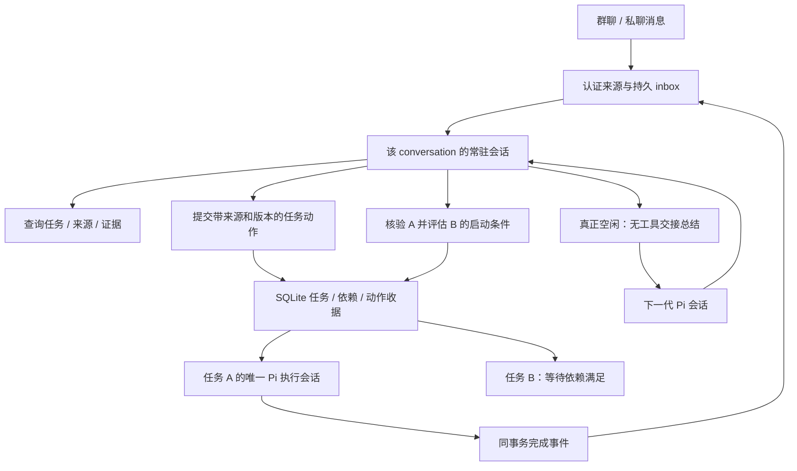

# 常驻会话与事项直连方案

日期：2026-11-06。基线：`refactor/pi-native-retirement@0a03f0bbb3ce6119b488553c4e143110d1e71f78`。

本文件是实施前决策方案。本轮只核对源码、锁定版本的 Pi API 和官方文档，没有修改运行时代码，也没有进行模型、渠道或部署验收。

## 1. 结论与目标

采用“每个群聊/私聊一个常驻逻辑会话 + 每个事项一个执行会话”。删除 Topic 业务实体以及消息先归 Topic、再由 Topic 判断任务的两阶段流程。常驻会话直接理解消息、查询事项、安排和调整事项，并接收事项执行结果。

常驻的是会话身份、职责和连续的业务记录；Pi 物理会话可以更换。每次处理完当前队列，执行一次无工具交接总结，再新建下一代 Pi 会话。旧 journal 保留，下一代只携带必要交接与查询入口，不重新装入整个历史。

“先 A 后 B”必须同时具备两种记忆：SQLite 中可校验的任务依赖，以及常驻会话对用户意图的理解。A 完成事件唤醒常驻会话，由模型结合验收条件和实际证据判断是否满足要求；Host 校验版本、权限及依赖后才允许 B 执行。不能只靠自然语言摘要记住顺序，也不能见到 `completed` 就无条件自动启动 B。

本次重构不引入每任务 Owner、独立协调任务或执行团队。常驻会话负责所在 conversation 的安排；具体事项仍由已有唯一执行会话结合 Skill 和记忆完成。

## 2. 需求的具体解释

| 场景 | 目标行为 |
| --- | --- |
| 一条消息提出一个事项 | 直接创建或关联 task，记录原消息和版本 |
| 一条消息说“先 A 后 B” | 创建/关联 A、B，并原子保存依赖；B 暂不可执行 |
| 后续消息补充、调整、取消 | 常驻会话查询关联与当前版本，再调用原任务的补充/修订/控制能力 |
| 一条消息涉及多个事项 | 支持多对多关联，保留各事项对应的来源片段；不强行一消息一任务 |
| 指代不明确 | 记录该消息的待澄清处置，查询或提问；不新建一个改名后的 Topic |
| 问候、闲聊、简单进度查询 | 可以回复或忽略并记录处置，不制造空执行任务 |
| A 执行期间群里有新要求 | 常驻会话独立处理；需要时经版本校验 steer 到 A 的原执行会话 |
| A 汇报完成 | 常驻会话读取当前结果与必要证据，决定认可、继续 A、等待补充或释放 B |
| 常驻会话空闲但 A 仍在执行 | 仍可总结和轮换；不等待所有事项结束 |

会话身份沿用现有 `chat` / `chat-room` 隔离：渠道账号的命名空间、类型、conversationId 参与计算；私聊继续保留已认证对端隔离。群内不同发送人共享该群的安排上下文，但权限仍逐条绑定真实发送人。相同任务标题不作为跨群合并依据。

## 3. 当前实现与缺口

以下行号均绑定上述基线，不能用历史验收文档代替当前接线。

| 当前证据 | 结论及改动方向 |
| --- | --- |
| `src/channels/service.js:43–91` | 已有 conversation 身份、create/resume、memory bind 和串行投递；但 `:46` 在 attachIngress 后直接转入业务入口，不能认定当前默认路径已是常驻统筹 |
| `packages/dingtalk-core/task-session-service.js:1705–1723`、`:1030–1088` | 默认 chat/chat-room 仍进入旧 group/Topic 链；复用认证、来源版本、冲突检查和材料读取，替换下游路由 |
| `packages/dingtalk-core/coordination-sessions.js:44–52,108–120` | 当前按 group/request 创建临时会话；改成按 conversation 持有一个活动 generation |
| `packages/dingtalk-core/task-session-service.js:705–778` | Topic 还负责抽取授权来源和创建/修改任务；删除 Topic 时必须把来源合同迁到直接任务动作 |
| `packages/dingtalk-core/topic-facts.js:10–26`、`topic-runtime.js:810` | 完成事实回合的 schema 和提示都禁止任务动作；仅延长分诊会话寿命不会获得 A→B 推进能力 |
| `packages/dingtalk-core/dynamic-task-store.js:525–536,770–800` | task.create 立即 active+wake，claim 没有依赖门槛；B 必须在创建事务中就不可执行，claim 处也要检查 |
| 同文件 `:1036–1058,1986–1994` | 已有完成校验及同事务 `dynamic_task_events/task.completed`；复用该事件，不另建完成消息总线 |
| `src/tasks/single-session.js:19`、`task-session-service.js:1131,1172–1192` | 已有单执行会话、Skill/记忆接入、结果和冻结产物；继续保留 |
| `src/runtime/pi-business-admission.js:24–58` | Pi 输入幂等属于单个物理 session，不能单独保障跨 generation 不重放 |
| `src/tasks/ledger-archive.js:5–29` | task archive 当前包含 topic_facts 且有严格白名单；需要同步改来源、依赖、评估及恢复合同 |

## 4. Pi 能提供什么

项目锁定 `@earendil-works/* 1.5.0`。已核对同版本安装源码，以及官方 [SDK](https://github.com/earendil-works/pi/blob/v1.5.0/packages/coding-agent/docs/sdk.md)、[压缩说明](https://github.com/earendil-works/pi/blob/v1.5.0/packages/coding-agent/docs/compaction.md)、[AgentSession 源码](https://github.com/earendil-works/pi/blob/v1.5.0/packages/coding-agent/src/core/agent-session.ts)、[SessionManager 源码](https://github.com/earendil-works/pi/blob/v1.5.0/packages/coding-agent/src/core/session-manager.ts)。

| 官方能力 | 本次用途与限制 |
| --- | --- |
| `AgentSession.waitForIdle()`、`agent_settled` | 判断原生重试、队列与压缩结束；还要叠加 Host 业务提交和工具排空检查 |
| `setActiveToolsByName([])` | 当前会话进入无工具交接轮次；Host 仍须拒绝该阶段的任务动作、发送和其它副作用 |
| `sendCustomMessage(..., {triggerTurn:true})` | 经现有内部 admission 发起交接，不伪造一条新的用户授权 |
| `SessionManager.appendCustomMessageEntry(...)` | 新一代在初始化时接入交接；由官方组件构建上下文，并通过现有 native store 提交 |
| `compact(customInstructions)` / `session_before_compact` | 连续繁忙时继续使用官方压缩；不是本次空闲轮换的主路径 |
| `AgentSessionRuntime.newSession(...)` | 上游有换会话原语，但不能直接替换当前 Night actor/store 的接入方式 |

三个候选方案比较：

| 方案 | 优点 | 取舍 |
| --- | --- | --- |
| 永久使用同一 Pi session，定期 compact | 生命周期改动较小 | 历史树持续增长；默认压缩保留近期原文，小会话可能没有可压缩区间，不能满足空闲即轻量换新的目标 |
| 空闲后交接总结，再创建下一代 Pi session | 逻辑连续，后续推理只带短交接和本代输入 | **采用**；需要把可靠轮换接在现有业务账本与 native store 之间 |
| 每轮只查询 SQLite，完全重新构造会话 | 不付摘要成本 | 容易丢掉未结构化的意图、指代及未决问题；业务查询是必要补充，不能单独替代交接 |

特别注意：`agent_end` 之后仍可能自动重试、压缩或继续队列；`compact()` 会先 abort；默认 `compact().summary` 不包含仍被保留的近期原文。直接把该 summary 复制到新会话会漏掉最新一批内容。

Night 当前采用 `SessionManager.inMemory()` 配合严格 native store，而非 Pi 默认文件存储（`src/pi-session-persistence.js:109–119`）。SDK Runtime 的换会话流程会销毁旧对象、创建另一 manager，不能保持 Night 的 actor、owner、receipt 和 commit 绑定。因此通过现有 `OfficialAgentFactory` 创建下一代，不另写推理循环、历史投影或 Pi 文件编码。

## 5. 目标结构与职责

- **渠道层**：认证、归一化消息/附件/引用、发送与回读；DWS 仍是可选插件。
- **常驻会话**：理解用户意图，直接匹配任务，决定新建/补充/修订/取消/等待，解释执行结果并推进已授权安排。只挂载事项查询、受控事项动作、必要 Skill/记忆读取和回复工具；不直接代替执行会话跑业务脚本或访问外部写入工具。
- **事项执行会话**：一个任务一个执行 session；读取限定范围的 Skill、记忆和材料，完成工作并提交证据。补充或返工沿用该任务原会话和已有续办语义。
- **Host/SQLite**：来源、任务状态、依赖、权限、版本、租约、效果收据、事件消费、投递去重和轮换指针。模型负责业务判断，程序负责这些判断何时有权生效。
- **Pi**：模型推理、工具迭代、消息、上下文、原生压缩和会话 journal。
- **学习复盘**：保留独立的 tool-free reflection，负责有来源的记忆/Skill 提炼；它不决定是否启动 B，失败也不撤销交付或已满足的依赖。

## 6. 最小业务数据调整

扩展现有 SQLite store 和来源/事件/收据体系，不另建数据库、消息中间件或通用工作流引擎。具体表名在实现时沿当前 schema 约定确定，必须具备以下字段和约束：

| 记录 | 必需信息 |
| --- | --- |
| conversation 状态 | 稳定身份、activeSessionId、generation、phase、输入处理游标、轮换记录引用、持有者版本 |
| inbox 事件及处置 | conversation、eventId、类型、顺序、sourceId/messageVersion 或 task event 引用、处理状态、动作决定收据 |
| 消息↔任务关联 | taskId、sourceId/version、准确片段/引用锚点、创建/补充/控制等关系；支持零到多个任务 |
| 任务依赖 | B、前置 A、A 适用 requirementRevision、B 的安排版本、满足条件、原始授权来源、状态、评估收据 |
| 完成评估 | completionEventId、核验的任务版本、条件、证据引用、认可/继续/待补充结论、有效范围 |
| 交接及轮换 | old/new generation、输入截止游标、原 Pi 提交位置、摘要及引用校验结果、下一代提交证明、发布状态 |

任务依赖是“是否已准备好执行”的条件，独立于用户暂停/取消。创建 B 和创建依赖必须同事务；调度筛选及 `task.claim` 都校验依赖，不能仅靠模型不调用执行工具。自依赖和环必须拒绝；不新增复杂条件表达式语言。

任务事件复用 `dynamic_task_events`。完成事件写入原事务时，同时登记所属 conversation 的待消费引用，以 `(conversationId, eventId)` 唯一约束去重，不复制另一份完成 payload。重启从未消费引用恢复。默认只回到任务所属 conversation，跨会话可见性继续受既有授权控制。

摘要不是任务、权限、投递或依赖的权威。SQLite 也不保存第二套模型历史：只存业务事实、交接记录及 Pi journal 引用。

## 7. 一轮消息与动作如何处理

1. 认证渠道消息，记录版本化来源和持久 inbox；重复外部事件返回已有收据。同 ID 内容冲突继续拒绝，合法版本更新保存新版本。
2. 同一 conversation 只有一个活动业务轮次，每批最多 15 条用户消息，溢出留队；内部任务事件也有数量/字节预算。其它 conversation 可以独立处理。
3. 常驻会话收到本批消息、必要指代交接和查询入口；任务详情、完整日志、旧消息和产物按需查询，不在每轮铺满上下文。
4. 模型调用受控动作。Host 重新校验来源作者、版本、任务归属、取消/修订权限、当前任务版本及权限范围，再以稳定业务 operationId 提交。operationId 不依赖本次 Pi sessionId，跨代仍可去重。
5. 只有任务动作收据、消息关联及本批处置完成后才推进业务游标；Pi 的工具调用结束或单次 idle 都不等于业务处理完成。多步动作允许有已提交进度，恢复按收据继续，不假定整个模型轮次有一个大事务。
6. 初步回复保留精确引用、来源版本、暂定措辞和冻结的 outboundId；终态回复按已核实证据表达。发送 unknown 必须回读，轮换和重启都不能重新发送。
7. 新消息在原轮次处理中到达，可在 15 条上限内使用现有同会话 steer；已冻结的回复与已提交动作不重做。消息更改令旧决定失效，但不自动撤销已发生的外部效果。

## 8. “先任务 A，再任务 B”的完整闭环

以用户说“先核实数据 A，确认无误后生成报告 B”为例：

1. 常驻会话保存用户原话、A 的验收条件和 B 的依赖条件。在同一业务动作中创建 A、B，B 为依赖未满足，尚不启动执行会话。A 正常开始。
2. 常驻会话空闲后总结并轮换。下一代保留“当前正在推进的安排及未决语义”的短引用；完整条件和依赖可从任务查询恢复，即使摘要漏写任务名也不能让 B 提前执行。
3. A 的执行会话提交结果；Host 经过当前版本、未决人工输入和效果检查，提交任务结果及 `task.completed` 事件。通知另走 outbox，是否已送达不决定内部事件是否产生。
4. 事件进入同一 conversation 队列。常驻会话查询 A 当前版本、原验收条件、结果、证据/产物和未验证范围，判断是否真正达到“确认无误”。例如“只完成调查，未核实数据”不能被认可为满足条件。
5. 若证据不足或仍需工作，记录评估并补充/续办 A，或请求必要输入；B 继续等待。重开前先证明 A 原 actor 已排空。当前 `task.reopen` 会推进 requirementRevision：若是原目标和授权范围内返工，在同一业务事务更新 B 所等待的 A 版本并清除旧评估；若目标变化则重新评估安排，依赖不能无条件追随所有新版。不能仅因为 A 自报完成就放行。
6. 若满足条件，Host 在一个事务内校验 A/B 及安排的当前版本、原授权仍有效、没有取消或未决效果阻断，保存评估、消费事件、满足依赖并生成 B 的唯一 wake。B claim 时再次校验，再创建它的唯一执行会话。
7. 重复完成事件返回已有结果。A 的旧版本完成、B 已取消、用户已改成 C、权限已撤回，都不能释放 B。若 A 在 B 启动后被重开，向常驻会话发变化事件评估影响；不能静默倒退账本或假定 B 的既有外部效果可回滚。

“业务完成”“符合这条依赖的条件”“通知已送达”分别记录。如果用户明确要求“通知/人工确认后再 B”，才把相应送达/确认条件纳入依赖。任务事件没有新增授权能力：原消息没有授权的 B，应保持提议/待确认，不能由 A 的摘要创造权限。

## 9. 空闲交接与 Pi 会话轮换

### 9.1 保留什么、移出什么

| 内容 | 位置与处理 |
| --- | --- |
| 用户明确要求的先后顺序、条件、暂停和调整 | 先成为任务账本事实；交接仅留必要语义和查询引用 |
| 尚未解决的歧义、指代、承诺、用户当前意图 | 在有来源的交接中保留，不擅自删为“以后可查” |
| 任务状态、版本、验收条件、已完成证据、发送回执 | 通过受控工具查询，交接不重复整段内容 |
| 工具输出、日志、附件正文、代码、旧讨论过程 | 保留在各自原始受控存储，交接只保留确有必要的引用 |
| Skill 全文与长期记忆 | 按当前权限重新发现/检索；不复制整个 scope，也不让摘要复活已遗忘记忆 |

“可通过工具查到”必须是已经成功持久化且新一代有权读取，不能仅因为计划提供查询工具就先删除。摘要中的模型推测要标注为推测，不能提升为用户要求或授权。

交接采用有 schema 的短文：当前意图、未决问题、必要指代、尚未落成事实的假设、证据引用、截止游标。以短交接为目标，输入/输出预算通过验证确定；预算不足或输出截断时拒绝轮换，不静默裁掉关键内容。旧 journal 仍可追溯，但不会自动全量加载。

### 9.2 触发与操作顺序

1. 仅在业务游标自上次交接推进过，且当前轮次结束时检查：Pi `agent_settled/waitForIdle`、SDK pending 队列、Host 待交付输入、该常驻 actor 的工具/进程以及业务提交均已完成，conversation inbox 当前为空。
2. 在 conversation 串行边界内取得交接阶段与 cutoff；冻结向旧 generation 的普通业务投递。新消息继续耐久入队，不丢弃，也不同时 steer 到两代。
3. 设 `phase=handoff`，保存工具集合并 `setActiveToolsByName([])`。经现有 Host 私有内部 producer/admission，发一次原生 custom message 请求交接。模型继续使用现有 Pi 上下文、模型路由和认证；Host 在此阶段禁止业务副作用。
4. 摘要覆盖前一交接与本代全部必要内容，包含最后一批输入；验证 schema、来源范围、必需语义与引用存在性，确认模型正常结束并提交 Pi journal。摘要本身不成为一个新业务事件。
5. 摘要完成后才进入现有维护/排空边界。通过 `OfficialAgentFactory` 创建下一代，先绑定原 conversation 的资源、权限、Skill 和记忆过滤，在官方 SessionManager 初始化阶段加入有来源的 handoff custom entry，然后提交 native store。下一代在正式发布前不可消费业务或产生副作用。
6. 以 old generation、cutoff 和交接记录为条件，CAS 发布新的 active 指针及业务持有权。SQL 与 Pi 文件不是一个事务：下一代有效提交在前、指针发布在后，每一步有可恢复的轮换状态。
7. 旧 actor 保持冻结，关闭并释放资源；下一代接续 inbox。只保留一个有业务执行权的 generation。切换期间到达的消息在新一代处理，不因它们晚于 cutoff 就认定摘要无效或清掉队列。

不能把步骤 3 放在现有 `runMaintenance()` 回调内：该方法先暂停 admission，随后的模型请求会被拒绝（`src/pi-official-agent-factory.js:181–186`）。交接期只冻结 conversation 的普通投递，保留专用内部交接输入；总结完成后再进行 maintenance。直接调用 Pi 的 custom message 绕过应用 admission 也不可取。

新会话初始化与摘要完成不能触发下一次交接：必须同时满足业务游标推进、非 handoff phase 和唯一 handoff ID。不要出现“总结→新建→空闲→再次总结”的空转。

### 9.3 失败与恢复

| 故障位置 | 恢复规则 |
| --- | --- |
| 普通模型摘要失败、截断、缺必需引用 | 不清空原会话；仅在提交、owner 和 drain 可信且实例未被 fence 时恢复工具集合与普通 phase，记录维护故障。已完成业务不回滚；不无间隔循环重试 |
| 摘要阶段收到紧急取消 | 先耐久记录；可中止无副作用的摘要，按既有已认证控制路径处理，不能让维护长期挡住取消 |
| 摘要已提交，下一代创建失败 | active 仍是旧代；保留交接记录。只有旧代仍可合法接纳输入时才恢复；若维护失败已令 admission 暂停或实例被 fence，须保持阻断并按受控证明恢复/重开，不能简单改 phase 或重复业务动作 |
| 下一代已提交，CAS 前崩溃 | 旧指针仍权威；恢复检查候选的身份、journal 提交和cutoff，再完成发布或清理无业务效果的候选 |
| CAS 后、旧代释放前崩溃 | 新指针权威；旧代无权消费输入/执行动作，不重放其历史；恢复仍验证 native owner 和提交证明 |
| SQL/Pi 提交不完整、效果不确定 | 沿现有严格解码、提交栅栏和 unknown-effect 对账；禁止推断成功或自动重放 |

原历史不被清空或覆盖。旧代的保留与清理遵守运行数据/隐私规则，只清理确认无引用且非运行中的临时资源。

连续有消息时不能假装满足“队列为空”。此时继续按批次处理，并保留 Pi 原生阈值压缩及现有输入预算。该设计可限制通常空闲周期之间的上下文增长，但不承诺在无限持续流量、超大单条输入或模型服务变慢时消除所有压缩延迟。

## 10. 删除与保留的代码边界

| 范围 | 实施动作 |
| --- | --- |
| `src/channels/service.js`、`src/channels/triage.js` | 保留身份/渠道能力/引用回复约束；接入稳定 conversation 与直接 taskRefs，去掉 topicKey |
| `task-topic-coordinator.js`、`topic-runtime.js`、`topic-model.js` | 退休 Topic 路由、decision、revision、merge 和临时会话控制；可复用的来源分页等能力移到当前责任模块 |
| `coordination-sessions.js` | 替换按 request 的生命周期，不恢复已退休的任务 Owner/协调团队 |
| `task-session-service.js`、`dynamic-task-store.js` | 改为直接来源授权的任务动作；加入最小依赖、事件消费与轮换状态；保留任务版本、效果、调度与通知合同 |
| `topic-facts.js` | 移除 Topic 投影和 actions=[] 限制；复用原完成事件及回执约束接入 conversation，避免保留改名 Topic 实体 |
| `fixed-topics.js` 等特殊入口 | 逐项保留排期、配置、查询等真实能力，改成受控工具/直接动作，不能随 Topic 整包删除 |
| Pi factory/admission/persistence | 增加受控交接与新代种子接入；继续使用官方 Pi、strict journal、native commit、owner/drain |
| `src/tasks/ledger-archive.js` 及归档校验 | 同步任务直接来源、依赖与评估格式；不包含整群常驻 journal 或其它任务全文 |
| HTTP/终端与 prompts/tests | 去掉活动 Topic 入口和字段，直接显示任务、来源、conversation 及状态；同步合同测试 |
| README、运行/迁移/验证/归档文档及 AGENTS | 更新新职责和术语；来源/许可/manifest 对应实际保留和退休代码，不用改 guard 掩盖遗漏 |

必要时在现有 `src/channels/` 增加一个常驻会话生命周期模块：这是原 Channels 缺少的持久事件消费及轮换职责，避免继续塞进大型 task-session-service。它调用已有 factory/store，不演变成新的 Agent 框架。

## 11. 现有数据、备份与切换

新安装直接采用目标 schema。对已有 Night Bot 数据，走停机、排空、离线备份和显式升级：先提供 `--check` 零副作用检查，列出活动任务、Topic 来源关联、未决发送/效果与不可转换项；检查通过后才允许升级。这里不引入 DSH 导入、旧插件 ABI 或外部路径转换。

既有 taskId、执行 session、产物、原始来源和效果收据保持身份。已知 Topic→任务关联转换为直接来源关联；不能唯一确定的关联保留待核实，不让模型猜测后直接执行。旧 Topic 的历史记录作为只读审计保留，退出活动路由；没有已持久化依据时，不从旧临时会话摘要虚构依赖。

旧 Topic 内尚未生成任务的消息也须逐条有升级处置：已完整处理的保留结果、不重新入队；有可靠未处理证据的转入新 conversation inbox；待澄清或处置不确定的保存为 held 待核实并提供查询入口。不能因为旧 Topic 退出运行就丢掉这些事项，也不能把所有历史消息当成新命令重放。

当前 Night Bot 的 task archive 需要明确版本升级及已有版本读取策略：保留旧备份可验证性，旧 Topic 字段只作历史证据，不回灌为运行命令；不静默丢字段。单任务归档只携带自己的来源、依赖条件与对其它任务的必要身份/版本/证据引用，不复制整个 A 或整群上下文。恢复仍为 held/paused、操作员复核、禁止自动交付；前置任务不可验证时，B 的依赖保持未满足。

切换默认接线时同时退休旧 Topic 入口，不能让新旧两条链处理同一消息。schema 变更后回退须恢复匹配的代码和离线数据，不允许运行旧代码去猜测新 schema。

## 12. 实施顺序与完成标准

1. **直接任务来源与依赖账本**：先建立消息处置、直接关联、依赖创建/claim 守卫和现有完成事件消费合同，保留原执行与通知能力。
2. **常驻 conversation 接入**：把真实默认 ingress 接到一个按 conversation 串行的官方 Pi actor；挂载受限任务工具，打通 A→B 评估与一次性释放。先不依赖轮换证明业务正确。
3. **交接与换代**：加入 tool-free handoff、指针发布、失败恢复、迟到消息和跨代去重。先在实际 factory + 本地脚本模型端点上证明，再测长时间多轮行为。
4. **完整去 Topic**：迁移特殊能力、HTTP/终端、来源/归档、恢复、文档与测试；确认默认生产路径不再要求 Topic 实体，来源/导入/许可 guard 仍有效。
5. **集中验收**：按项目规则在 `docs/acceptance/<feature>/` 维护 matrix 和轮次证据。本方案不预先创建空验收文件；实施阶段绑定最终源码及工作树状态记录结果。

关键验收场景：

| 场景 | 必须证明 |
| --- | --- |
| 私聊/群聊、多发送人、跨渠道同 ID | 会话正确复用与隔离，真实发送人权限不被共享会话身份替代 |
| 单消息多任务、待澄清、无任务消息 | 无 Topic 也能完整记录消息处置；不漏项、不造空任务 |
| 15 条及溢出、处理中补充 | 同代串行/steer 正确，超额留队，来源版本和冻结回复不重复 |
| A→B，A 结果不达标，A 重开，B 取消或改成 C | B 不抢跑；认可后仅启动一次；旧结论不能放行；在途变更有明确处置 |
| 重复完成事件、通知失败/unknown、学习失败 | 事件不漏不重放；依赖、发送与学习互不冒充成功条件 |
| 每轮很短、交接遗漏/截断/失败、摘要自身 settled | 不依赖压缩阈值；不丢上下文；不无限自触发 |
| 总结时来消息/取消，准备/提交/CAS各阶段崩溃 | 输入不丢不双投；可从持久状态恢复唯一活动代；不重放旧效果 |
| Skill 更新、权限撤回、忘记记忆、越权来源 | 新代重新应用当前策略，摘要不扩权、不泄漏、不复活已撤销内容 |
| 原任务归档/恢复、B 脱离 A 恢复 | 仅任务范围材料，依赖待核实，恢复不自动执行/通知 |
| 多轮与持续繁忙 | 空闲周期后上下文不随全部历史线性增长；记录交接成本及新消息等待时间，持续有队列时原生压缩仍可工作 |

实施后按影响运行 `pnpm test`、`pnpm test:runtime`、`pnpm test:routing`，并覆盖本次受影响的 domain/containment、严格 journal/归档以及 native source/hash/import guard。使用隔离目录、本地脚本模型和假渠道验证默认接线；真实模型效果、Windows/Linux 平台限制、真实 DWS 发送单独报告。本文的源码/API核验不算这些测试通过。

最终完成的判据：默认消息路径不再创建或依赖 Topic；每个 conversation 的逻辑职责可跨重启和换代延续；任务保持唯一执行会话；A→B 在当前授权和证据条件下可靠推进；无丢消息、重复执行、越权或归档扩散；空闲交接失败不损坏已完成业务。
